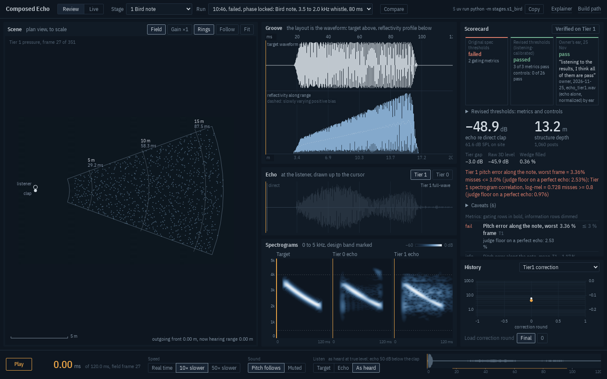

# Composed Echo

A simulator and inverse designer for a passive field of rigid posts that returns a hand clap as a chosen sound.
You pick a target (a bird whistle, a motif, a melody, a word); the code places thin vertical posts so that the
reflections of one clap add up to that sound at the listener, and checks the result with a full-wave acoustic solver.
Everything is simulated; nothing has been built yet, and [BUILD.md](BUILD.md) says what to build first.



**Status:** see the first lines of [REPORT.md](REPORT.md). It keeps three verdicts apart and generates their counts
from the run files: the spec's original thresholds, the revised (listening-calibrated) thresholds, and the owner's
by-ear verdict (not blind). In short, the ring-layout bird whistle is the result that works; most other targets were
accepted by ear but are not confirmed by any automated test.

## Quick start

```
uv sync                              # Python >= 3.11, CPU torch
uv run python -m echo.lab            # serves the repo on http://127.0.0.1:8000 (--port to change)
```

Then open <http://127.0.0.1:8000/viewer/> (review mode: post field, wave video, echo, spectrograms, verdicts),
<http://127.0.0.1:8000/viewer/?mode=live> (Live mode: clap at your microphone, hear the structure answer), and
<http://127.0.0.1:8000/explainer/> (a lay explanation).

## What to read

1. [REPORT.md](REPORT.md): what works, how to hear it, all results at a glance, what we learned, how far to trust it.
   Detailed tables are in [docs/report/](docs/report/). Regenerate everything from the files on disk with
   `uv run python -m stages.report` (`--no-tests` skips the test run).
2. [BUILD.md](BUILD.md): from simulation to a real structure (a hearing test and a 1:10 scale model first; fabrication
   packs under `build/`).
3. The explainer (`explainer/index.html`, served at `/explainer/`).
4. [SPEC.md](SPEC.md) is the original specification; [DECISIONS.md](DECISIONS.md) logs every choice and deviation.

## Listen

[`listen/`](listen/) has, for every test, the target, the simulated echo alone, and the clap followed by the echo
raised to 12 dB under it. [`listen/README.md`](listen/README.md) gives each echo's true level: it is tens of dB below
the clap, so a run folder's `as_heard.wav` (true ratio) sounds like only a clap. Whether a person hears the echo after
their own clap is a question the simulation does not answer. A blind listening kit is in
[`runs/_criteria/blind_test/`](runs/_criteria/blind_test/README.md).

## Design from your own sound

Upload a sound file in Live mode (needs the lab server), or use the command line:

```
uv run python -m stages.custom --target inputs/targets/rising_two_note.wav --name "rising two-note"
uv run python -m stages.custom --target inputs/targets/my.wav --name "my sound" --tier1   # plus one full-wave check
```

A fast-model design takes seconds to a minute; `--tier1` adds one full-wave solve and is refused if it would take more
than 20 minutes (in practice targets up to roughly 150 ms). Formats, limits and what happens to the file:
[`inputs/README.md`](inputs/README.md).

The lab server answers only on this machine (Host 127.0.0.1 / localhost). Its upload API, `POST /api/design`, needs the
header `X-Echo-Lab: 1` (the viewer sends it; a curl example is in `inputs/README.md`), so other web pages cannot submit
jobs. Uploaded files stay in `runs/custom/_uploads/` until you delete them.

## Reproduce each stage

Each command writes a new run folder under `runs/<stage>/<run_id>/` and updates `runs/index.json`. On the CPU machine
the runs were made on, one full-wave solve took about 4 to 30 minutes (each run's `manifest.json`, `solver.wall_s`),
and a stage driver runs several solves (correction rounds, robustness cases), so a stage takes from tens of minutes
to a few hours.

```
uv run python -m stages.validate              # solver validation -> runs/validation/metrics.json (slow)
uv run python -m stages.s1_bird               # stage 1, bird whistle
uv run python -m stages.s2_motif              # stage 2, four-note motif
uv run python -m stages.s3_melody             # stage 3, melody, 100 ms notes (add --note-ms 60)
uv run python -m stages.s4_speech --only 4a   # stage 4: 4a vowel, 4b syllables, 4c word (--only 4b / 4c)
uv run python -m stages.build_pilot           # build-optimized pilot design (not one of the four stages)
uv run python -m stages.rescore               # three verdicts per run -> runs/_criteria/ (minutes, no solves)
uv run python -m stages.build_pack --refresh-doc   # fabrication packs and BUILD.md's generated blocks
uv run python -m stages.report                # REPORT.md and docs/report/
```

## Tests

```
uv run pytest -q              # fast suite (a few minutes)
RUN_SLOW=1 uv run pytest -q   # adds the slow solver and speech-recognizer tests
```

## Layout

- `echo/`: scene, clap, targets, fast model (Tier 0), full-wave solver (Tier 1), inverse design, judges
  (`metrics.py` original thresholds, `metrics_v2.py` revised), export, lab server (`lab.py`).
- `stages/`: stage drivers, validation, rescoring, custom designs, build pack and pilot, report generator.
- `runs/`: run folders (`runs/index.json` lists them), `runs/_criteria/` (verdict summary, blind kit),
  `runs/validation/`.
- `viewer/` (static page, review and Live modes), `explainer/`, `listen/`, `inputs/`, `build/`, `artifacts/`
  (plots, speech targets, screenshots), `docs/report/` (report appendices), `tests/`.

## License

MIT, see [LICENSE](LICENSE).

## Third-party notices

- [wavesurfer.js](https://wavesurfer.xyz/) (BSD 3-Clause) and [uPlot](https://github.com/leeoniya/uPlot) (MIT) are
  vendored under `viewer/vendor/` with their licenses (`LICENSE.wavesurfer`, `LICENSE.uplot`).
- The stage-4 speech targets were generated with [espeak-ng](https://github.com/espeak-ng/espeak-ng) and are cached
  under `artifacts/speech/raw/`.
- The stage-4c word recognizer uses [faster-whisper](https://github.com/SYSTRAN/faster-whisper) with the "small"
  model, which is not in the repository: download it separately (for example from `Systran/faster-whisper-small`)
  into `.cache/whisper-small/`.
