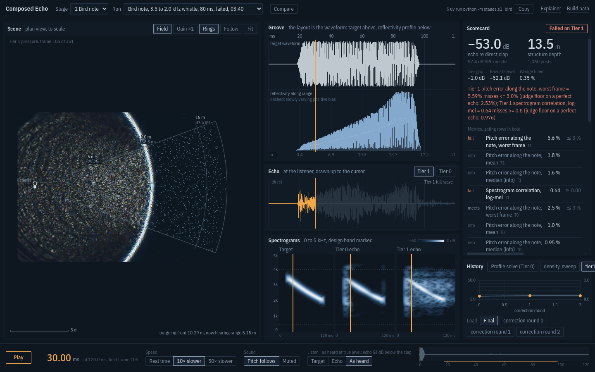

**INTERIM — 1 of 4 stages run; stage 1 failed on the full-wave solver; stages 2–4 not yet run.**

# Composed Echo — morning report

*Generated 2026-11-25T09:12+02:00 by `uv run python -m stages.report` from the files on disk; re-run it as results land. Open: [viewer](viewer/) · [explainer](explainer/index.html) · [build path](BUILD.md) · [decisions](DECISIONS.md).*

## 1. Verdict

The full-wave solver (engine fd8-3) passes the spec's four validation checks, with limits listed in the validation section: it is checked against exact theory only for single-post backscatter, and dense-field effects are checked only by self-convergence. Stage 1 (Bird note, 3.5 to 2.0 kHz whistle, 80 ms, run `20261125-033940-s1`) failed on the full-wave solver (Tier 1): Tier 1 pitch error along the note, worst frame = 5.59% misses <= 3.0% (judge floor on a perfect echo: 2.53%); Tier 1 spectrogram correlation, log-mel = 0.64 misses >= 0.8 (judge floor on a perfect echo: 0.976). The same design on the single-scattering model (Tier 0) meets those thresholds (pitch_err_pct 2.453; spec_corr 0.810), so the shortfall appears between the single-scattering model and the full-wave solver. It uses 1060 posts over 13.5 m of range (fill 0.35 % of the wedge); the 3D echo estimate is -53.0 dB re the direct clap, about 57 dB SPL for a 100 dB clap. Robustness: 0/5 clap variants pass on their own; 0/3 listener positions pass (nominal, 1 m sideways, 1 m back) (fragile flag in the file: no). Stages 2–4: not run. The spec's gate says stage 1 must pass on Tier 1 before any work starts on stage 2; stage 1 has not passed, so later stages wait.

## 2. How to look at the results

Serve the repo and open the viewer (it reads the run folders directly):

```
uv run python -m http.server 8000      # from the repo root
```

- Viewer: <http://localhost:8000/viewer/> (opens the newest final run; pick runs in the header).
- Lay explainer: <http://localhost:8000/explainer/> (`explainer/index.html`, rebuilt by `uv run python explainer/build.py`).
- Build path: [`BUILD.md`](BUILD.md).

Audio for every final run (target / echo / as heard: the direct clap followed by the echo at its true relative level, which is why the echo is barely audible in that file):

| stage | run | target | echo | as heard | echo level in as-heard |
|---|---|---|---|---|---|
| 1 s1_bird | `20261125-033940-s1` | `runs/s1_bird/20261125-033940-s1/target.wav` | `runs/s1_bird/20261125-033940-s1/echo_tier1.wav` | `runs/s1_bird/20261125-033940-s1/as_heard.wav` | -53.8 dB |

Viewer, s1 (screenshot taken 2026-11-25T09:09+02:00).




## 3. Solver validation

Source: `runs/validation/metrics.json` (engine `fd8-3`, 10 points per wavelength). Overall `passed`: **yes**.

| check | value | threshold | result | key |
|---|---|---|---|---|
| 1. Single rigid cylinder, backscatter vs analytic (stage-1 grid, all catalog radii) | worst 0.93 dB | ≤ 1.0 dB | PASS | checks.cylinder.stage1_grid.per_radius.*.max_abs_err_db |
| 2. Grid convergence (halve dx), sparse reference design | 0.75 dB | < 1 dB | PASS | checks.grid_convergence.sparse.max_abs_delta_db |
| 2b. Grid convergence, dense patch (self-convergence only) | 0.36 dB | < 1 dB | PASS | checks.grid_convergence.dense.max_abs_level_delta_db |
| 3. Empty scene: nothing after the direct clap | -85.4 dB | < -60 dB | PASS | checks.empty_scene.max_after_direct_db |
| 4. Tier 0 vs Tier 1, sparse design | 1.05 dB | ≤ 2.0 dB | PASS | checks.tier0_vs_tier1.max_abs_delta_db |

Per post radius (error vs the analytic cylinder, dB; forward and 90° are an extended check beyond the spec):

| grid f_max | radius | backscatter err | spec check | forward err | 90° err | worst any angle | all angles |
|---|---|---|---|---|---|---|---|
| 4000 Hz | 1 cm | 0.77 | PASS | 1.04 | 1.77 | 1.77 | FAIL |
| 4000 Hz | 2 cm | 0.62 | PASS | 1.47 | 0.43 | 1.47 | FAIL |
| 4000 Hz | 4 cm | 0.93 | PASS | — | — | 0.93 | PASS |
| 4000 Hz | 8 cm | 0.64 | PASS | — | — | 0.64 | PASS |
| 2000 Hz | 1 cm | 2.54 | FAIL | 1.21 | 2.82 | 2.82 | FAIL |
| 2000 Hz | 2 cm | 0.30 | PASS | 0.89 | 0.66 | 0.89 | PASS |
| 2000 Hz | 4 cm | 0.75 | PASS | — | — | 0.75 | PASS |
| 2000 Hz | 8 cm | 0.74 | PASS | — | — | 0.74 | PASS |

**What this validation does and does not show:**

- Tier 1 is validated against exact theory only for single-post backscatter.
- At the 4000 Hz grid only 4 cm, 8 cm posts match the analytic cylinder at all angles (1 cm: forward 1.04 dB, 90° 1.77 dB off; 2 cm: forward 1.47 dB, 90° 0.43 dB off).
- The 1 cm backscatter match relies on an area factor fitted to backscatter (factor 0.908, `solver.area_cal`); held-out offsets confirm backscatter only.
- Shadowing and multiple scattering in dense fields are checked by self-convergence only (production grid vs twice as fine, 436 posts from `runs/s1_bird/20261125-013334-s1/scene.json`), not against an exact solution. A bias shared by both grids would not show, so the effect of the angular errors above on dense-field echoes is not bounded.
- At the 2000 Hz grid (needed for stage 3) 1 cm posts are not validated.

Caveats as recorded in the file (`caveats`):

- 1 cm and 2 cm posts: forward/side scattering off the analytic cylinder at the 4 kHz grid (1 cm forward 1.04 dB, 90-degree 1.77 dB; 2 cm forward 1.47 dB, 90-degree 0.43 dB) (dipole part ~10 % strong for sub-cell posts; backscatter within 1 dB); effect on dense-field echoes is not bounded; shadowing and multiple scattering are checked by self-convergence only, not against an exact solution
- 1 cm posts fail backscatter at the 2 kHz grid: not validated there
- the 1 cm backscatter match depends on an area factor fitted to backscatter (area factor 0.908; held-out offsets confirm backscatter only)

## 4. Scorecards

### Stage 1 — Bird note

#### `s1_bird` — FAILED

Run `runs/s1_bird/20261125-033940-s1` (Bird note, 3.5 to 2.0 kHz whistle, 80 ms), created 2026-11-25T03:40:34+02:00, solver `fdtd` engine `fd8-3`, verified: yes. Source: `runs/s1_bird/20261125-033940-s1/metrics.json`.

| quantity | value | key |
|---|---|---|
| Echo level, 3D estimate, tier-gap corrected | -53.0 dB re direct | headline.echo_level_db_re_direct |
| Echo level, raw 3D (Tier 0) | -52.1 dB re direct | headline.echo_level_db_re_direct_raw3d |
| Echo level for a 100 dB clap | 57.4 dB SPL | headline.echo_spl_db |
| Structure depth (bistatic range) | 13.52 m | headline.depth_m |
| Post count | 1060 | headline.post_count |
| Fill fraction of the wedge | 0.35 % | headline.fill_fraction |
| Tier gap (Tier 1 − Tier 0 level, 2D) | -0.98 dB | headline.tier_gap_db |
| Fragile (spec: works for only one clap or one listener) | no | fragile |
| Robustness summary | 0/5 clap variants pass on their own; 0/3 listener positions pass (nominal, 1 m sideways, 1 m back) | fragile_reason |
| Failure cause | Tier 1 pitch error along the note, worst frame = 5.59% misses <= 3.0% (judge floor on a perfect echo: 2.53%); Tier 1 spectrogram correlation, log-mel = 0.64 misses >= 0.8 (judge floor on a perfect echo: 0.976) | failure_cause |
| Echo level with 2.0 m posts (info) | -52.4 dB re direct | headline.echo_level_db_re_direct_finite_height |

**Metrics** (mean over the clap family; the gating rows decide pass/fail; the judge floor is what the same judge gives a physically perfect echo, `judge_floor.mean`):

| tier | metric | value | threshold | result | judge floor (perfect echo) | gating |
|---|---|---|---|---|---|---|
| tier1 | Pitch error along the note, worst frame (`pitch_err_pct`) | 5.59 % | <= 3.00 | FAIL | 2.53 | yes |
| tier1 | Pitch error along the note, mean (`pitch_err_mean_pct`) | 1.83 % | — | — | 0.97 | no |
| tier1 | Pitch error along the note, median (info) (`pitch_err_median_pct`) | 1.59 % | — | — | 0.85 | no |
| tier1 | Spectrogram correlation, log-mel (`spec_corr`) | 0.640 | >= 0.800 | FAIL | 0.976 | yes |
| tier0 | Pitch error along the note, worst frame (`pitch_err_pct`) | 2.45 % | <= 3.00 | PASS | 2.53 | no |
| tier0 | Pitch error along the note, mean (`pitch_err_mean_pct`) | 1.01 % | — | — | 0.97 | no |
| tier0 | Pitch error along the note, median (info) (`pitch_err_median_pct`) | 0.95 % | — | — | 0.85 | no |
| tier0 | Spectrogram correlation, log-mel (`spec_corr`) | 0.810 | >= 0.800 | PASS | 0.976 | no |

**Per clap variant** (with the judge floor per clap):

| clap | tier | pitch_err_pct | spec_corr | pitch_err_pct floor | spec_corr floor |
|---|---|---|---|---|---|
| 0 | tier1 | 3.04 | 0.664 | 1.87 | 0.979 |
| 1 | tier1 | 10.48 | 0.662 | 1.86 | 0.987 |
| 2 | tier1 | 2.60 | 0.641 | 2.00 | 0.971 |
| 3 | tier1 | 8.67 | 0.628 | 3.86 | 0.986 |
| 4 | tier1 | 3.16 | 0.607 | 3.06 | 0.957 |
| 0 | tier0 | 1.87 | 0.820 | 1.87 | 0.979 |
| 1 | tier0 | 1.61 | 0.851 | 1.86 | 0.987 |
| 2 | tier0 | 2.04 | 0.781 | 2.00 | 0.971 |
| 3 | tier0 | 3.86 | 0.843 | 3.86 | 0.986 |
| 4 | tier0 | 2.89 | 0.754 | 3.06 | 0.957 |

**Robustness** (Tier 1 value, change from nominal in brackets):

| case | pitch_err_pct (delta) | spec_corr (delta) | passes |
|---|---|---|---|
| Nominal design (`nominal`) | 5.59 (+0.00) | 0.640 (+0.000) | FAIL |
| Listener moved 1 m sideways (`listener_side_1m`) | 47.31 (+41.72) | 0.352 (-0.288) | FAIL |
| Listener moved 1 m back (`listener_back_1m`) | 25.24 (+19.65) | 0.514 (-0.127) | FAIL |
| Speed of sound 331 m/s (`c_331`) | 7.04 (+1.44) | 0.639 (-0.002) | FAIL |
| Speed of sound 349 m/s (`c_349`) | 6.41 (+0.82) | 0.634 (-0.007) | FAIL |
| Posts jittered 5 mm, radii 1 mm (uniform) (`jitter`) | 8.80 (+3.21) | 0.618 (-0.022) | FAIL |
| Clap variant 0 alone (`clap_0`) | 3.04 (-2.55) | 0.664 (+0.024) | FAIL |
| Clap variant 1 alone (`clap_1`) | 10.48 (+4.89) | 0.662 (+0.022) | FAIL |
| Clap variant 2 alone (`clap_2`) | 2.60 (-2.99) | 0.641 (+0.000) | FAIL |
| Clap variant 3 alone (`clap_3`) | 8.67 (+3.08) | 0.628 (-0.012) | FAIL |
| Clap variant 4 alone (`clap_4`) | 3.16 (-2.43) | 0.607 (-0.034) | FAIL |

**Design study — density sweep** (picked fill 0.0035; selection: lowest Tier 1 spectrogram loss (window_loss); judges not used):

| fill | posts | fill_realized | loss_tier1 | loss_tier0 | tier_gap_db | echo_level_db_3d_corrected | spec_corr_tier1_info_only |
|---|---|---|---|---|---|---|---|
| 0.01 | 3029 | 0.00998 | 5.883 | 1.803 | -6.00 | -49.17 | 0.629 |
| 0.0035 | 1060 | 0.00351 | 5.652 | 2.720 | -1.65 | -52.84 | 0.627 |
| 0.0015 | 454 | 0.00152 | 6.173 | 4.651 | -0.22 | -52.88 | 0.559 |

**Design study — Tier 1 correction rounds** (best round 1):

| round | posts | loss | score | tier_gap_db | pitch_err_pct | spec_corr |
|---|---|---|---|---|---|---|
| 0 | 1060 | 5.652 | -1.528 | -1.65 | 7.58 | 0.627 |
| 1 | 1060 | 5.701 | -0.864 | -0.98 | 5.59 | 0.640 |
| 2 | 1060 | 5.685 | -0.939 | -1.17 | 5.82 | 0.624 |

**Caveats recorded in this run:**

- 1 cm and 2 cm posts: forward/side scattering off the analytic cylinder at the 4 kHz grid (1 cm forward 1.04 dB, 90-degree 1.77 dB; 2 cm forward 1.47 dB, 90-degree 0.43 dB) (dipole part ~10 % strong for sub-cell posts; backscatter within 1 dB); effect on dense-field echoes is not bounded (this run file states a bound; an independent review found that inference invalid and it is withdrawn))
- 1 cm posts fail backscatter at the 2 kHz grid: not validated there
- radii [0.01] used by this design are validated for backscatter but not at all angles at this grid (metrics.json:checks.cylinder.stage1_grid (f_max 4000.0 Hz, ppw 10.0))

Reproduce: `uv run python -m stages.s1_bird` (seed 0, commit `d2e62b7`).

Earlier runs of this stage (history; the scorecard above uses the newest final run):

| run | status | passed | verified | pitch/gating summary |
|---|---|---|---|---|
| `runs/s1_bird/20261125-013334-s1` | tier0_only | no | no | pitch_err_pct 2.56 (tier0); spec_corr 0.96 (tier0) |


### Stage 2 — Motif

**Not run.** The spec's gate says stage 1 must pass on Tier 1 before any work starts on stage 2; stage 1 has not passed, so later stages wait.

### Stage 3 — Melody

**Not run.** The spec's gate says stage 1 must pass on Tier 1 before any work starts on stage 2; stage 1 has not passed, so later stages wait.

### Stage 4 — Speech

**Not run.** The spec's gate says stage 1 must pass on Tier 1 before any work starts on stage 2; stage 1 has not passed, so later stages wait.

*Preparation findings for stage 4 (judges run on a physically perfect echo, target ⊛ clap; these are not stage-4 results — those count only from a stage-4 `metrics.json`). Source: `artifacts/speech/judge_sanity.json`.*

| judge check | value | threshold | key |
|---|---|---|---|
| 4a vowel: worst formant error, perfect echo | 10.3 % mean (5.7–15.9 % per clap) | ≤ 10 % | s4a_vowel.rows.perfect_clap*.formant_err_pct |
| 4b syllables: ESTOI / closed-set correct, perfect echo | 0.72–0.92; 15 of 15 correct | ESTOI ≥ 0.5 | s4b_syllables.rows.*.perfect_clap* |
| 4c word: recognizer says "hello", perfect echo | 5 of 5 | ≥ 3 of 5 | s4c_word.rows.perfect_clap*.hit |

## 5. Open questions from the spec

1. **How loud is the echo for each stage, in the 3D estimate?** stage 1 (`s1_bird`): -53.0 dB re the direct clap, 57.4 dB SPL for a 100 dB clap — `runs/s1_bird/20261125-033940-s1/metrics.json` keys `headline.echo_level_db_re_direct`, `headline.echo_spl_db`. Not yet answered for stages 2–4 (no final run).
2. **How short can notes get before the melody stops transcribing?** Not yet answered: needs stage-3 final runs at 100 ms and 60 ms notes (none exist).
3. **Which is the limit on speech: the clap spectrum, the positivity constraint, or small-post scattering?** Not yet answered: no stage-4 run exists. Preparation finding only (not a stage-4 result): on a physically perfect echo the clap's spectrum alone moves the first formant by 5.7–15.9 % across clap variants (`artifacts/speech/judge_sanity.json` key `s4a_vowel.rows.perfect_clap*.f1_err_pct`), against a 10 % threshold, which points at the clap spectrum as one limit before any structure is built.
4. **How much do build tolerances of 5 mm matter?** stage 1 (`s1_bird`, Posts jittered 5 mm, radii 1 mm (uniform)): pitch_err_pct +3.210, pitch_err_mean_pct +0.825, pitch_err_median_pct +0.548, spec_corr -0.022; jittered design passes: no — `runs/s1_bird/20261125-033940-s1/metrics.json` key `robustness[case=jitter].delta`. Where the nominal design already fails, these deltas show sensitivity, not whether a passing design would survive; BUILD.md's placement tables (Tier 0) go further.

## 6. What limited each stage, and what to try next

**What limited each stage (from `failure_cause`):**

- Stage 1 (`s1_bird`): Tier 1 pitch error along the note, worst frame = 5.59% misses <= 3.0% (judge floor on a perfect echo: 2.53%); Tier 1 spectrogram correlation, log-mel = 0.64 misses >= 0.8 (judge floor on a perfect echo: 0.976)
- Stage 2: not run — The spec's gate says stage 1 must pass on Tier 1 before any work starts on stage 2; stage 1 has not passed, so later stages wait.
- Stage 3: not run — The spec's gate says stage 1 must pass on Tier 1 before any work starts on stage 2; stage 1 has not passed, so later stages wait.
- Stage 4: not run — The spec's gate says stage 1 must pass on Tier 1 before any work starts on stage 2; stage 1 has not passed, so later stages wait.

**What to try next, ranked (generated from the data above):**

1. Stage 1: the design meets its thresholds on Tier 0 but not on Tier 1 — work on how the profile becomes posts (realization) and on multiple scattering, not on the profile solve (scorecard metric table, tier rows).
2. Stage 1: no displaced listener passes (robustness table, listener rows) — score designs over several listener positions, or narrow the wedge.
3. Stage 1: 5 mm / 1 mm placement jitter fails (robustness table, jitter row) — prefer realizations whose echo does not hinge on exact spacing.
4. Stage 1: the `pitch_err_pct` judge floor uses most of its threshold (metric table, judge-floor column) — even a perfect echo has little headroom; keep the judge fixed (integrity rule) and treat near-threshold results with care.
5. Pass stage 1 on Tier 1 to unblock stages 2–4 (spec gate).

**Commentary** (hand-written, preserved between runs of the generator):

<!-- COMMENTARY:BEGIN (hand-written; preserved by stages/report.py) -->
*Current best understanding (hand-written, no numbers; see the tables for values).*

- The stage-1 design realizes the reflectivity profile as a positive bias plus the signal, sampled into post
  positions. Most posts carry the bias rather than the note, so the post budget is largely spent on a component that
  adds nothing to the whistle, and the echo is hypersensitive to millimetre position errors (jitter row of the
  robustness table; BUILD.md's placement tables).
- A redesign of the realization (phase-locked placement: posts placed at the phase of the target so that each post
  adds coherently to the note) is in progress in a separate agent; its run will appear here as a newer stage-1 final
  run when it lands.
- The wedge is wide, so path lengths change quickly as the listener moves: the echo is specific to the listener
  position (see the listener rows of the robustness table). A narrower wedge or a design that is scored over several
  listener positions would trade echo level for a larger listening spot.
<!-- COMMENTARY:END -->

## 7. Build path

[`BUILD.md`](BUILD.md) is the plan from simulation to a real structure: a decision ladder (desk → 1:10 ultrasonic scale model → full-scale calibration posts → pilot), with a fabrication pack under `build/` (stake-out tables, templates, bill of materials, listening files). Its simulated numbers live in a generated block refreshed by `uv run python -m stages.build_pack --refresh-doc`.

Its generated block was computed from: `s1_bird/20261125-013334-s1`.
**That block is stale**: newer final runs exist for `s1_bird` (`20261125-033940-s1`); its numbers describe the older design.
Fabrication packs on disk: `build/s1_bird-20261125-013334-s1`, `build/variants`.

**Status: reviewed draft with open items.** The last independent re-review recorded in the ledger:

> 02:12 Task 13a: fix round 2/5 re-review: C,D,E addressed; A,B,F partial; new Important: (N1) INCONCLUSIVE gate margins (m=|threshold−floor|) indefensible and leak into simulation gates — restrict to physical-measurement gates, simulation verdicts use spec thresholds only; (N2) tangential jitter rows print a meaningless coherent factor A; (N3) residual split omits >4 kHz band, band edges inconsistent (2014–3500 vs 1919–3553). Open from A: clap-dependence of sensitivity not in prose (variant per-clap corr at 1 mm: 0.969/0.914/0.994/0.790/0.997), in-band residual 10× smaller for variant not stated, block outcome vs reading rule not stated, line 56 unsourced; B: say what the temperature rows show; F: floor missing in run-summary row + readout bullets, "1 %"/"a few percent" and "0.5 m" hand-typed, cache key lacks run inputs/other modules/variant target.

Related ledger entries:

- 01:42 Task 13a implementer DONE_WITH_CONCERNS (commit 3cc1491): BUILD.md + buildkit + build pack for stage-1 run. Findings (Tier 0, unverified): design needs ~1 mm radial placement accuracy (corr <0.8 at 2 mm, pitch >3 % at 5 mm); rigid-ground image model: clap/ear at 1–1.5 m fail, 0.3–0.5 m pass; temperature rows fail pitch at 0/30 °C. Review dispatched (opus). For 13b: consider lower-pitch pilot target for tolerance.
- Ruling: Task 13a round 3 is folded into Task 13b (pilot design), which rewrites the same BUILD.md sections with verified numbers and gets these open findings verbatim — avoids a third prose-only round on unverified numbers — cost if wrong: findings ride until 13b; they are listed here so they cannot be lost.

## 8. What happened overnight

Timeline from the controller's ledger (`.superpowers/sdd/plan/progress.md`), first sentence of each timed entry:

- **22:25** Task 1 dispatched (opus), BASE c98fa1c.
- **22:27** Task 5 (viewer) dispatched early in parallel (opus), BASE c98fa1c, owns viewer/ + artifacts/viewer/ only.
- **22:40** Task 5 implementer DONE_WITH_CONCERNS (commits c98fa1c..2bc548f): untested on real data; needs field video row0=ymax + frequent keyframes; http.server has no Range …
- **23:50** Owner added scope mid-run: lay-person interactive explainer (Task 12) and real-world build path (Task 13).
- **23:50** Task 1 implementer DONE_WITH_CONCERNS (commits 8c7cd27, 62b9f33; 47 pass): 90 min (slow downloads); torch CPU-only; kwave CUDA binary still downloading (do not import …
- **23:52** Dispatched in parallel: Task 2 (tier0), Task 3 (tier1), Task 12 (explainer), Task 1 review.
- **23:53** Task 1 review: spec ✅, Approved.
- **23:55** Task 1: fix round 1 (4 addressed, 0 open; commit 2aa598a; 48 pass 1 skip).
- **00:07** Task 2 implementer DONE (commits b067ec4, e81d1d3; 76 pass 1 skip).
- **00:08** Task 12 implementer DONE (commit ae2460b).
- **00:10** Task 2 review: spec ✅, physics independently confirmed.
- **00:12** Whisper model now downloading via .cache/whisper-small/pdl.sh (12 parallel ranges, ~650 KB/s); done marker .cache/whisper-small/dl.done.
- **00:20** Task 2: fix round 1/5 implementer done (commit 3d72e0c; 82 pass 1 skip): ka-table interpolation, post_height/ear_height for 3d, docstrings.
- **00:22** Task 2: fix round 1/5 re-review: 3 addressed, 0 open, no new breakage.
- **00:22** USAGE LIMIT REACHED. Controller stopping.
- **00:23** Task 3 implementer BLOCKED at handoff (commit 1a9c1d3 WIP, not validated): FD8 solver works (free field ±0.15 dB; 2 cm posts within 0.67 dB; 1 cm −1.45 dB flat; 4 cm …
- **00:24** Task 4 implementer DONE_WITH_CONCERNS (commits 04cfeff, 0b5665e; 104 pass): stage-1 Tier 0 run runs/s1_bird/20261125-002316-s1 (pitch err 2.56 %, corr 0.959, 3D echo …
- **01:12** RESUMED after usage reset.
- **01:17** Task 5 round 2 done (commit 4a476d3): real Tier-0 run renders, unverified marking, header links, default-run logic.
- **01:18** Task 4 review: integrity ✅; Needs fixes.
- **01:34** Task 4: fix round 1/5 implementer done (commits ec91ac2..0672f50; 145 pass): new stage-1 Tier 0 run runs/s1_bird/20261125-013334-s1 (pitch 2.56 % worst / 0.84 % …
- **01:35** Task 4: fix round 1/5 re-review: 4 addressed, 0 open, integrity intact, no new breakage.
- **01:42** Task 13a implementer DONE_WITH_CONCERNS (commit 3cc1491): BUILD.md + buildkit + build pack for stage-1 run.
- **01:45** Task 3 implementer DONE_WITH_CONCERNS (commits d3957ca..2a57c9c): FD (numba), 9 ppw, all four validation checks pass at stage-1 grid (cyl err: 1cm 0.55 w/ area factor …
- **01:49** Task 13a review: fabrication data + hand physics confirmed; Needs fixes — 7 Important (tolerance headline overstated: judge sensitivity not echo loss, waveform corr …
- **01:49** Task 5 round 3 done (commit b18a212): field sync/registration verified on real sample (front within 1.6 cm of 343·t), field gain, follow mode for strips.
- **01:54** Task 3 review: Needs fixes.
- **01:55** Task 9 (speech targets + judges) dispatched: agent aeb70d1dd1453101f.
- **02:00** Task 13a: fix round 1/5 implementer done (commit 54d733f; 163 pass 3 skip).
- **02:04** Task 13a: fix round 1/5 re-review: findings 3-6 addressed; 1,2,7,8,9 partial; 5 new Important (unsupported 'bias cancels only through exact spacing' mechanism + …
- **02:10** Task 13a: fix round 2/5 implementer done (commit aa0abc8; test_buildkit 22 pass): hypothesis framing; 0.933-vs-0.96 gap = clap weighting (clap 3 corr 0.788); SNR gate …
- **02:12** Task 13a: fix round 2/5 re-review: C,D,E addressed; A,B,F partial; new Important: (N1) INCONCLUSIVE gate margins (m=|threshold−floor|) indefensible and leak into …
- **02:13** Task 9 implementer DONE_WITH_CONCERNS (commits ed6a4b7, ed33857): espeak via dpkg -x (no sudo), raw WAVs cached; judges: 4a formant judge FAILS its own floor (perfect …
- **02:17** Task 9 review: Needs fixes.
- **02:20** Task 9: fix round 1/5 done (commits 6f8b6ac, b810b48; 23 pass w/ RUN_SLOW): formant judge 8 kHz order 10 + range rules (floor now 10.3 % mean vs 10 %, 2/5 claps …
- **02:43** Task 3: fix round 1/5 done (commit 19f6a78, engine fd8-3, 10 ppw, per-point stencil order): dense-field check passes (level ≤0.36 dB, time-scale −0.005 %, inst. freq …
- **02:44** Task 3: validation restructured (commit f13ec5a): passed true on spec checks; validated backscatter 4 kHz {1,2,4,8 cm}, all-angles {4,8}; 2 kHz {2,4,8} both.
- **08:59** SESSION STALLED 03:40→08:59 (Task 6 agent watchdog failure; controller not re-invoked).
- **09:02** Dispatched: Task 6b stage-1 diagnosis+redesign (fresh opus, agent adbd105a57ac7c476; hypotheses H1–H5: bias+signal sampling wastes posts & is mm-sensitive; referee …
- **09:03** Task 3: caveat corrections done (commit 23abcca; engine fd8-3 unchanged; passed true).

**Rulings the controller made on the owner's behalf** (every `Ruling:` in the ledger, in order):

| # | ruling | reason | cost if wrong |
|---|---|---|---|
| 1 | work on `main` in a fresh repo, no worktree | greenfield, user asked to implement here and review in the morning | costs nothing if wrong (history is linear, can branch later). |
| 2 | repo root is /home/shyam/projects/echo, not `composed-echo/` | that is where the spec lives | rename is trivial if wrong. |
| 3 | "range" for delay = bistatic range (\|PS\|+\|PL\|)/2, arcs are confocal ellipses | listener is 0.3 m off the source so circular arcs smear delay by up to one period at 3.5 kHz | if wrong, posts sit a few cm off the spec's literal arcs. |
| 4 | Tier 1 runs once per design with a broadband pulse; clap variants derived by linearity (H = (P_scene−P_empty)/P_empty) | 5x fewer full-wave runs | if wrong, per-clap echoes differ from direct simulation only by regularization error in band. |
| 5 | FS = 16 kHz for all audio | 2x the design band top, native rate for whisper | if wrong, files sound band-limited (they are anyway). |
| 6 | Tasks 2/3/5 run in parallel after Task 1 (disjoint files, path-scoped commits); skill says serial | the night is 10 h and Tier 1 is the long pole | risk is an index.lock collision or a cross-commit, both recoverable. |
| 7 | speech metrics/targets go in echo/metrics_speech.py and echo/targets_speech.py (spec lists only metrics.py/targets.py) | lets speech prep run alongside stages 2-3 without file conflicts | cosmetic layout deviation. |
| 8 | stage-4 speech prep (Task 9) waits for the stage-1 gate | spec: no later-stage work before stage 1 passes on Tier 1. | not stated |
| 9 | espeak-ng may be installed with passwordless sudo apt if no user-space package works | the spec names espeak-ng as the speech source — a system package the user did not explicitly approve; logged in DECISIONS.md. | not stated |
| 10 | echo level = Tier 0 3D level corrected by the 2D tier gap | spec wants a 3D estimate but the referee is 2D — raw 3D number reported alongside. | not stated |
| 11 | start viewer before Task 1 lands | it needs only the data contract | cost if wrong: fixture drift, caught when real run folder lands. |
| 12 | build path = plan + fabrication data + build-optimized pilot design, no hardware (spec non-goal stands for tonight) | — | if wrong, owner wanted more/less depth; BUILD.md is easy to extend. |
| 13 | 4 small reviewer-specified fixes with covering tests; re-review cost > risk | — | if wrong, final review catches it). |
| 14 | start build-path doc before the stage-1 gate | it is not a stage and the owner called it important | cost if wrong: prose written before results, mitigated by generated numbers block. |
| 15 | validated Tier 1 catalog may be {1 cm, 2 cm} if 4/8 cm cannot meet 1 dB at the stage grid; stages restrict the catalog and log it | spec prefers many small posts anyway | cost: large posts unverified/unused. |
| 16 | keep the gating pitch judge as is (worst-frame, pyin 256/−frame/8; reviewer found it the best config and same-judge reference no fairer) | changing it now would look like tuning the judge | cost: stage 1 may fail on judge floor; judge_floor block makes that visible. |
| 17 | Tier 1 results before the solver fix are not reportable | reviewer showed solver bias comparable to the pass margin | cost: ~45 min delay to stage 1. |
| 18 | start Task 9 before the stage-1 gate (reverses earlier ruling) | the gate delay is a solver fix, Task 9 is judge/target prep independent of stage 1, light CPU, and the night is short | cost if wrong: wasted prep only; spec's gate letter ("before any work starts on stage 2") concerns stage 2 design work, which still waits. |
| 19 | Task 13a round 3 is folded into Task 13b (pilot design), which rewrites the same BUILD.md sections with verified numbers and gets these open findings verbatim | avoids a third prose-only round on unverified numbers | cost if wrong: findings ride until 13b; they are listed here so they cannot be lost. |
| 20 | no separate re-review | the implementer's post-fix numbers equal the reviewer's independent measurements (10.3 %, margins 26–33) | cost if wrong: final review catches it. |
| 21 | validation verdict follows the spec's check 1 wording (backscatter within 1 dB); forward/side-angle errors reported as an extended check + caveat on every run using 1–2 cm posts; no further solver changes tonight (engine frozen at fd8-3) | spec defines the check as backscatter and the dense-field convergence bounds the effect at 0.36 dB **[Later withdrawn: an independent re-review found that self-convergence cannot bound a bias both grids share; the effect on dense fields is not bounded.]** | cost if wrong: multiple-scattering detail in dense 1–2 cm fields is ~1–2 dB less certain than stated; visible in caveats. |
| 22 | stages 2–4 stay gated until the stage-1 redesign reports (spec gate); if redesign still fails with cause identified, controller will run stages 2–3 anyway as informative attempts (owner asked for all four targets) | — | cost if wrong: effort on stages built on a failing recipe. |

## 9. Deviations from the spec

Departures from the spec's letter, short form of the matching `DECISIONS.md` lines (first clause; superseded lines dropped). The other lines there record choices the spec left open.

**Solver (Tier 1)**

- Tier 1 engine is our own 2D staggered-grid FDTD (8th-order stencils in free air, leapfrog, numba-compiled, float32, 8 CPU cores, split-field PML of 24 cells), logged as solver "fdtd". It is not k-Wave.
- Tier 1 air absorption uses the extra path c t - |SL|, the same as Tier 0 (global constraints say c t; the difference is 0.3 m of path, negligible).
- Grid is now 10 points per wavelength at f_max (spec minimum for finite differences).
- Validation finding (fd8-3, ppw 10): check 1 FAILS for 1 cm and 2 cm at non-backscatter angles.
- Validation verdict follows the spec's check 1 (backscatter); forward/90° results reported as an extended check with a caveat; separate monopole/dipole calibration left as future work
- CORRECTION to the line above about the 1 cm area factor: it is validated for backscatter only (held-out offsets ≤ 0.35 dB); forward and 90° scattering FAIL the 1 dB extended check (1.04 / 1.77 dB); the factor is fitted to backscatter and masks a …

**Single-scattering model (Tier 0)**

- Tier 0 form function: one master partial-wave table on a ka grid (step 0.004, grown on demand) replaces per-radius tables cached by lru_cache; radii sit on a 0.5 mm grid with linear blending between neighbouring grid radii (catalog radii exact)

**Design pipeline, judges and stage driver**

- Range polish uses the non-aliased FFT length (choose_n_fft over the largest delay) with an exact, post-chunked gradient; skipped (and logged) above 20,000 posts or 2.5e7 posts x in-band bins.
- fragile = (exactly one clap variant passes on its own) or (exactly one of {nominal, 1 m sideways, 1 m back} passes)

**Clap, targets, environment**

- Torch switched to the PyTorch CPU index (`[tool.uv.sources]`, torch 2.15.0+cpu)
- Shortest clap variant raised from 2.0 to 2.3 ms nominal so every variant's -40 dB extent is within the spec's 2-5 ms (measured 2.1-4.8 ms over seeds 0-3); 0.3 ms raised-cosine onset ramp added so clips start at 0 (cropped pre-ringing had left a step of …

Other choices logged in [`DECISIONS.md`](DECISIONS.md) — solver (tier 1): 6; single-scattering model (tier 0): 8; design pipeline, judges and stage driver: 18; speech targets and judges (stage 4 prep): 8; clap, targets, environment: 17; viewer: 5; build path: 10.

## 10. Tests

<!-- TESTS:BEGIN -->
`uv run pytest -q` (default fast suite) on 2026-11-25T09:12+02:00: `199 passed, 4 skipped in 124.98s (0:02:04)`
<!-- TESTS:END -->
