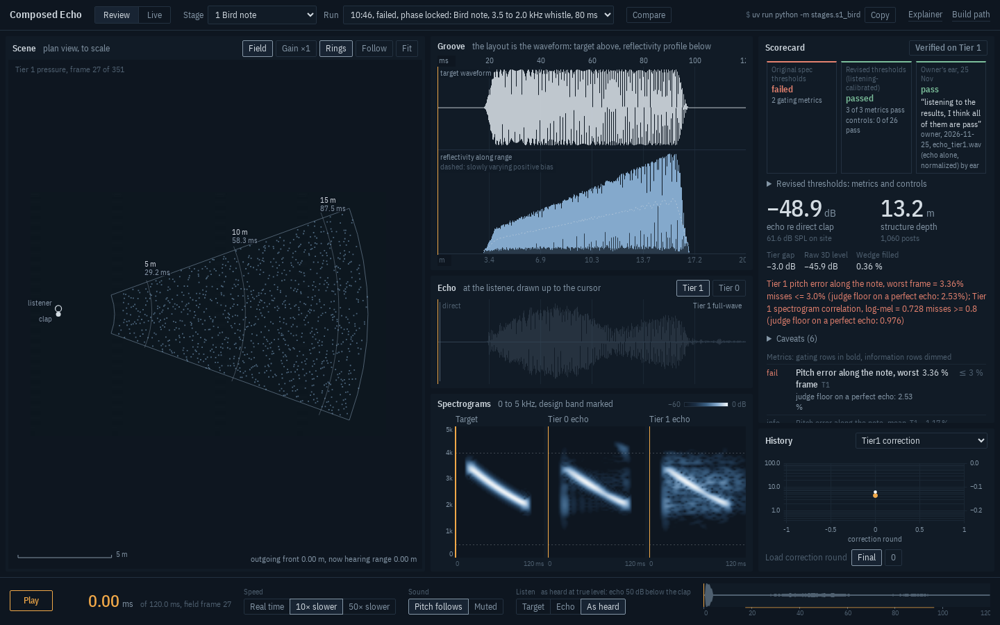
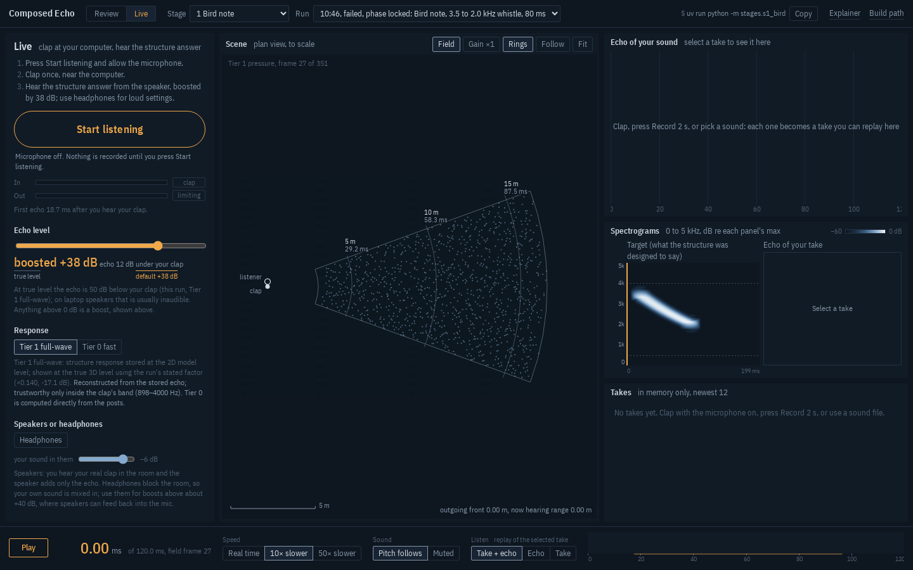

# Composed Echo — report

**Status, 9 tests, three separate verdicts (simulated, full-wave solver):** original spec thresholds: 1 of 9 passed (4c word "hello") · owner's ear (2026-11-25, not blind): 9 of 9 accepted · revised thresholds: 2 of 9 confirmed automatically (Stage 1 bird whistle; 4c word "hello", same recognizer as the original test, so not independent), 7 not established · 7 of 9 accepted by ear (not blind) and not confirmed by any automated test.

[Viewer](viewer/) · [Live mode](viewer/?mode=live) · [Explainer](explainer/index.html) · [Build path](BUILD.md) · [Listen](listen/) · [Repository](https://github.com/shyamvalsan/echo-engineering)

*Generated 2026-11-25T17:53+02:00 by `uv run python -m stages.report` from the files on disk. A passive field of rigid posts is designed so that a hand clap comes back as a chosen sound; everything here is simulated. Detailed tables: [Per-test scorecards](docs/report/scorecards.md) · [Criteria: original, revised, by ear](docs/report/criteria.md) · [Solver validation](docs/report/validation.md) · [Design studies and open questions](docs/report/design-studies.md) · [Timeline and rulings](docs/report/timeline-and-rulings.md) · [Deviations from the spec](docs/report/deviations.md).*

## 1. What works

### The ring-layout whistle (stage 1: Bird note, 3.5 to 2.0 kHz whistle, 80 ms)

A clap at a marked spot, thin vertical posts standing in a fan in front of it, and a falling bird whistle coming back. Each ring of posts lies on one equal-delay curve, and successive rings are one period of the note apart, so each ring adds one cycle of the whistle and the shrinking ring spacing makes the pitch fall (like the chirp from a clap in front of a long flight of stairs).

- **Design** (run `runs/s1_bird/20261125-104529-s1`): 1060 posts of 1 cm radius in 206 rings, 13.2 m deep, fan ±20°, covering 0.36 % of the ground (`metrics.json` `headline`, `manifest.json` `design`).
- **How loud** (simulated): the echo is -49.7 dB re the clap at the ear for clap variant 0 (`manifest.audio.as_heard_echo_level_db`; mean over the clap variants -48.9 dB, `headline.echo_level_db_re_direct`, the value BUILD.md quotes); for a 100 dB clap about 61.6 dB SPL (`headline.echo_spl_db`), roughly quiet conversation.

**Three verdicts, kept apart:**

1. **Original spec thresholds: missed**, narrowly: pitch_err_pct 3.36 (needs <= 3.00; perfect echo 2.53); spec_corr 0.728 (needs >= 0.800; perfect echo 0.976). The "perfect echo" value is what the same judge gives a physically perfect echo (target ⊛ clap), so the pitch mark sits close to the judge's own floor (`criteria.spec_v1`, `judge_floor.mean`).
2. **Revised thresholds (owner_v2): PASS**: nearest its own target on 5 of 5 claps; median pitch off by 13 cents (threshold 40); controls rejected 26/26. The pitch threshold sits between the worst accepted or perfect echo (14 cents) and the best mistuned control (69 cents). Rests on: C1 closed-set identification; C2 pitch within 40.0 c (each on >= 3 of 5 claps) (`runs/_criteria/summary.json`).
3. **Owner's ear: accepted by ear (owner, 2026-11-25, not blind)**: “listening to the results, I think all of them are pass” — basis echo_tier1.wav (echo alone, normalized) by ear.

Earlier whistle designs scored with the same frozen revised criterion: `20261125-033940-s1` PASS; `20261125-095837-s1` PASS.

**Play:** [`listen/s1_echo_only.wav`](listen/s1_echo_only.wav), [`listen/s1_clap_then_echo_boosted.wav`](listen/s1_clap_then_echo_boosted.wav), [`listen/s1_target.wav`](listen/s1_target.wav) (echo alone; clap then echo raised 37.7 dB; the target), and the run's own `runs/s1_bird/20261125-104529-s1/echo_tier1.wav`.

### "hello" (stage 4c)

- What came back: the recognizer heard “Hello.” on 5 of 5 claps (`recognized_text`). Wrong echoes given to the same recognizer: 4 of 4 never heard "hello" (`recognizer_controls`).
- Intelligibility is low: ESTOI 0.316 against 0.736 for a perfect echo; with the listener 1 m sideways the original test fails (`robustness`).
- Verdicts: original thresholds passed; revised thresholds PASS, but that pass rests on the same recognizer and 3-of-5 rule as the original test plus 15/15 rejected controls, so it is not an independent confirmation; owner's ear accepted by ear (owner, 2026-11-25, not blind). The stored study from the same 4c pipeline (`metrics.json` `controls.other_words`) heard 3 of 15 other-word control echoes as "hello" (yellow 1/5, mellow 2/5, halo 0/5); the rescore regenerated these controls and heard "hello" in none of them, and why the two disagree was not found (`runs/_criteria/summary.md`).
- Play: `listen/s4_4c_hello_echo_only.wav`. Details: [scorecard](docs/report/scorecards.md#stage-4c--word).




## 2. Hear it and try it

**Listen** ([`listen/`](listen/), [`listen/README.md`](listen/README.md)): for each test, `<tag>_target.wav` (the aim), `<tag>_echo_only.wav` (the simulated echo alone, at full volume) and `<tag>_clap_then_echo_boosted.wav` (the clap, then the echo raised to sit 12 dB under it). In reality the echo is -40.3 to -72.6 dB re the clap (true level per test in the README), which is why a run folder's `as_heard.wav`, kept at the true ratio, sounds like only a clap. Whether a person hears the echo right after their own clap is a question about hearing that simulation does not cover.

**Live mode** (microphone in, echo out):

```
uv run python -m echo.lab        # then open http://127.0.0.1:8000/viewer/?mode=live
```

Clap or whistle at the microphone and the speakers play the chosen structure's echo of it, live (convolution with the run's impulse response, `manifest.json` `ir`); every sound is kept as a take you can replay with the waves moving through the posts. Default echo boost puts it 12 dB under the clap; 0 dB is the true level. Tested in headless Chrome with a fake microphone only: **not tested with a real microphone and speakers, not tested in Firefox, and system latency can only be compensated up to the first post's delay** (beyond that the echo comes late, and the panel says so). Structure responses of the full-wave runs are reconstructed from the clap-0 echo and are accurate only inside the clap's band ([`viewer/README.md`](viewer/README.md#live-mode)).

**Design from your own sound:** upload a file on the Live page (lab server), or run `uv run python -m stages.custom --target inputs/targets/<file>.wav --name "my sound"` (add `--tier1` for one full-wave check of short targets). These are fast-model designs, marked unverified unless the `--tier1` full-wave run completes (then `verified: true`, as for the example in `runs/custom/`), with no pass or fail ([`inputs/README.md`](inputs/README.md)).

**Look:** the [viewer](viewer/) (review mode: scene, wave video, echo, spectrograms and the three verdicts per run), the lay [explainer](explainer/index.html), and the [build path](BUILD.md).

**Blind test kit** ([`runs/_criteria/blind_test/`](runs/_criteria/blind_test/README.md)): 9 shuffled echo-only samples of equal length and the target choices, with the key kept in a separate folder. It has not been run: no blind result exists, so the owner's verdict remains the only listening verdict, and it is not blind.



## 3. All results at a glance

One row per test; the run is the one the owner listened to (`runs/_criteria/summary.json` `accepted_runs`). "Not established" means no automated criterion separates the echo from the negative controls: it is neither a pass nor a fail. Level: true echo level re the clap at the ear for clap variant 0 (`manifest.audio.as_heard_echo_level_db`; BUILD.md quotes the mean over the clap variants, `headline.echo_level_db_re_direct`, which differs by up to about a dB) / estimated level for a 100 dB clap (simulated).

| test | what came back | original spec thresholds | revised thresholds | owner's ear | level | depth / posts | details |
|---|---|---|---|---|---|---|---|
| Stage 1 bird whistle | a falling whistle; worst-frame pitch error 3.36 % | missed: pitch_err_pct 3.36 (needs <= 3.00); spec_corr 0.728 (needs >= 0.800) | PASS: nearest its own target on 5 of 5 claps; median pitch off by 13 cents (threshold 40); controls rejected 26/26 | accepted by ear (not blind) | -49.7 dB / 61.6 dB SPL | 13.2 m / 1060 | [card](docs/report/scorecards.md#stage-1--bird-note) |
| Stage 2 four-note motif | notes in the right order on 0 of 5 claps; notes not matched on any clap (the judge's 1200-cent sentinel) | missed: notes_in_order 0.000 (needs >= 1.000); note_cents_max 1200 (sentinel: notes not matched) (needs <= 30.00) | not established | accepted by ear (not blind) | -40.3 dB / 67.6 dB SPL | 29.9 m / 2538 | [card](docs/report/scorecards.md#stage-2--motif) |
| Stage 3 melody, 100 ms notes | notes in the right order on 0 of 5 claps; notes not matched on any clap (the judge's 1200-cent sentinel) | missed: notes_in_order 0.000 (needs >= 1.000); note_cents_max 1200 (sentinel: notes not matched) (needs <= 50.00) | not established | accepted by ear (not blind) | -72.6 dB / 37.2 dB SPL | 133.6 m / 2500 | [card](docs/report/scorecards.md#stage-3--melody) |
| Stage 3 melody, 60 ms notes | notes in the right order on 0 of 5 claps; notes not matched on any clap (the judge's 1200-cent sentinel) | missed: notes_in_order 0.000 (needs >= 1.000); note_cents_max 1200 (sentinel: notes not matched) (needs <= 50.00) | not established | accepted by ear (not blind) | -67.9 dB / 41.8 dB SPL | 80.5 m / 2500 | [card](docs/report/scorecards.md#stage-3--melody) |
| 4a vowel "ah" | formant judge found no first formant | missed: formant_err_pct no value (needs <= 10.00) | not established | accepted by ear (not blind) | -51.3 dB / 58.6 dB SPL | 25.4 m / 1499 | [card](docs/report/scorecards.md#stage-4a--vowel) |
| 4b syllable "ma" | intelligibility (ESTOI) 0.159; picked out from the other two syllables: no | missed: closed_set_correct 0.000 (needs >= 1.000); estoi 0.159 (needs >= 0.500) | not established | accepted by ear (not blind) | -62.0 dB / 46.0 dB SPL | 38.0 m / 1655 | [card](docs/report/scorecards.md#stage-4b--syllables) |
| 4b syllable "ba" | intelligibility (ESTOI) 0.0746; picked out from the other two syllables: yes | missed: closed_set_correct 1.000 (needs >= 1.000); estoi 0.0746 (needs >= 0.500) | not established | accepted by ear (not blind) | -63.4 dB / 44.7 dB SPL | 40.5 m / 1751 | [card](docs/report/scorecards.md#stage-4b--syllables) |
| 4b syllable "om" | intelligibility (ESTOI) 0.470; picked out from the other two syllables: yes | missed: closed_set_correct 1.000 (needs >= 1.000); estoi 0.470 (needs >= 0.500) | not established | accepted by ear (not blind) | -66.8 dB / 43.1 dB SPL | 42.0 m / 1808 | [card](docs/report/scorecards.md#stage-4b--syllables) |
| 4c word "hello" | the recognizer heard “Hello.” on 5 of 5 claps | passed: hello_count 5.000 (needs >= 3) | PASS: recognizer says "hello" on 5 of 5 claps; controls rejected 15/15 (the stored study from the same pipeline heard 3 of 15 other-word control echoes as "hello"; the regenerated controls disagree, cause unknown) | accepted by ear (not blind) | -66.2 dB / 44.1 dB SPL | 68.1 m / 3899 | [card](docs/report/scorecards.md#stage-4c--word) |

**To be confirmed by the owner:** for stage 2 the files attach the listening verdict to the first design `20261125-122003-s2`; a second design `20261125-145628-s2v2` (created 2026-11-25T14:57:45+02:00) existed by the time the listening files were made, and the record does not establish which of the two the owner heard (`listening_verdict.note` in the run's `metrics.json`).

**The whistle's redesign history** (oldest first):

| run | design | original thresholds (values) | revised | owner's ear | level | posts | coverage |
|---|---|---|---|---|---|---|---|
| `20261125-033940-s1` | density sampling, ±20°, 1 cm posts | pitch_err_pct 5.59 (needs <= 3.00); spec_corr 0.640 (needs >= 0.800) | PASS | not heard by the owner | 57.4 dB SPL | 1060 | 0.35 % |
| `20261125-095837-s1` | phase_locked, ±20°, 1 cm posts | pitch_err_pct 3.30 (needs <= 3.00); spec_corr 0.720 (needs >= 0.800) | PASS | not heard by the owner | 61.3 dB SPL | 1060 | 0.35 % |
| `20261125-104529-s1` | phase_locked, ±20°, 1 cm posts, stretch compensated | pitch_err_pct 3.36 (needs <= 3.00); spec_corr 0.728 (needs >= 0.800) | PASS | accepted by ear (not blind) | 61.6 dB SPL | 1060 | 0.36 % |
| `20261125-150605-pilot_whistle80` | build pilot: phase_locked, ±10°, 1 cm posts, stretch compensated | pitch_err_pct 5.39 (needs <= 3.00); spec_corr 0.611 (needs >= 0.800) | not scored | not heard by the owner | 55.8 dB SPL | 500 | 0.34 % |

**The motif's two designs** (oldest first):

| run | design | original thresholds (values) | revised | owner's ear | level | posts | coverage |
|---|---|---|---|---|---|---|---|
| `20261125-122003-s2` | phase_locked, ±10°, 2 cm posts, stretch compensated | notes_in_order 0.000 (needs >= 1.000); note_cents_max 1200 (sentinel: notes not matched) (needs <= 30.00) | not established | accepted by ear (not blind) | 67.6 dB SPL | 2538 | 1.66 % |
| `20261125-145628-s2v2` | phase_locked, ±20°, 1 cm posts, stretch compensated | notes_in_order 0.400 (needs >= 1.000); note_cents_max 726.12 (needs <= 30.00) | not established | not heard by the owner | 47.5 dB SPL | 1543 | 0.12 % |

## 4. What we learned

1. **Exact rings beat scattered posts.** Same 1060 posts: density sampling gave pitch_err_pct 5.59 (needs <= 3.00); spec_corr 0.640 (needs >= 0.800); phase_locked rings gave pitch_err_pct 3.30 (needs <= 3.00); spec_corr 0.720 (needs >= 0.800) (`runs/s1_bird/20261125-033940-s1`, `runs/s1_bird/20261125-095837-s1`).
2. **The post field slows sound (compensable) and extinguishes it (not).** The slowing stretches the echo's time axis (prior -0.680 × coverage; applied -0.24 % for the whistle) and is undone by scaling the ranges. Extinction removes sound and grows with frequency, with post radius squared and with how narrowly the posts are confined sideways. Predicted vs measured for the motif (two-way, dB):

   | run | note | predicted | measured (full-wave − fast model) |
   |---|---|---|---|
   | `20261125-122003-s2` | 1047 Hz | -4.3 | -9.5 |
   | `20261125-122003-s2` | 1319 Hz | -22.0 | -18.3 |
   | `20261125-122003-s2` | 1568 Hz | -51.0 | -33.0 |
   | `20261125-122003-s2` | 2093 Hz | -106.6 | -48.2 |
   | `20261125-145628-s2v2` | 1047 Hz | -0.0 | -1.1 |
   | `20261125-145628-s2v2` | 1319 Hz | -0.1 | -5.1 |
   | `20261125-145628-s2v2` | 1568 Hz | -0.6 | -1.8 |
   | `20261125-145628-s2v2` | 2093 Hz | -2.4 | -3.5 |

   The first design (2 cm posts, narrow fan) lost its upper notes; the second (1 cm, wide fan) kept them. Sources: `runs/s2_motif/_studies/v*_extinction.json`.
3. **A broadband residue sits under the whistle.** The full-wave echo of the final stage-1 design (run `20261125-104529-s1`, 1060 posts) differs from the fast model of the same posts by an incoherent residue -16.1 dB below it, the size of 3.8 mm of random placement error; for the 500-post build pilot (run `20261125-150605-pilot_whistle80`) it is -10.0 dB (4.4 mm); with 420 posts of 4 cm it is -0.8 dB. Whether it is real scattering between posts or the solver drawing 1 cm posts on a ~1 cm grid is not settled; the 1:10 model would settle it (`runs/s1_bird/_studies/tier_diff.json`).
4. **The clap's spectrum and weak low-frequency scattering tilt everything toward 2–3 kHz.** In the speech ablations the largest single cost is the clap spectrum on 5 of 5 speech runs (`ablations.attribution`); low notes, the melody's lower notes and vowels suffer most ([design studies](docs/report/design-studies.md)).
5. **The listening spot is centimetres wide.** For the ±20° fan the echo heard 10 cm sideways correlates 0.86 and 25 cm sideways correlates -0.35 with the design listener's (1 = identical; fast model, `runs/s1_bird/_studies/design_study_tier0.json` `sweet_spot`).
6. **Millimetre placement moves the strict score, not the waveform.** Random radial error, fast model: 1 mm: spectrogram score 0.828, waveform correlation 0.999; 2 mm: spectrogram score 0.764, waveform correlation 0.993; 5 mm: spectrogram score 0.650, waveform correlation 0.960 (`build/s1_bird-20261125-104529-s1/pack.json` `physics.jitter`; the original mark is ≥ 0.8).
7. **Temperature retunes it.** The whole whistle's pitch follows the speed of sound: 0 °C -3.4 %, 10 °C -1.7 %, 20 °C +0.1 %, 30 °C +1.8 % (`build/s1_bird-20261125-104529-s1/pack.json` `physics.temperature`).
8. **The echo is 40.3 to 72.6 dB below the clap** (`listen/README.md`). A loud sound raises the ear's threshold for tens of milliseconds afterwards (forward masking); whether a person hears the echo right after their own clap is not something this simulation covers.

**Commentary** (hand-written, preserved between runs of the generator):

<!-- COMMENTARY:BEGIN (hand-written; preserved by stages/report.py) -->
*Commentary (hand-written, no numbers; the generated sections carry the values and their sources).*

**What to take away.** One design family works in simulation and is worth building toward: the ring-layout whistle.
It is the only result that a listener (the owner, knowing the target) accepted and that an automated test also
confirms against negative controls. It still misses the spec's original strict marks, narrowly, next to judges that
score a perfect echo close to those marks too. The other results were accepted by ear (not blind) but no automated test confirms
them; they are recorded, not chased.

**Why the verdicts differ.** The original thresholds measure fidelity strictly (worst-frame pitch, spectrogram
match over a wide dynamic range). The revised criteria ask a narrower question: is the echo nearer its own target than
to plausible wrong answers, and is its pitch right, on most claps? The owner's ear asks the widest one, with the
target in mind. No single verdict replaces the others, and a blind listening test has not been run yet.

**What decides the real thing.** Whether a person hears an echo that arrives tens of dB under their own clap is a
question about hearing, not acoustics; simulation cannot answer it. The build path therefore starts with a cheap
outdoor hearing test and a tabletop scale model, before any full-size structure.
<!-- COMMENTARY:END -->

## 5. What did not work, briefly

Recorded, not chased (owner, afternoon of 25 Nov: focus on what works). Every number is in the [scorecards](docs/report/scorecards.md).
- **Motif (stage 2).** `20261125-122003-s2` (2538 posts, 29.9 m): notes in the right order on 0 of 5 claps; notes not matched on any clap (the judge's 1200-cent sentinel); `20261125-145628-s2v2` (1543 posts, 29.3 m): notes in the right order on 2 of 5 claps; worst note 726 cents off (mean over claps; a clap whose notes are not matched counts as 1200). The first design's thick posts in a narrow fan extinguished the upper notes; the thin-post redesign kept them but not the balance between notes ([card](docs/report/scorecards.md#stage-2--motif)).
- **Melody (stage 3).** 100 ms: notes in the right order on 0 of 5 claps; notes not matched on any clap (the judge's 1200-cent sentinel), 133.6 m deep, 7 of 8 notes below 35 dB SPL; 60 ms: notes in the right order on 0 of 5 claps; notes not matched on any clap (the judge's 1200-cent sentinel), 80.5 m deep, 7 of 8 notes below 35 dB SPL. The structure is a long strip; the sound fades along it, and on the fast model no realized design transcribes for every clap ([card](docs/report/scorecards.md#stage-3--melody)).
- **Vowel (4a).** formant judge found no first formant. Thin posts scatter little at low frequency and the clap carries little there, so the low formants are weak; the speech ablations put the clap spectrum first ([card](docs/report/scorecards.md#stage-4a--vowel)).
- **Syllables (4b).** “ma”: intelligibility (ESTOI) 0.159; picked out from the other two syllables: no; “ba”: intelligibility (ESTOI) 0.0746; picked out from the other two syllables: yes; “om”: intelligibility (ESTOI) 0.470; picked out from the other two syllables: yes. Thin posts scatter little at low frequency and the clap carries little there, so the low formants are weak; the speech ablations put the clap spectrum first ([card](docs/report/scorecards.md#stage-4b--syllables)).

## 6. Build path

From [`BUILD.md`](BUILD.md): **first**, an outdoor hearing test on a quiet site — one 20 mm bar, then a small grating of posts — listened to by several people (estimated €0.2–0.5k), because the simulations cannot say whether anyone hears an echo that far under their own clap. **In parallel**, the 1:10 ultrasonic tabletop model (estimated €0.7–1.5k, then €50–100, then €0.3–0.6k more), which answers fidelity and whether the residue is physics or solver, but not audibility. **Full scale** (estimated €5–10k) only if at least 8 of 10 listeners hear the grating's tone after the clap and the 1:10 model's residue, measured on the design drilled into the board, lands near the fast model's residue at the board's placement accuracy rather than near that design's full-wave residue (BUILD.md phase 2c; the numbers are per design: pilot `20261125-150605-pilot_whistle80`: fast model -22.7 dB at 1 mm, full wave -10.0 dB; stage-1 design `20261125-104529-s1`: fast model -28.0 dB at 1 mm, full wave -16.1 dB, `runs/s1_bird/_studies/tier_diff.json`).

Build pilot `20261125-150605-pilot_whistle80` (500 posts, a narrower fan, 55.8 dB SPL): original thresholds missed — pitch_err_pct 5.39 (needs <= 3.00; perfect echo 2.53); spec_corr 0.611 (needs >= 0.800; perfect echo 0.976); it did worse than the 1060-post design (pitch_err_pct 3.36 (needs <= 3.00); spec_corr 0.728 (needs >= 0.800)). Fabrication packs: `build/`.

## 7. How far to trust this

Solver validation (`runs/validation/metrics.json`, engine `fd8-3`, overall `passed`: **yes**):

| check | value | threshold | result | what it compares against |
|---|---|---|---|---|
| Single post, backscatter vs exact theory | worst 0.93 dB | ≤ 1.0 dB | PASS | exact theory, backscatter only |
| Grid convergence, sparse design | 0.75 dB | < 1 dB | PASS | self-convergence |
| Grid convergence, dense patch | 0.36 dB | < 1 dB | PASS | self-convergence only |
| Empty scene: nothing after the clap | -85.4 dB | < -60 dB | PASS | — |
| Fast model vs full-wave, sparse design | 1.05 dB | ≤ 2.0 dB | PASS | model agreement |

In plain words:

- The solver is checked against exact theory only for one post scattering straight back.
- Thin posts are off at other angles (error against exact theory; threshold 1 dB): 1 cm at 4000 Hz (forward 1.04 dB, 90° 1.77 dB); 2 cm at 4000 Hz (forward 1.47 dB, 90° 0.43 dB); 1 cm at 2500 Hz (forward 2.61 dB, 90° 0.51 dB); 2 cm at 2500 Hz (forward 1.73 dB, 90° 1.65 dB); 1 cm at 2000 Hz (forward 1.21 dB, 90° 2.82 dB).
- Backscatter itself fails for: 1 cm at 2000 Hz (2.54 dB) (threshold 1 dB; the overall pass is judged on the 4 kHz stage-1 grid only).
- Dense fields are checked only by comparing the solver with itself on a finer grid; a bias both grids share would not show.
- Live mode's structure responses for full-wave runs are reconstructed from one echo and are accurate only inside the clap's band.
- Full detail: [validation appendix](docs/report/validation.md).

**Automated versus human.** The original and revised thresholds are automated judges on simulated audio. The owner's verdict is a human judgment by ear, not blind; the blind kit has not been run.

**What was reviewed independently.** The solver, the fast model, the design pipeline, the speech judges, the first build-path plan and the first version of the revised criteria each had an independent review recorded in the ledger (the revised-criteria review withdrew the motif's revised pass; see the [criteria appendix](docs/report/criteria.md)). **Not separately reviewed:** the criteria fix round that produced every current revised-threshold number (no re-review), the BUILD.md rewrite and the build pilot, the custom designer, this report generator, the third round of stage-1 work, the stage scripts for stages 2–4, the viewer, the explainer and the lab server. The final review of the whole repository was read-only spot-checking (about 40 numbers checked against the files), not a re-derivation.

**Tests.**

<!-- TESTS:BEGIN -->
`uv run pytest -q` (default fast suite) on 2026-11-25T17:53+02:00: `295 passed, 4 skipped, 1 xfailed, 4 warnings in 305.89s (0:05:05)`
<!-- TESTS:END -->

## 8. The spec's four open questions

1. **How loud?** For a 100 dB clap the simulated echoes peak between 37.2 dB SPL (Stage 3 melody, 100 ms notes) and 67.6 dB SPL (Stage 2 four-note motif); 0 of 9 peaks are below the spec's 35 dB line (`headline.echo_spl_db`), but along the melody 7 of 8 notes at 100 ms, 7 of 8 notes at 60 ms fall below it (`s3_extra.level_along_melody`).
2. **How short can notes get?** A perfect echo transcribes down to 30 ms notes; the realized design at no tested length (fast model only, `runs/s3_melody/20261125-133244-s3_60ms/metrics.json` `design_study.note_length_sweep`).
3. **What limits speech?** The clap spectrum: the largest single cost on 5 of 5 speech runs' ablations, ahead of positivity and small-post scattering (`ablations.attribution`).
4. **Do 5 mm build tolerances matter?** Yes for the strict score: at 5 mm random radial error the whistle's spectrogram score falls to 0.650 while its waveform still correlates 0.960 with the exact design (`build/s1_bird-20261125-104529-s1/pack.json`); whether a listener hears the difference is a listening test.

Full answers with tables: [design studies](docs/report/design-studies.md#the-specs-four-open-questions).

## 9. Process notes

- **23:50** Task 1 implementer DONE_WITH_CONCERNS (commits 8c7cd27, 62b9f33; 47 pass): 90 min (slow downloads); torch CPU-only; …
- **00:22** USAGE LIMIT REACHED. Controller stopping.
- **01:54** Task 3 review: Needs fixes. Important: (1) uncorrected 2nd-order (Yee) zones around posts → ~0.6–0.9 % phase / ~1.7 % group-delay error in the dense stage-1 field (exceeds pitch headroom); (2) no dense-field validation; (3) check-4 …
- **02:43** Task 3: fix round 1/5 done (commit 19f6a78, engine fd8-3, 10 ppw, per-point stencil order): dense-field check passes (level ≤0.36 dB, time-scale −0.005 %, inst. freq −0.045 %).
- **08:59** SESSION STALLED 03:40→08:59 (Task 6 agent watchdog failure; controller not re-invoked).
- **14:52** OWNER STEER: heard recognizable bird whistles during audio tests; 'we don't need to chase the dead ends, let's focus on the things that work'; asked what original sound the echoes answer (a clap).

The controller made **27 rulings** on the owner's behalf; every one, in order, with its cost-if-wrong, is in [timeline and rulings](docs/report/timeline-and-rulings.md), with the full timeline. Deviations from the spec's letter: [deviations](docs/report/deviations.md).
