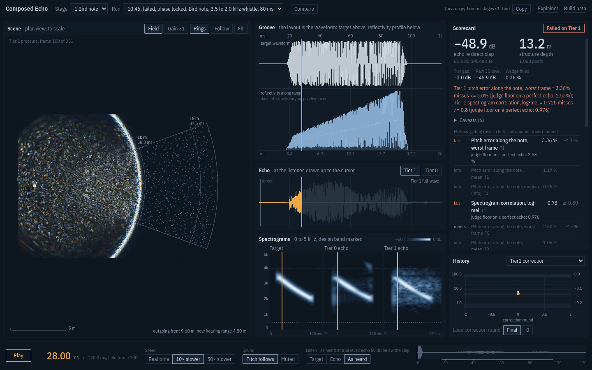
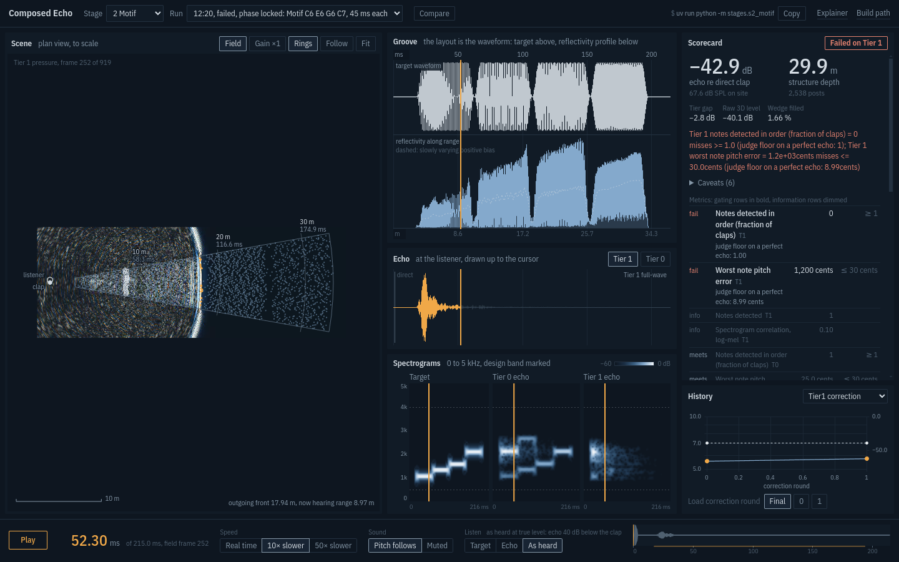
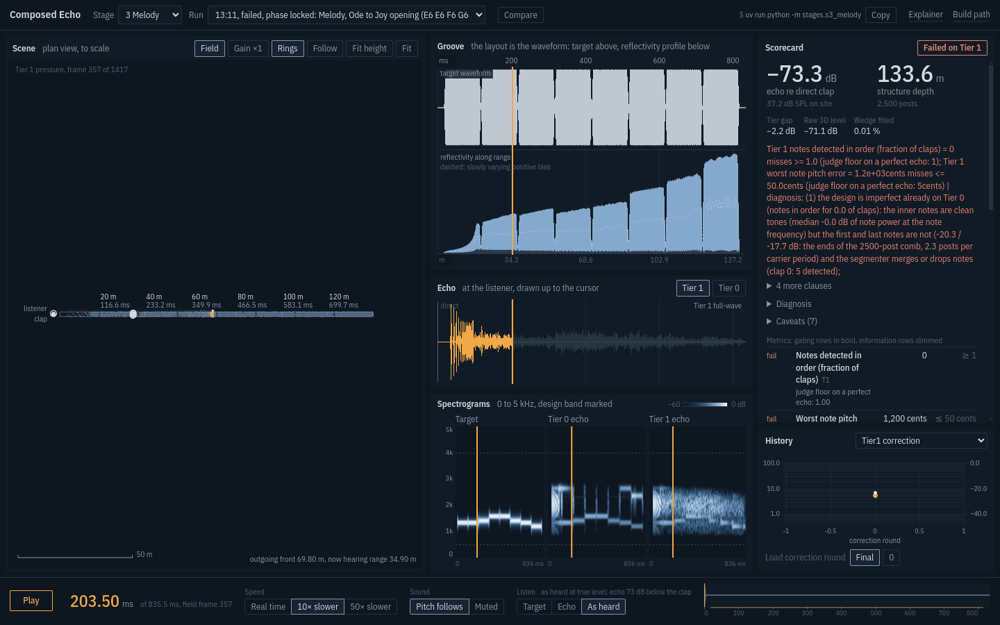
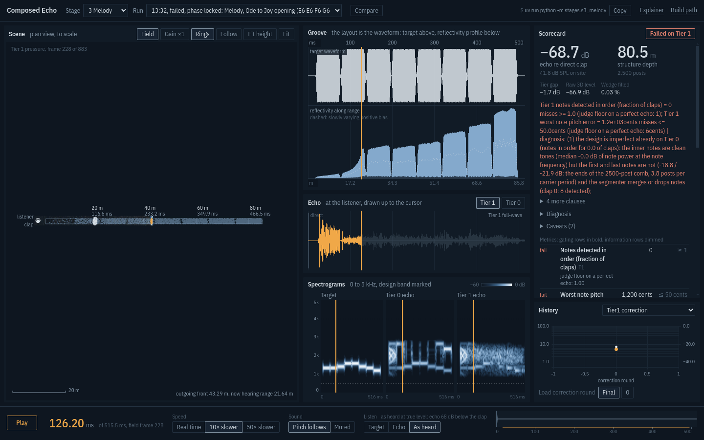
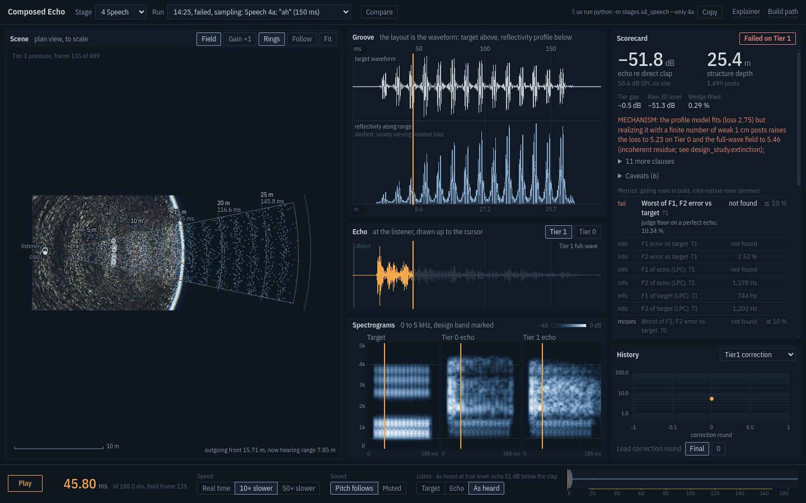
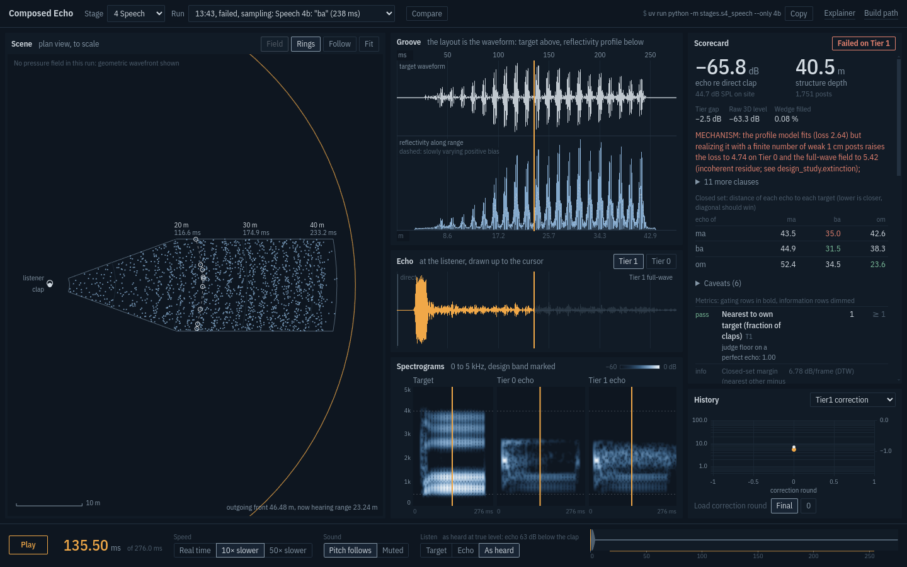
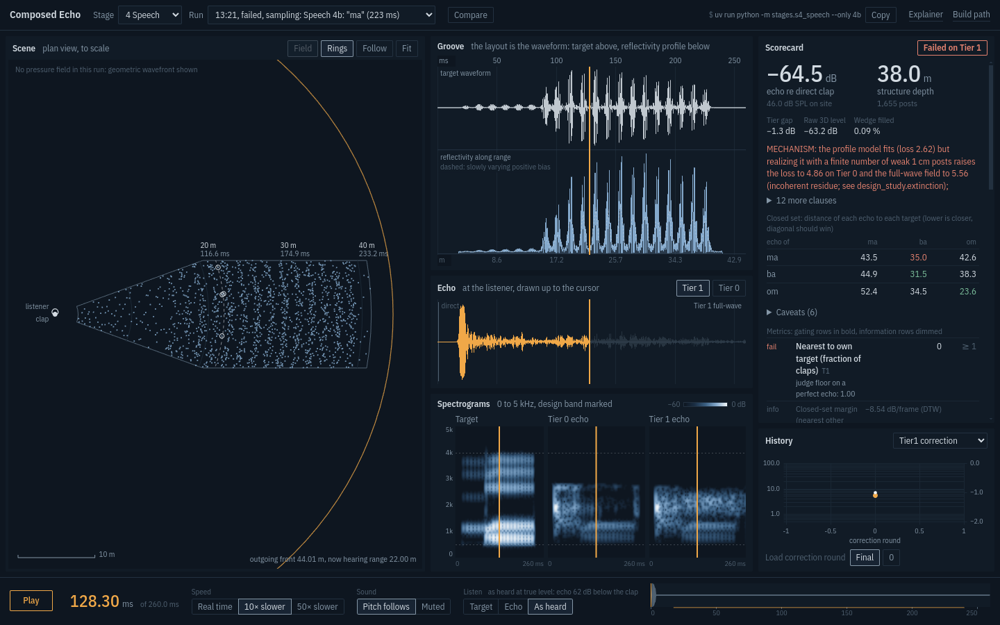
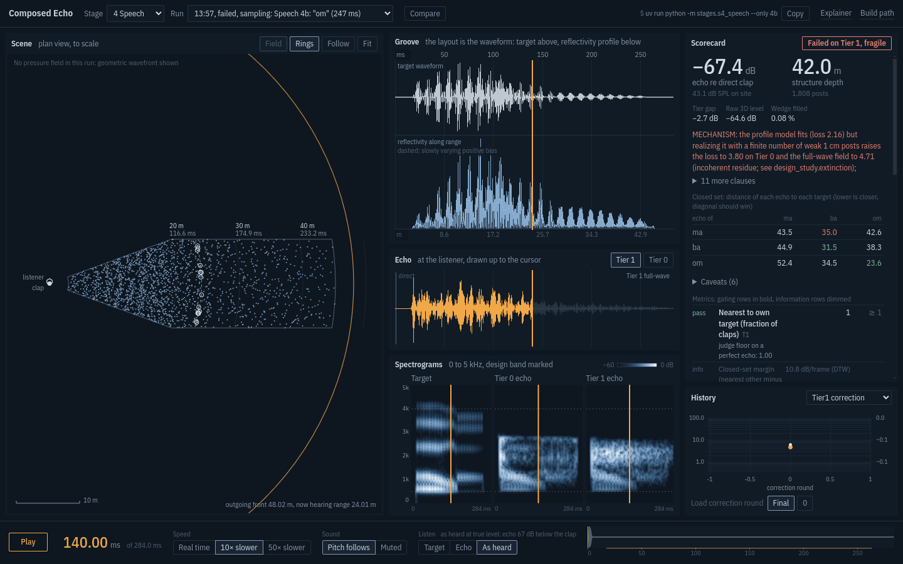
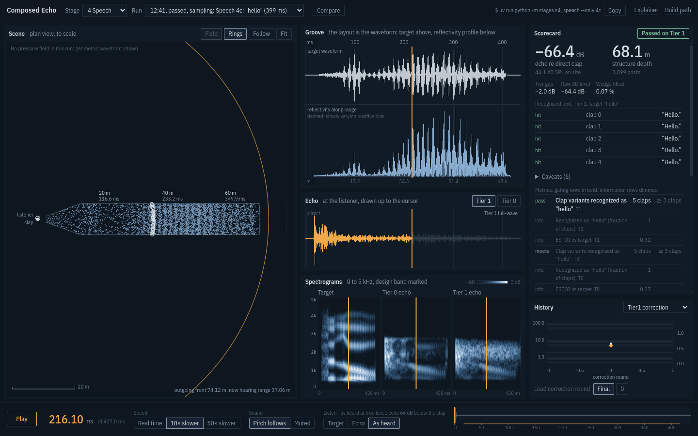
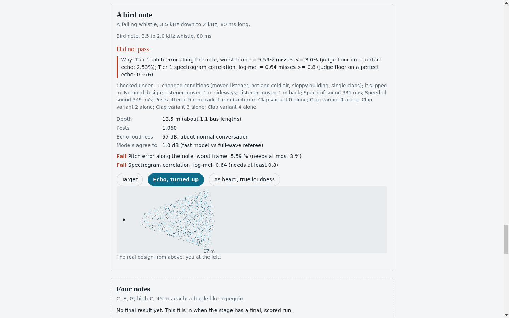

*Appendix of [REPORT.md](../../REPORT.md); generated 2026-11-25T17:15+02:00 by `uv run python -m stages.report`.*

# Per-test scorecards

Generated by `stages/report.py`. Each unit of the spec's stage table, with the three verdicts per run, earlier attempts, and the full metric, per-clap and robustness tables of the newest run (and of the run the owner heard, when that differs). Paths are relative to the repository root.

## Audio and screenshots

Serve the repo with the lab server (`uv run python -m echo.lab`, default port 8000; `--port` to change) and open `/viewer/` (`?run=<stage>/<run_id>` opens a given run) or `/explainer/`.

Audio for every final run (target / echo / as heard: the direct clap followed by the echo at its true relative level, which is why the echo is barely audible in that file):

| unit | run | role | result | target | echo | as heard | echo level in as-heard |
|---|---|---|---|---|---|---|---|
| 1 | `20261125-104529-s1` | result | FAIL | `runs/s1_bird/20261125-104529-s1/target.wav` | `runs/s1_bird/20261125-104529-s1/echo_tier1.wav` | `runs/s1_bird/20261125-104529-s1/as_heard.wav` | -49.69 dB |
| 1 | `20261125-095837-s1` | earlier attempt | FAIL | `runs/s1_bird/20261125-095837-s1/target.wav` | `runs/s1_bird/20261125-095837-s1/echo_tier1.wav` | `runs/s1_bird/20261125-095837-s1/as_heard.wav` | -49.87 dB |
| 1 | `20261125-033940-s1` | earlier attempt | FAIL | `runs/s1_bird/20261125-033940-s1/target.wav` | `runs/s1_bird/20261125-033940-s1/echo_tier1.wav` | `runs/s1_bird/20261125-033940-s1/as_heard.wav` | -53.75 dB |
| 2 | `20261125-145628-s2v2` | result | FAIL | `runs/s2_motif/20261125-145628-s2v2/target.wav` | `runs/s2_motif/20261125-145628-s2v2/echo_tier1.wav` | `runs/s2_motif/20261125-145628-s2v2/as_heard.wav` | -60.93 dB |
| 2 | `20261125-122003-s2` | earlier attempt | FAIL | `runs/s2_motif/20261125-122003-s2/target.wav` | `runs/s2_motif/20261125-122003-s2/echo_tier1.wav` | `runs/s2_motif/20261125-122003-s2/as_heard.wav` | -40.34 dB |
| 3 100 ms | `20261125-131152-s3` | result | FAIL | `runs/s3_melody/20261125-131152-s3/target.wav` | `runs/s3_melody/20261125-131152-s3/echo_tier1.wav` | `runs/s3_melody/20261125-131152-s3/as_heard.wav` | -72.65 dB |
| 3 60 ms | `20261125-133244-s3_60ms` | result | FAIL | `runs/s3_melody/20261125-133244-s3_60ms/target.wav` | `runs/s3_melody/20261125-133244-s3_60ms/echo_tier1.wav` | `runs/s3_melody/20261125-133244-s3_60ms/as_heard.wav` | -67.95 dB |
| 4a | `20261125-142346-s4_4a_ah` | result | FAIL | `runs/s4_speech/20261125-142346-s4_4a_ah/target.wav` | `runs/s4_speech/20261125-142346-s4_4a_ah/echo_tier1.wav` | `runs/s4_speech/20261125-142346-s4_4a_ah/as_heard.wav` | -51.34 dB |
| 4b ma | `20261125-132102-s4_4b_ma` | result | FAIL | `runs/s4_speech/20261125-132102-s4_4b_ma/target.wav` | `runs/s4_speech/20261125-132102-s4_4b_ma/echo_tier1.wav` | `runs/s4_speech/20261125-132102-s4_4b_ma/as_heard.wav` | -61.99 dB |
| 4b ba | `20261125-134325-s4_4b_ba` | result | FAIL | `runs/s4_speech/20261125-134325-s4_4b_ba/target.wav` | `runs/s4_speech/20261125-134325-s4_4b_ba/echo_tier1.wav` | `runs/s4_speech/20261125-134325-s4_4b_ba/as_heard.wav` | -63.41 dB |
| 4b om | `20261125-135718-s4_4b_om` | result | FAIL | `runs/s4_speech/20261125-135718-s4_4b_om/target.wav` | `runs/s4_speech/20261125-135718-s4_4b_om/echo_tier1.wav` | `runs/s4_speech/20261125-135718-s4_4b_om/as_heard.wav` | -66.83 dB |
| 4c | `20261125-124137-s4_4c_hello` | result | PASS | `runs/s4_speech/20261125-124137-s4_4c_hello/target.wav` | `runs/s4_speech/20261125-124137-s4_4c_hello/echo_tier1.wav` | `runs/s4_speech/20261125-124137-s4_4c_hello/as_heard.wav` | -66.16 dB |

Viewer, 1 — run `20261125-104529-s1` (screenshot taken 2026-11-25T14:37+02:00).

Viewer, 2 — run `20261125-145628-s2v2` (screenshot taken 2026-11-25T14:35+02:00). **Older than the result run `20261125-145628-s2v2`: retake it.**

Viewer, 3-100ms — run `20261125-131152-s3` (screenshot taken 2026-11-25T14:36+02:00).

Viewer, 3-60ms — run `20261125-133244-s3_60ms` (screenshot taken 2026-11-25T14:36+02:00).

Viewer, 4a — run `20261125-142346-s4_4a_ah` (screenshot taken 2026-11-25T14:36+02:00).

Viewer, 4b-ba — run `20261125-134325-s4_4b_ba` (screenshot taken 2026-11-25T14:36+02:00). This run has no field video (`manifest.field` is null).

Viewer, 4b-ma — run `20261125-132102-s4_4b_ma` (screenshot taken 2026-11-25T14:36+02:00). This run has no field video (`manifest.field` is null).

Viewer, 4b-om — run `20261125-135718-s4_4b_om` (screenshot taken 2026-11-25T14:36+02:00). This run has no field video (`manifest.field` is null).

Viewer, 4c — run `20261125-124137-s4_4c_hello` (screenshot taken 2026-11-25T14:37+02:00). This run has no field video (`manifest.field` is null).

Explainer, results section:

## Scorecards

### Stage 1 — Bird note

**Stage 1, original spec thresholds (newest final run of each part): missed**. The three verdicts (original thresholds, revised thresholds, owner's ear) are kept apart in the table below.

**Three verdicts, Stage 1** (every final run, newest first):

| run | role | original spec thresholds | revised thresholds (owner_v2) | owner's ear |
|---|---|---|---|---|
| `20261125-104529-s1` | newest, heard by the owner | missed: pitch_err_pct 3.36 (needs <= 3.00); spec_corr 0.728 (needs >= 0.800) | PASS | accepted by ear (owner, 2026-11-25, not blind) |
| `20261125-095837-s1` | earlier | missed: pitch_err_pct 3.30 (needs <= 3.00); spec_corr 0.720 (needs >= 0.800) | PASS | not heard by the owner |
| `20261125-033940-s1` | earlier | missed: pitch_err_pct 5.59 (needs <= 3.00); spec_corr 0.640 (needs >= 0.800) | PASS | not heard by the owner |

**Earlier attempts, Stage 1** (newest first; the first row is the result):

| run | result | gating (Tier 1) | echo dB re direct | posts | fill % | tier gap dB | what changed vs the previous attempt (design config) |
|---|---|---|---|---|---|---|---|
| `20261125-104529-s1` (result) | FAIL | pitch_err_pct 3.36; spec_corr 0.728 | -48.89 | 1060 | 0.36 | -3.03 | correction_rounds: 2 → 1; fill_candidates: 0.0035, 0.0066, 0.01 → —; stretch_comp: — → yes; stretch_per_fill: — → -0.680; target_fill: 0.0066 → 0.0035 |
| `20261125-095837-s1` | FAIL | pitch_err_pct 3.30; spec_corr 0.720 | -49.13 | 1060 | 0.35 | -3.14 | correction_rounds: 3 → 2; fill_candidates: 0.01, 0.0035, 0.0015 → 0.0035, 0.0066, 0.01; posts_per_period: — → 1; realization: — → phase_locked; target_fill: 0.01 → 0.0066 |
| `20261125-033940-s1` | FAIL | pitch_err_pct 5.59; spec_corr 0.640 | -53.04 | 1060 | 0.35 | -0.98 | first attempt |

#### Stage 1 — newest run, original thresholds: missed

Run `runs/s1_bird/20261125-104529-s1` (Bird note, 3.5 to 2.0 kHz whistle, 80 ms), created 2026-11-25T10:46:41+02:00, solver `fdtd` engine `fd8-3`, grid f_max 4000 Hz, verified: yes. Source: `runs/s1_bird/20261125-104529-s1/metrics.json`.

| quantity | value | key |
|---|---|---|
| Echo level, 3D estimate, tier-gap corrected | -48.89 dB re direct | headline.echo_level_db_re_direct |
| Echo level, raw 3D (Tier 0) | -45.85 dB re direct | headline.echo_level_db_re_direct_raw3d |
| Echo level for a 100 dB clap | 61.57 dB SPL | headline.echo_spl_db |
| Structure depth (bistatic range) | 13.21 m | headline.depth_m |
| Post count | 1060 | headline.post_count |
| Fill fraction of the wedge | 0.36 % | headline.fill_fraction |
| Tier gap (Tier 1 − Tier 0 level, 2D) | -3.03 dB | headline.tier_gap_db |
| Fragile (spec: works for only one clap or one listener) | no | fragile |
| Robustness summary | 0/5 clap variants pass on their own; 0/3 listener positions pass (nominal, 1 m sideways, 1 m back) | fragile_reason |
| Robustness verdict | fails everywhere | robust_summary |
| Echo level with 2.0 m posts (info) | -48.11 dB re direct | headline.echo_level_db_re_direct_finite_height |

**Failure cause** (`failure_cause`): Tier 1 pitch error along the note, worst frame = 3.36% misses <= 3.0% (judge floor on a perfect echo: 2.53%); Tier 1 spectrogram correlation, log-mel = 0.728 misses >= 0.8 (judge floor on a perfect echo: 0.976)

**Metrics** (mean over the clap family; gating rows decide pass/fail; the judge floor is what the same judge gives a physically perfect echo, `judge_floor.mean`):

| tier | metric | value | threshold | result | judge floor (perfect echo) | gating |
|---|---|---|---|---|---|---|
| tier1 | Pitch error along the note, worst frame (`pitch_err_pct`) | 3.36 % | <= 3.00 | FAIL | 2.53 | yes |
| tier1 | Pitch error along the note, mean (`pitch_err_mean_pct`) | 1.17 % | — | — | 0.97 | no |
| tier1 | Pitch error along the note, median (info) (`pitch_err_median_pct`) | 0.96 % | — | — | 0.85 | no |
| tier1 | Spectrogram correlation, log-mel (`spec_corr`) | 0.728 | >= 0.800 | FAIL | 0.976 | yes |
| tier0 | Pitch error along the note, worst frame (`pitch_err_pct`) | 2.60 % | <= 3.00 | PASS | 2.53 | no |
| tier0 | Pitch error along the note, mean (`pitch_err_mean_pct`) | 1.05 % | — | — | 0.97 | no |
| tier0 | Pitch error along the note, median (info) (`pitch_err_median_pct`) | 0.93 % | — | — | 0.85 | no |
| tier0 | Spectrogram correlation, log-mel (`spec_corr`) | 0.897 | >= 0.800 | PASS | 0.976 | no |

**Per clap variant** (with the judge floor per clap):

| clap | tier | pitch_err_pct | spec_corr | pitch_err_pct floor | spec_corr floor |
|---|---|---|---|---|---|
| 0 | tier1 | 2.45 | 0.738 | 1.87 | 0.979 |
| 1 | tier1 | 3.68 | 0.751 | 1.86 | 0.987 |
| 2 | tier1 | 1.90 | 0.728 | 2.00 | 0.971 |
| 3 | tier1 | 5.93 | 0.730 | 3.86 | 0.986 |
| 4 | tier1 | 2.83 | 0.692 | 3.06 | 0.957 |
| 0 | tier0 | 2.45 | 0.904 | 1.87 | 0.979 |
| 1 | tier0 | 2.11 | 0.915 | 1.86 | 0.987 |
| 2 | tier0 | 1.43 | 0.896 | 2.00 | 0.971 |
| 3 | tier0 | 4.11 | 0.898 | 3.86 | 0.986 |
| 4 | tier0 | 2.89 | 0.872 | 3.06 | 0.957 |

**Robustness** (Tier 1 value, change from nominal in brackets; cases not run are marked so):

| case | pitch_err_pct (delta) | spec_corr (delta) | passes |
|---|---|---|---|
| Nominal design (`nominal`) | 3.36 (+0.00) | 0.728 (+0.000) | FAIL |
| Listener moved 1 m sideways (`listener_side_1m`) | 41.33 (+37.97) | 0.335 (-0.392) | FAIL |
| Listener moved 1 m back (`listener_back_1m`) | 11.49 (+8.13) | 0.558 (-0.170) | FAIL |
| Speed of sound 331 m/s (`c_331`) | 3.91 (+0.55) | 0.715 (-0.012) | FAIL |
| Speed of sound 349 m/s (`c_349`) | 4.52 (+1.16) | 0.717 (-0.011) | FAIL |
| Posts jittered 5 mm, radii 1 mm (uniform) (`jitter`) | 3.53 (+0.17) | 0.680 (-0.048) | FAIL |
| Clap variant 0 alone (`clap_0`) | 2.45 (-0.91) | 0.738 (+0.010) | FAIL |
| Clap variant 1 alone (`clap_1`) | 3.68 (+0.32) | 0.751 (+0.024) | FAIL |
| Clap variant 2 alone (`clap_2`) | 1.90 (-1.46) | 0.728 (-0.000) | FAIL |
| Clap variant 3 alone (`clap_3`) | 5.93 (+2.57) | 0.730 (+0.002) | FAIL |
| Clap variant 4 alone (`clap_4`) | 2.83 (-0.53) | 0.692 (-0.036) | FAIL |

**Stretch compensation** (`tier1_correction.stretch`: the post field slows sound; ε is the echo's time-axis stretch, the prior is ε per unit fill):

- enabled: yes
- stretch_per_fill_prior: -0.680
- definition: Tier 1 echo(t) ~ Tier 0 echo of the same posts at t (1 + eps); ranges scaled by 1 + eps_applied; residual refit after each Tier 1 run
- final_applied: -0.00238
- final_residual: -0.00238

**Tier 1 correction rounds** (best round 0):

| round | posts | loss | score | tier_gap_db | stretch_eps_applied | pitch_err_pct | spec_corr |
|---|---|---|---|---|---|---|---|
| 0 | 1060 | 4.617 | -0.119 | -3.03 | -0.00238 | 3.36 | 0.728 |

**Design study — `design_study_tier0`**: Tier 0 design study, stage 1 (2D mode for losses/judges, 3D for level)

- selection: designs compared by Tier 0 spectrogram loss (window_loss) and its jitter robustness only; pitch error and log-mel correlation (judges) are recorded for information and never used to choose
- jitter: radial (along the ray from the source), Gaussian sigma, seeds (11, 12, 13)
- wall_s: 119.45

*profile_solve:*

- steps: 300
- best_loss: 1.445
- band: 898.44, 4000.00

*rows:*

| n_request | mode | posts_per_period | n_posts | dropped | shadow_violations | n_rings | max_posts_per_ring | realize_s | loss_tier0 | echo_level_db_2d | echo_level_db_3d |
|---|---|---|---|---|---|---|---|---|---|---|---|
| 300 | sampling | 1 | 300 | 0 | 0 | — | — | 2.86 | 5.629 | -38.98 | -53.00 |
| 300 | phase_locked | 1 | 301 | 0 | 0 | 162 | 2 | 0.04 | 3.877 | -41.02 | -55.10 |
| 300 | phase_locked | 2 | 301 | 0 | 0 | 189 | 2 | 0.05 | 5.792 | -41.10 | -55.45 |
| 600 | sampling | 1 | 600 | 0 | 0 | — | — | 6.32 | 3.915 | -38.32 | -52.76 |
| 600 | phase_locked | 1 | 600 | 0 | 0 | 203 | 6 | 0.10 | 2.890 | -34.63 | -51.49 |
| 600 | phase_locked | 2 | 600 | 0 | 0 | 323 | 2 | 0.10 | 3.699 | -37.28 | -52.26 |
| 1060 | sampling | 1 | 1060 | 0 | 0 | — | — | 8.80 | 2.723 | -34.86 | -51.19 |
| 1060 | phase_locked | 1 | 1060 | 0 | 0 | 207 | 11 | 0.21 | 2.880 | -28.60 | -45.98 |
| 1060 | phase_locked | 2 | 1060 | 0 | 0 | 402 | 5 | 0.20 | 2.714 | -33.56 | -49.85 |
| 2000 | sampling | 1 | 2000 | 0 | 0 | — | — | 28.11 | 2.132 | -29.36 | -46.77 |
| 2000 | phase_locked | 1 | 2000 | 0 | 0 | 209 | 21 | 0.82 | 2.587 | -22.61 | -40.02 |
| 2000 | phase_locked | 2 | 2000 | 0 | 0 | 413 | 10 | 0.55 | 2.725 | -26.60 | -43.99 |

*(more columns in `runs/s1_bird/20261125-104529-s1/metrics.json` key `design_study.design_study_tier0.rows`.)*

*sweet_spot:*

| half_angle_deg | offset_m | n_posts | dropped | loss_tier0 | echo_level_db_2d | wave_corr_vs_nominal | spec_corr_info_only | pitch_err_pct_info_only |
|---|---|---|---|---|---|---|---|---|
| 20.00 | 0.00, 0.00 | 1060 | 0 | 2.880 | -28.60 | 1.000 | 0.897 | 2.563 |
| 20.00 | 0.00, 0.10 | 1060 | 0 | 5.269 | -28.85 | 0.864 | 0.588 | 9.610 |
| 20.00 | 0.00, 0.25 | 1060 | 0 | 6.835 | -28.66 | -0.349 | 0.408 | 49.70 |
| 20.00 | 0.00, 0.50 | 1060 | 0 | 7.003 | -26.34 | 0.211 | 0.385 | 43.24 |
| 20.00 | 0.00, 1.00 | 1060 | 0 | 7.296 | -25.85 | -0.0239 | 0.317 | 48.24 |
| 20.00 | -0.50, 0.00 | 1060 | 0 | 4.341 | -26.19 | 0.970 | 0.702 | 3.298 |
| 20.00 | -1.00, 0.00 | 1060 | 0 | 5.161 | -25.26 | 0.368 | 0.601 | 7.667 |
| 10.00 | 0.00, 0.00 | 1060 | 0 | 2.880 | -28.60 | 1.000 | 0.897 | 2.563 |
| 10.00 | 0.00, 0.10 | 1060 | 0 | 4.456 | -27.25 | 0.948 | 0.695 | 3.352 |
| 10.00 | 0.00, 0.25 | 1060 | 0 | 5.910 | -27.40 | 0.589 | 0.534 | 19.93 |
| 10.00 | 0.00, 0.50 | 1060 | 0 | 6.927 | -26.94 | -0.243 | 0.390 | 43.01 |
| 10.00 | 0.00, 1.00 | 1060 | 0 | 7.041 | -24.44 | 0.0767 | 0.378 | 43.47 |

*(9 more rows in `runs/s1_bird/20261125-104529-s1/metrics.json` key `design_study.design_study_tier0.sweet_spot`.)*

**Design study — `h2_tier1_vs_tier0`**: H2: Tier 1 vs Tier 0 on the same posts, and the Tier 0 radial jitter that reproduces the residue

- selection: diagnostic only; nothing is chosen from this file

*rows:*

| label | realization | posts_per_period | n_posts | fill | tier1_wall_s | loss_tier0 | loss_tier1 | tier_gap_db | wave_corr_tier1_vs_tier0 | residue_db_tier1_vs_tier0 | judges_tier0_info_only.pitch_err_pct |
|---|---|---|---|---|---|---|---|---|---|---|---|
| phase_locked K=1 N=301 | phase_locked | 1 | 301 | 0.00101 | 288.40 | 3.877 | 5.776 | -0.47 | 0.897 | -7.153 | 6.48 |
| phase_locked K=1 N=420 a=0.04 | phase_locked | 1 | 420 | 0.0227 | 698.35 | 3.238 | 7.527 | 1.00 | 0.158 | -0.180 | 2.89 |

*(more columns in `runs/s1_bird/20261125-104529-s1/metrics.json` key `design_study.h2_tier1_vs_tier0.rows`.)*

**Caveats recorded in this run:**

- 1 cm and 2 cm posts: forward/side scattering off the analytic cylinder at the 4 kHz grid (1 cm forward 1.04 dB, 90-degree 1.77 dB; 2 cm forward 1.47 dB, 90-degree 0.43 dB) (backscatter within 1 dB; cause measured at the 4 kHz grid: dipole part ~10 % strong for sub-cell posts); effect on dense-field echoes is not bounded; shadowing and multiple scattering are checked by self-convergence only, not against an exact solution
- 1 cm and 2 cm posts: forward/side scattering off the analytic cylinder at the 2.5 kHz grid (1 cm forward 2.61 dB, 90-degree 0.51 dB; 2 cm forward 1.73 dB, 90-degree 1.65 dB) (backscatter within 1 dB; cause measured at the 4 kHz grid: dipole part ~10 % strong for sub-cell posts); effect on dense-field echoes is not bounded; shadowing and multiple scattering are checked by self-convergence only, not against an exact solution
- 1 cm posts at the 2.5 kHz grid (r/dx 0.73) pass backscatter at the 3 fixed offsets only: below the calibrated sub-cell range (area factor clamped), no held-out offsets checked there
- 1 cm posts fail backscatter at the 2 kHz grid: not validated there
- the 1 cm backscatter match depends on an area factor fitted to backscatter (area factor 0.908; held-out offsets confirm backscatter only)
- radii [0.01] used by this design are validated for backscatter but not at all angles at this grid (metrics.json:checks.cylinder.stage1_grid (f_max 4000.0 Hz, ppw 10.0))

Reproduce: `uv run python -m stages.s1_bird` (seed 0, commit `f190d1c`).

Study files for this stage (`runs/s1_bird/_studies`): `design_study_tier0.json`, `h2_tier1_vs_tier0.json`, `tier_diff.json`.

**`tier_diff.json`**: Tier 1 - Tier 0 decomposition on the same posts (clap 0): stretch, linear filter, incoherent residue, and the Tier 0 radial jitter giving the same residue

- selection: diagnostic only

*rows:*

| run | n_posts | tier1_vs_tier0.stretch_eps | tier1_vs_tier0.offset_s | tier1_vs_tier0.corr_raw | tier1_vs_tier0.corr_stretched | tier1_vs_tier0.residue_db_gain_only | tier1_vs_tier0.residue_db_stretched | tier1_vs_tier0.residue_db_stretched_fir33 | equivalent_radial_jitter_m | radius |
|---|---|---|---|---|---|---|---|---|---|---|
| 20261125-033940-s1 | 1060 | -0.00224 | 0.00 | 0.331 | 0.957 | -0.503 | -10.78 | -11.69 | 0.00 | — |
| 20261125-095837-s1 | 1060 | -0.00238 | 0.00 | 0.190 | 0.983 | -0.159 | -14.67 | -16.19 | 0.00 | — |
| h2_echoes_phase_locked_K1_N420_a0.04.npz | 420 | -0.0057 | 0.00 | 0.0846 | 0.191 | -0.0312 | -0.161 | -0.797 | — | 0.04 |

### Stage 2 — Motif

**Stage 2, original spec thresholds (newest final run of each part): missed**. The three verdicts (original thresholds, revised thresholds, owner's ear) are kept apart in the table below.

**Three verdicts, Stage 2** (every final run, newest first):

| run | role | original spec thresholds | revised thresholds (owner_v2) | owner's ear |
|---|---|---|---|---|
| `20261125-145628-s2v2` | newest | missed: notes_in_order 0.400 (needs >= 1.000); note_cents_max 726.12 (needs <= 30.00) | not established | not heard by the owner |
| `20261125-122003-s2` | earlier, heard by the owner | missed: notes_in_order 0.000 (needs >= 1.000); note_cents_max 1200.00 (needs <= 30.00) | not established | accepted by ear (owner, 2026-11-25, not blind) |

**Earlier attempts, Stage 2** (newest first; the first row is the result):

| run | result | gating (Tier 1) | echo dB re direct | posts | fill % | tier gap dB | what changed vs the previous attempt (design config) |
|---|---|---|---|---|---|---|---|
| `20261125-145628-s2v2` (result) | FAIL | notes_in_order 0.400; note_cents_max 726.12 | -62.98 | 1543 | 0.12 | -2.70 | a_ref: 0.02 → 0.01; catalog: 0.02 → 0.01; correction_clip: — → 0.250, 4.000; half_angle_deg: 10.00 → 20.00; robustness_c_cases: — → —; robustness_jitter: — → yes; tag: s2 → s2v2; target_fill: 0.016 → 0.001 |
| `20261125-122003-s2` | FAIL | notes_in_order 0.000; note_cents_max 1200.00 | -42.91 | 2538 | 1.66 | -2.84 | first attempt |

#### Stage 2 — newest run, original thresholds: missed

Run `runs/s2_motif/20261125-145628-s2v2` (Motif C6 E6 G6 C7, 45 ms each (v2: 1 cm posts, 20 deg, extinction-budgeted)), created 2026-11-25T14:57:45+02:00, solver `fdtd` engine `fd8-3`, grid f_max 2500 Hz, verified: yes. Source: `runs/s2_motif/20261125-145628-s2v2/metrics.json`.

| quantity | value | key |
|---|---|---|
| Echo level, 3D estimate, tier-gap corrected | -62.98 dB re direct | headline.echo_level_db_re_direct |
| Echo level, raw 3D (Tier 0) | -60.28 dB re direct | headline.echo_level_db_re_direct_raw3d |
| Echo level for a 100 dB clap | 47.48 dB SPL | headline.echo_spl_db |
| Structure depth (bistatic range) | 29.28 m | headline.depth_m |
| Post count | 1543 | headline.post_count |
| Fill fraction of the wedge | 0.12 % | headline.fill_fraction |
| Tier gap (Tier 1 − Tier 0 level, 2D) | -2.70 dB | headline.tier_gap_db |
| Fragile (spec: works for only one clap or one listener) | no | fragile |
| Robustness summary | 2/5 clap variants pass on their own; 0/3 listener positions pass (nominal, 1 m sideways, 1 m back) | fragile_reason |
| Robustness verdict | partial | robust_summary |
| Echo level with 2.0 m posts (info) | -61.68 dB re direct | headline.echo_level_db_re_direct_finite_height |

**Failure cause** (`failure_cause`): Tier 1 notes detected in order (fraction of claps) = 0.4 misses >= 1.0 (judge floor on a perfect echo: 1); Tier 1 worst note pitch error = 726cents misses <= 30.0cents (judge floor on a perfect echo: 8.99cents)

**Metrics** (mean over the clap family; gating rows decide pass/fail; the judge floor is what the same judge gives a physically perfect echo, `judge_floor.mean`):

| tier | metric | value | threshold | result | judge floor (perfect echo) | gating |
|---|---|---|---|---|---|---|
| tier1 | Notes detected in order (fraction of claps) (`notes_in_order`) | 0.400 | >= 1.000 | FAIL | 1.000 | yes |
| tier1 | Worst note pitch error (`note_cents_max`) | 726.12 cents | <= 30.00 | FAIL | 8.990 | yes |
| tier1 | Notes detected (`n_notes_detected`) | 4.200 | — | — | 4.000 | no |
| tier1 | Spectrogram correlation, log-mel (`spec_corr`) | 0.466 | — | — | 0.956 | no |
| tier0 | Notes detected in order (fraction of claps) (`notes_in_order`) | 1.000 | >= 1.000 | PASS | 1.000 | no |
| tier0 | Worst note pitch error (`note_cents_max`) | 12.98 cents | <= 30.00 | PASS | 8.990 | no |
| tier0 | Notes detected (`n_notes_detected`) | 4.000 | — | — | 4.000 | no |
| tier0 | Spectrogram correlation, log-mel (`spec_corr`) | 0.568 | — | — | 0.956 | no |

**Per clap variant** (with the judge floor per clap):

| clap | tier | notes_in_order | note_cents_max | notes_in_order floor | note_cents_max floor |
|---|---|---|---|---|---|
| 0 | tier1 | 0.000 | 1200.00 | 1.000 | 14.98 |
| 1 | tier1 | 1.000 | 15.65 | 1.000 | 5.000 |
| 2 | tier1 | 1.000 | 14.98 | 1.000 | 5.000 |
| 3 | tier1 | 0.000 | 1200.00 | 1.000 | 5.000 |
| 4 | tier1 | 0.000 | 1200.00 | 1.000 | 14.98 |
| 0 | tier0 | 1.000 | 14.98 | 1.000 | 14.98 |
| 1 | tier0 | 1.000 | 14.98 | 1.000 | 5.000 |
| 2 | tier0 | 1.000 | 5.000 | 1.000 | 5.000 |
| 3 | tier0 | 1.000 | 14.98 | 1.000 | 5.000 |
| 4 | tier0 | 1.000 | 14.98 | 1.000 | 14.98 |

**Robustness** (Tier 1 value, change from nominal in brackets; cases not run are marked so):

| case | notes_in_order (delta) | note_cents_max (delta) | passes |
|---|---|---|---|
| Nominal design (`nominal`) | 0.400 (+0.000) | 726.12 (+0.000) | FAIL |
| Listener moved 1 m sideways (`listener_side_1m`) | 0.000 (-0.400) | 1200.00 (+473.875) | FAIL |
| Listener moved 1 m back (`listener_back_1m`) | 0.000 (-0.400) | 1200.00 (+473.875) | FAIL |
| Posts jittered 5 mm, radii 1 mm (uniform) (`jitter`) | 0.000 (-0.400) | 1200.00 (+473.875) | FAIL |
| Clap variant 0 alone (`clap_0`) | 0.000 (-0.400) | 1200.00 (+473.875) | FAIL |
| Clap variant 1 alone (`clap_1`) | 1.000 (+0.600) | 15.65 (-710.477) | PASS |
| Clap variant 2 alone (`clap_2`) | 1.000 (+0.600) | 14.98 (-711.149) | PASS |
| Clap variant 3 alone (`clap_3`) | 0.000 (-0.400) | 1200.00 (+473.875) | FAIL |
| Clap variant 4 alone (`clap_4`) | 0.000 (-0.400) | 1200.00 (+473.875) | FAIL |

**Stretch compensation** (`tier1_correction.stretch`: the post field slows sound; ε is the echo's time-axis stretch, the prior is ε per unit fill):

- enabled: yes
- stretch_per_fill_prior: -0.680
- definition: Tier 1 echo(t) ~ Tier 0 echo of the same posts at t (1 + eps_measured) (the medium's stretch); ranges scaled by 1 + eps_applied; timing residual = (1 + eps_measured) / (1 + eps_applied) - 1; refit after each Tier 1 run
- final_applied: -0.0008
- final_measured: -0.00066
- final_timing_residual: 0.00014

**Tier 1 correction rounds** (best round 1):

| round | posts | loss | score | tier_gap_db | stretch_eps_applied | notes_in_order | note_cents_max |
|---|---|---|---|---|---|---|---|
| 0 | 1543 | 4.261 | -31.16 | -1.73 | -0.000826 | 0.200 | 964.83 |
| 1 | 1543 | 4.183 | -23.20 | -2.70 | -0.0008 | 0.400 | 726.12 |

**Design study — `design_study_tier0`**

- missing: /home/shyam/projects/echo/runs/s2_motif/_studies/_studies/design_study_tier0.json

**Design study — `design_study_v2_tier0`**

- missing: /home/shyam/projects/echo/runs/s2_motif/_studies/_studies/design_study_v2_tier0.json

**Caveats recorded in this run:**

- 1 cm and 2 cm posts: forward/side scattering off the analytic cylinder at the 4 kHz grid (1 cm forward 1.04 dB, 90-degree 1.77 dB; 2 cm forward 1.47 dB, 90-degree 0.43 dB) (backscatter within 1 dB; cause measured at the 4 kHz grid: dipole part ~10 % strong for sub-cell posts); effect on dense-field echoes is not bounded; shadowing and multiple scattering are checked by self-convergence only, not against an exact solution
- 1 cm and 2 cm posts: forward/side scattering off the analytic cylinder at the 2.5 kHz grid (1 cm forward 2.61 dB, 90-degree 0.51 dB; 2 cm forward 1.73 dB, 90-degree 1.65 dB) (backscatter within 1 dB; cause measured at the 4 kHz grid: dipole part ~10 % strong for sub-cell posts); effect on dense-field echoes is not bounded; shadowing and multiple scattering are checked by self-convergence only, not against an exact solution
- 1 cm posts at the 2.5 kHz grid (r/dx 0.73) pass backscatter at the 3 fixed offsets only: below the calibrated sub-cell range (area factor clamped), no held-out offsets checked there
- 1 cm posts fail backscatter at the 2 kHz grid: not validated there
- the 1 cm backscatter match depends on an area factor fitted to backscatter (area factor 0.908; held-out offsets confirm backscatter only)
- radii [0.01] used by this design are validated for backscatter but not at all angles at this grid (metrics.json:checks.cylinder.stage2_grid (f_max 2500.0 Hz, ppw 10.0))

Reproduce: `uv run python -m stages.s2_motif` (seed 0, commit `ec7cc06`).

#### Stage 2 — run the owner listened to, original thresholds: missed

Run `runs/s2_motif/20261125-122003-s2` (Motif C6 E6 G6 C7, 45 ms each), created 2026-11-25T12:20:55+02:00, solver `fdtd` engine `fd8-3`, grid f_max 2500 Hz, verified: yes. Source: `runs/s2_motif/20261125-122003-s2/metrics.json`.

| quantity | value | key |
|---|---|---|
| Echo level, 3D estimate, tier-gap corrected | -42.91 dB re direct | headline.echo_level_db_re_direct |
| Echo level, raw 3D (Tier 0) | -40.07 dB re direct | headline.echo_level_db_re_direct_raw3d |
| Echo level for a 100 dB clap | 67.55 dB SPL | headline.echo_spl_db |
| Structure depth (bistatic range) | 29.90 m | headline.depth_m |
| Post count | 2538 | headline.post_count |
| Fill fraction of the wedge | 1.66 % | headline.fill_fraction |
| Tier gap (Tier 1 − Tier 0 level, 2D) | -2.84 dB | headline.tier_gap_db |
| Fragile (spec: works for only one clap or one listener) | no | fragile |
| Robustness summary | 0/5 clap variants pass on their own; 0/3 listener positions pass (nominal, 1 m sideways, 1 m back) | fragile_reason |
| Robustness verdict | fails everywhere | robust_summary |
| Echo level with 2.0 m posts (info) | -41.71 dB re direct | headline.echo_level_db_re_direct_finite_height |

**Failure cause** (`failure_cause`): Tier 1 notes detected in order (fraction of claps) = 0 misses >= 1.0 (judge floor on a perfect echo: 1); Tier 1 worst note pitch error = 1.2e+03cents misses <= 30.0cents (judge floor on a perfect echo: 8.99cents)

**Metrics** (mean over the clap family; gating rows decide pass/fail; the judge floor is what the same judge gives a physically perfect echo, `judge_floor.mean`):

| tier | metric | value | threshold | result | judge floor (perfect echo) | gating |
|---|---|---|---|---|---|---|
| tier1 | Notes detected in order (fraction of claps) (`notes_in_order`) | 0.000 | >= 1.000 | FAIL | 1.000 | yes |
| tier1 | Worst note pitch error (`note_cents_max`) | 1200.00 cents | <= 30.00 | FAIL | 8.990 | yes |
| tier1 | Notes detected (`n_notes_detected`) | 1.000 | — | — | 4.000 | no |
| tier1 | Spectrogram correlation, log-mel (`spec_corr`) | 0.103 | — | — | 0.956 | no |
| tier0 | Notes detected in order (fraction of claps) (`notes_in_order`) | 1.000 | >= 1.000 | PASS | 1.000 | no |
| tier0 | Worst note pitch error (`note_cents_max`) | 25.00 cents | <= 30.00 | PASS | 8.990 | no |
| tier0 | Notes detected (`n_notes_detected`) | 4.000 | — | — | 4.000 | no |
| tier0 | Spectrogram correlation, log-mel (`spec_corr`) | 0.617 | — | — | 0.956 | no |

**Per clap variant** (with the judge floor per clap):

| clap | tier | notes_in_order | note_cents_max | notes_in_order floor | note_cents_max floor |
|---|---|---|---|---|---|
| 0 | tier1 | 0.000 | 1200.00 | 1.000 | 14.98 |
| 1 | tier1 | 0.000 | 1200.00 | 1.000 | 5.000 |
| 2 | tier1 | 0.000 | 1200.00 | 1.000 | 5.000 |
| 3 | tier1 | 0.000 | 1200.00 | 1.000 | 5.000 |
| 4 | tier1 | 0.000 | 1200.00 | 1.000 | 14.98 |
| 0 | tier0 | 1.000 | 25.00 | 1.000 | 14.98 |
| 1 | tier0 | 1.000 | 25.00 | 1.000 | 5.000 |
| 2 | tier0 | 1.000 | 25.00 | 1.000 | 5.000 |
| 3 | tier0 | 1.000 | 25.00 | 1.000 | 5.000 |
| 4 | tier0 | 1.000 | 25.00 | 1.000 | 14.98 |

**Robustness** (Tier 1 value, change from nominal in brackets; cases not run are marked so):

| case | notes_in_order (delta) | note_cents_max (delta) | passes |
|---|---|---|---|
| Nominal design (`nominal`) | 0.000 (+0.000) | 1200.00 (+0.000) | FAIL |
| Listener moved 1 m sideways (`listener_side_1m`) | 0.000 (+0.000) | 1200.00 (+0.000) | FAIL |
| Listener moved 1 m back (`listener_back_1m`) | 0.000 (+0.000) | 1200.00 (+0.000) | FAIL |
| Speed of sound 331 m/s (`c_331`) | 0.000 (+0.000) | 1200.00 (+0.000) | FAIL |
| Speed of sound 349 m/s (`c_349`) | 0.000 (+0.000) | 1200.00 (+0.000) | FAIL |
| Posts jittered 5 mm, radii 1 mm (uniform) (`jitter`) | 0.000 (+0.000) | 1200.00 (+0.000) | FAIL |
| Clap variant 0 alone (`clap_0`) | 0.000 (+0.000) | 1200.00 (+0.000) | FAIL |
| Clap variant 1 alone (`clap_1`) | 0.000 (+0.000) | 1200.00 (+0.000) | FAIL |
| Clap variant 2 alone (`clap_2`) | 0.000 (+0.000) | 1200.00 (+0.000) | FAIL |
| Clap variant 3 alone (`clap_3`) | 0.000 (+0.000) | 1200.00 (+0.000) | FAIL |
| Clap variant 4 alone (`clap_4`) | 0.000 (+0.000) | 1200.00 (+0.000) | FAIL |

**Stretch compensation** (`tier1_correction.stretch`: the post field slows sound; ε is the echo's time-axis stretch, the prior is ε per unit fill):

- enabled: yes
- stretch_per_fill_prior: -0.680
- definition: Tier 1 echo(t) ~ Tier 0 echo of the same posts at t (1 + eps_measured) (the medium's stretch); ranges scaled by 1 + eps_applied; timing residual = (1 + eps_measured) / (1 + eps_applied) - 1; refit after each Tier 1 run
- final_applied: -0.0109
- final_measured: -0.00732
- final_timing_residual: 0.0036

**Tier 1 correction rounds** (best round 0):

| round | posts | loss | score | tier_gap_db | stretch_eps_applied | notes_in_order | note_cents_max |
|---|---|---|---|---|---|---|---|
| 0 | 2538 | 5.568 | -39.00 | -2.84 | -0.0109 | 0.000 | 1200.00 |
| 1 | 2538 | 5.775 | -39.00 | -7.78 | -0.00732 | 0.000 | 1200.00 |

**Design study — `design_study_tier0`**

*Same content as `runs/s2_motif/20261125-145628-s2v2/metrics.json` key `design_study.design_study_tier0`.*

**Caveats recorded in this run:**

- 1 cm and 2 cm posts: forward/side scattering off the analytic cylinder at the 4 kHz grid (1 cm forward 1.04 dB, 90-degree 1.77 dB; 2 cm forward 1.47 dB, 90-degree 0.43 dB) (backscatter within 1 dB; cause measured at the 4 kHz grid: dipole part ~10 % strong for sub-cell posts); effect on dense-field echoes is not bounded; shadowing and multiple scattering are checked by self-convergence only, not against an exact solution
- 1 cm and 2 cm posts: forward/side scattering off the analytic cylinder at the 2.5 kHz grid (1 cm forward 2.61 dB, 90-degree 0.51 dB; 2 cm forward 1.73 dB, 90-degree 1.65 dB) (backscatter within 1 dB; cause measured at the 4 kHz grid: dipole part ~10 % strong for sub-cell posts); effect on dense-field echoes is not bounded; shadowing and multiple scattering are checked by self-convergence only, not against an exact solution
- 1 cm posts at the 2.5 kHz grid (r/dx 0.73) pass backscatter at the 3 fixed offsets only: below the calibrated sub-cell range (area factor clamped), no held-out offsets checked there
- 1 cm posts fail backscatter at the 2 kHz grid: not validated there
- the 1 cm backscatter match depends on an area factor fitted to backscatter (area factor 0.908; held-out offsets confirm backscatter only)
- radii [0.02] used by this design are validated for backscatter but not at all angles at this grid (metrics.json:checks.cylinder.stage2_grid (f_max 2500.0 Hz, ppw 10.0))

Reproduce: `uv run python -m stages.s2_motif` (seed 0, commit `891fd75`).

Study files for this stage (`runs/s2_motif/_studies`): `design_study_tier0.json`, `design_study_v2_tier0.json`, `v1_extinction.json`, `v2_extinction.json`.

**`v1_extinction.json`**: v1 (2 cm, 10 deg, 1.6 % fill) extinction: predicted two-way coherent loss at each note (Tier 0 cylinder sigma, profile.json, stages.s2_motif.optical_depth) vs measured Tier 1 - Tier 0 in-note energy (echo wavs of clap 0, manifest gains undone)

- run: 20261125-122003-s2

*rows:*

| note_hz | predicted_two_way_extinction_db | measured_tier1_minus_tier0_db_clap0 |
|---|---|---|
| 1047.00 | -4.26 | -9.490 |
| 1319.00 | -22.04 | -18.29 |
| 1568.00 | -50.96 | -33.04 |
| 2093.00 | -106.56 | -48.16 |

**`v2_extinction.json`**: v2 (1 cm, 20 deg, 0.1 % fill + extinction pre-compensation) extinction: predicted two-way coherent loss per note (Tier 0 cylinder sigma, run profile.json, stages.s2_motif.optical_depth) vs measured Tier 1 - Tier 0 in-note energy (echo wavs of clap 0, manifest gains undone)

- run: 20261125-145628-s2v2

*rows:*

| note_hz | predicted_two_way_extinction_db | measured_tier1_minus_tier0_db_clap0 |
|---|---|---|
| 1047.00 | -0.01 | -1.130 |
| 1319.00 | -0.15 | -5.140 |
| 1568.00 | -0.59 | -1.760 |
| 2093.00 | -2.36 | -3.540 |

### Stage 3 — Melody

**Stage 3, original spec thresholds (newest final run of each part): missed** — 2 parts: 100 ms, 60 ms. The three verdicts (original thresholds, revised thresholds, owner's ear) are kept apart in the table below.

The spec's pass condition is the 100 ms melody; the 60 ms run answers an open question.

**Three verdicts, Stage 3 — 100 ms** (every final run, newest first):

| run | role | original spec thresholds | revised thresholds (owner_v2) | owner's ear |
|---|---|---|---|---|
| `20261125-131152-s3` | newest, heard by the owner | missed: notes_in_order 0.000 (needs >= 1.000); note_cents_max 1200.00 (needs <= 50.00) | not established | accepted by ear (owner, 2026-11-25, not blind) |

#### Stage 3 — 100 ms — newest run, original thresholds: missed

Run `runs/s3_melody/20261125-131152-s3` (Melody, Ode to Joy opening (E6 E6 F6 G6 G6 F6 E6 D6), 100 ms notes), created 2026-11-25T13:11:57+02:00, solver `fdtd` engine `fd8-3`, grid f_max 2500 Hz, verified: yes. Source: `runs/s3_melody/20261125-131152-s3/metrics.json`.

| quantity | value | key |
|---|---|---|
| Echo level, 3D estimate, tier-gap corrected | -73.26 dB re direct | headline.echo_level_db_re_direct |
| Echo level, raw 3D (Tier 0) | -71.11 dB re direct | headline.echo_level_db_re_direct_raw3d |
| Echo level for a 100 dB clap | 37.19 dB SPL | headline.echo_spl_db |
| Structure depth (bistatic range) | 133.61 m | headline.depth_m |
| Post count | 2500 | headline.post_count |
| Fill fraction of the wedge | 0.01 % | headline.fill_fraction |
| Tier gap (Tier 1 − Tier 0 level, 2D) | -2.15 dB | headline.tier_gap_db |
| Fragile (spec: works for only one clap or one listener) | no | fragile |
| Robustness summary | 0/5 clap variants pass on their own; 0/3 listener positions pass (nominal, 1 m sideways, 1 m back) | fragile_reason |
| Robustness verdict | fails everywhere | robust_summary |
| Echo level with 2.0 m posts (info) | -72.05 dB re direct | headline.echo_level_db_re_direct_finite_height |

**Failure cause** (`failure_cause`): Tier 1 notes detected in order (fraction of claps) = 0 misses >= 1.0 (judge floor on a perfect echo: 1); Tier 1 worst note pitch error = 1.2e+03cents misses <= 50.0cents (judge floor on a perfect echo: 5cents) \| diagnosis: (1) the design is imperfect already on Tier 0 (notes in order for 0.0 of claps): the inner notes are clean tones (median -0.0 dB of note power at the note frequency) but the first and last notes are not (-20.3 / -17.7 dB: the ends of the 2500-post comb, 2.3 posts per carrier period) and the segmenter merges or drops notes (clap 0: 5 detected); (2) on Tier 1 a broadband residue dominates: the inner notes carry only -7.9 dB of their power at the note frequency, the Tier 1 inner-note level is +8.0 dB ABOVE Tier 0 (median) although coherent extinction predicts 6.3 dB below, and the pitch tracker locks to 1903-2063 Hz (the top of the 2.5 kHz band where the clap x (ka)^2 scattering residue is strongest; interpretation) instead of the 1175-1568 Hz notes; Tier 1 stretch -0.114 % (corr 0.58 -> 0.65 after it). Coherent extinction is not the binding cause (predicted 7.0 dB at the last note, mean tier gap -2.2 dB); the incoherent residue of a sparse comb of weak (ka ~ 0.2-0.3) posts is the binding cause on Tier 1, and the comb's ends on Tier 0

**Metrics** (mean over the clap family; gating rows decide pass/fail; the judge floor is what the same judge gives a physically perfect echo, `judge_floor.mean`):

| tier | metric | value | threshold | result | judge floor (perfect echo) | gating |
|---|---|---|---|---|---|---|
| tier1 | Notes detected in order (fraction of claps) (`notes_in_order`) | 0.000 | >= 1.000 | FAIL | 1.000 | yes |
| tier1 | Worst note pitch error (`note_cents_max`) | 1200.00 cents | <= 50.00 | FAIL | 4.996 | yes |
| tier1 | Notes detected (`n_notes_detected`) | 5.800 | — | — | 8.000 | no |
| tier1 | Spectrogram correlation, log-mel (`spec_corr`) | 0.275 | — | — | 0.979 | no |
| tier0 | Notes detected in order (fraction of claps) (`notes_in_order`) | 0.000 | >= 1.000 | FAIL | 1.000 | no |
| tier0 | Worst note pitch error (`note_cents_max`) | 1200.00 cents | <= 50.00 | FAIL | 4.996 | no |
| tier0 | Notes detected (`n_notes_detected`) | 7.200 | — | — | 8.000 | no |
| tier0 | Spectrogram correlation, log-mel (`spec_corr`) | 0.585 | — | — | 0.979 | no |

**Per clap variant** (with the judge floor per clap):

| clap | tier | notes_in_order | note_cents_max | notes_in_order floor | note_cents_max floor |
|---|---|---|---|---|---|
| 0 | tier1 | 0.000 | 1200.00 | 1.000 | 4.996 |
| 1 | tier1 | 0.000 | 1200.00 | 1.000 | 4.996 |
| 2 | tier1 | 0.000 | 1200.00 | 1.000 | 4.996 |
| 3 | tier1 | 0.000 | 1200.00 | 1.000 | 4.996 |
| 4 | tier1 | 0.000 | 1200.00 | 1.000 | 4.996 |
| 0 | tier0 | 0.000 | 1200.00 | 1.000 | 4.996 |
| 1 | tier0 | 0.000 | 1200.00 | 1.000 | 4.996 |
| 2 | tier0 | 0.000 | 1200.00 | 1.000 | 4.996 |
| 3 | tier0 | 0.000 | 1200.00 | 1.000 | 4.996 |
| 4 | tier0 | 0.000 | 1200.00 | 1.000 | 4.996 |

**Robustness** (Tier 1 value, change from nominal in brackets; cases not run are marked so):

| case | notes_in_order (delta) | note_cents_max (delta) | passes |
|---|---|---|---|
| Nominal design (`nominal`) | 0.000 (+0.000) | 1200.00 (+0.000) | FAIL |
| Listener moved 1 m sideways (`listener_side_1m`) | 0.000 (+0.000) | 1200.00 (+0.000) | FAIL |
| Listener moved 1 m back (`listener_back_1m`) | 0.000 (+0.000) | 1200.00 (+0.000) | FAIL |
| Clap variant 0 alone (`clap_0`) | 0.000 (+0.000) | 1200.00 (+0.000) | FAIL |
| Clap variant 1 alone (`clap_1`) | 0.000 (+0.000) | 1200.00 (+0.000) | FAIL |
| Clap variant 2 alone (`clap_2`) | 0.000 (+0.000) | 1200.00 (+0.000) | FAIL |
| Clap variant 3 alone (`clap_3`) | 0.000 (+0.000) | 1200.00 (+0.000) | FAIL |
| Clap variant 4 alone (`clap_4`) | 0.000 (+0.000) | 1200.00 (+0.000) | FAIL |
| Speed of sound 331 m/s (`c_331`) | not run (cost) | not run (cost) | not run (cost) |
| Speed of sound 349 m/s (`c_349`) | not run (cost) | not run (cost) | not run (cost) |
| — (`jitter`) | not run (time/cost: the 100 ms run alone took ~30 min on the 2.5 kHz grid with the Tier 1 lock shared by three stages; free cases only) | not run (time/cost: the 100 ms run alone took ~30 min on the 2.5 kHz grid with the Tier 1 lock shared by three stages; free cases only) | not run (time/cost: the 100 ms run alone took ~30 min on the 2.5 kHz grid with the Tier 1 lock shared by three stages; free cases only) |

**Diagnosis** (`diagnosis`):

(1) the design is imperfect already on Tier 0 (notes in order for 0.0 of claps): the inner notes are clean tones (median -0.0 dB of note power at the note frequency) but the first and last notes are not (-20.3 / -17.7 dB: the ends of the 2500-post comb, 2.3 posts per carrier period) and the segmenter merges or drops notes (clap 0: 5 detected); (2) on Tier 1 a broadband residue dominates: the inner notes carry only -7.9 dB of their power at the note frequency, the Tier 1 inner-note level is +8.0 dB ABOVE Tier 0 (median) although coherent extinction predicts 6.3 dB below, and the pitch tracker locks to 1903-2063 Hz (the top of the 2.5 kHz band where the clap x (ka)^2 scattering residue is strongest; interpretation) instead of the 1175-1568 Hz notes; Tier 1 stretch -0.114 % (corr 0.58 -> 0.65 after it). Coherent extinction is not the binding cause (predicted 7.0 dB at the last note, mean tier gap -2.2 dB); the incoherent residue of a sparse comb of weak (ka ~ 0.2-0.3) posts is the binding cause on Tier 1, and the comb's ends on Tier 0

Predicted vs measured extinction (`diagnosis.extinction_table`; model: 8.686 * sum over nearer posts of sigma_tot(f) / strip width (stage-1 calibrated: 7.4 dB predicted vs 7.2 dB measured)):

| # | note_hz | range_mid_m | predicted_two_way_db | measured_tier_gap_per_note_db |
|---|---|---|---|---|
| 1 | 1318.50 | 11.64 | 0.03 | -2.15 |
| 2 | 1318.50 | 28.79 | 0.86 | -4.64 |
| 3 | 1396.90 | 45.94 | 2.38 | 3.64 |
| 4 | 1568.00 | 63.09 | 5.37 | 8.64 |
| 5 | 1568.00 | 80.23 | 7.56 | 9.30 |
| 6 | 1396.90 | 97.39 | 7.25 | 10.25 |
| 7 | 1318.50 | 114.54 | 7.85 | 7.29 |
| 8 | 1174.70 | 131.69 | 6.97 | -2.45 |

Level two ways (`diagnosis.level_two_ways`; full-wedge columns are UNVERIFIED Tier 0 scaling):

| # | strip_as_simulated_corrected_3d_db | strip_as_simulated_spl_db | full_wedge_tier0_3d_db_UNVERIFIED | full_wedge_spl_db_UNVERIFIED |
|---|---|---|---|---|
| 1 | -73.26 | 37.19 | -58.58 | 51.88 |
| 2 | -89.41 | 21.05 | -64.36 | 46.09 |
| 3 | -92.83 | 17.62 | -72.01 | 38.45 |
| 4 | -92.54 | 17.91 | -73.97 | 36.49 |
| 5 | -93.87 | 16.59 | -73.86 | 36.60 |
| 6 | -93.93 | 16.53 | -73.19 | 37.27 |
| 7 | -97.81 | 12.65 | -72.70 | 37.76 |
| 8 | -100.15 | 10.31 | -64.09 | 46.37 |

*(Further diagnosis keys in `runs/s3_melody/20261125-131152-s3/metrics.json` key `diagnosis`.)*

**Level along the melody** (`s3_extra.level_along_melody`; 35 dB SPL is the spec's audibility line):

| note | Hz | Tier 1 2D dB | corrected 3D dB | dB SPL | dB SPL, 2 m posts | flag |
|---|---|---|---|---|---|---|
| 1 | 1318.51 | -57.10 | -73.26 | 37.19 | 38.41 | — |
| 2 | 1318.51 | -68.04 | -89.41 | 21.05 | 18.72 | below 35 dB |
| 3 | 1396.91 | -68.79 | -92.83 | 17.62 | 16.50 | below 35 dB |
| 4 | 1567.98 | -66.54 | -92.54 | 17.91 | 15.57 | below 35 dB |
| 5 | 1567.98 | -66.67 | -93.87 | 16.59 | 13.51 | below 35 dB |
| 6 | 1396.91 | -65.86 | -93.93 | 16.53 | 13.00 | below 35 dB |
| 7 | 1318.51 | -68.85 | -97.81 | 12.65 | 8.27 | below 35 dB |
| 8 | 1174.66 | -70.86 | -100.15 | 10.31 | 6.14 | below 35 dB |

Grid and domain (`s3_extra.grid_and_domain`):

- f_max_hz: 2500.00
- band_max_hz: 2500.00
- half_angle_deg: 20.00
- reason: Tier 1 budget (spec: <= 20 min per run; narrowed so one 100 ms run fits ~15 min on an idle machine); f_max from the top note G6 1568 Hz
- invisible_to_tier1: clap content and comb harmonics above 2 kHz

**Stretch compensation** (`tier1_correction.stretch`: the post field slows sound; ε is the echo's time-axis stretch, the prior is ε per unit fill):

- enabled: yes
- stretch_per_fill_prior: -0.680
- definition: Tier 1 echo(t) ~ Tier 0 echo of the same posts at t (1 + eps_measured) (the medium's stretch); ranges scaled by 1 + eps_applied; timing residual = (1 + eps_measured) / (1 + eps_applied) - 1; refit after each Tier 1 run
- final_applied: -0.00195
- final_measured: -0.00118
- final_timing_residual: 0.000767

**Tier 1 correction rounds** (best round 0):

| round | posts | loss | score | tier_gap_db | stretch_eps_applied | notes_in_order | note_cents_max |
|---|---|---|---|---|---|---|---|
| 0 | 2500 | 5.393 | -23.00 | -2.15 | -0.00195 | 0.000 | 1200.00 |

**Design study — `design_study_tier0`**: Tier 0 design study, stage 3 (100 ms notes); 2D for losses/judges/levels, 3D for level

- selection: K chosen by the Tier 0 spectrogram loss (window_loss) on the FULL clap band under 2 mm radial jitter (seed 11); the note judge (notes in order, cents) is recorded for information and never used to choose; extinction estimate and per-note levels are physics, reported to explain the fill choice
- band_full_hz: 898.44, 4000.00
- band_capped_hz: 898.44, 2500.00
- extinction_model: two-way coherent loss ~ 8.686 * sum_j sigma_tot / (2 r_j tan(half-angle)) dB over posts nearer than the note (sigma_tot 2D rigid cylinder at 1.3 kHz); an estimate
- radius_m: 0.01
- strip_half_width_m: 1.00
- n_posts_target: 2500
- wall_s: 217.36

| # | band_full_hz | band_capped_hz |
|---|---|---|
| 1 | 898.44 | 898.44 |
| 2 | 4000.00 | 2500.00 |

*profile_solve:*

- steps: 0
- lr: 0.005
- best_loss: 1.833

*sigma_tot_m:*

- 1175: 0.00072
- 1319: 0.00101
- 1397: 0.00119
- 1568: 0.00166
- 2500: 0.00586

*rows:*

| fill_target | mode | posts_per_period | radius_m | half_angle_deg | dropped | n_rings | label | n_posts | fill_realized | depth_m | loss_tier0_capped_band |
|---|---|---|---|---|---|---|---|---|---|---|---|
| 0.01 | phase_locked | 1 | 0.01 | 20.00 | 0 | 993 | fill=1.00% phase_locked K=1 | 2500 | 0.000115 | 136.08 | 4.083 |
| 0.01 | phase_locked | 2 | 0.01 | 20.00 | 0 | 1389 | fill=1.00% phase_locked K=2 | 2500 | 0.000115 | 135.97 | 4.975 |
| 0.01 | phase_locked_uniform | 4 | 0.01 | 20.00 | 0 | 1913 | fill=1.00% phase_locked_uniform K=4 | 2500 | 0.000115 | 136.21 | 5.480 |

*(more columns in `runs/s3_melody/20261125-131152-s3/metrics.json` key `design_study.design_study_tier0.rows`.)*

*tier1_cost:*

| note_ms | strip_half_width_m | dx_m | dt_s | grid | n_steps | cell_steps | est_wall_s_idle_8_threads | f_max |
|---|---|---|---|---|---|---|---|---|
| 100 | 0.75 | 0.01 | 0.00 | 10499, 288 | 68025 | 205688008800.00 | 972.34 | 2500.00 |
| 100 | 1.00 | 0.01 | 0.00 | 10499, 306 | 68025 | 218543509350.00 | 1033.11 | 2500.00 |
| 100 | 1.50 | 0.01 | 0.00 | 10499, 343 | 68025 | 244968704925.00 | 1158.03 | 2500.00 |
| 100 | 2.00 | 0.01 | 0.00 | 10499, 417 | 68025 | 297819096075.00 | 1407.87 | 2500.00 |
| 60 | 0.75 | 0.01 | 0.00 | 6466, 288 | 42425 | 79004174400.00 | 373.47 | 2500.00 |
| 60 | 1.00 | 0.01 | 0.00 | 6466, 306 | 42425 | 83941935300.00 | 396.82 | 2500.00 |
| 60 | 1.50 | 0.01 | 0.00 | 6466, 343 | 42425 | 94091777150.00 | 444.80 | 2500.00 |
| 60 | 2.00 | 0.01 | 0.00 | 6466, 417 | 42425 | 114391460850.00 | 540.76 | 2500.00 |

**Design study — `strip_density_tier0`**: Tier 0 quick density check (strip +-1 m, 1 cm, K=1); judge info only

*rows:*

| n_posts | fill_realized | depth_m | loss_tier0_capped_band | loss_tier0_full_band | echo_level_db_2d | echo_level_db_3d_full_band | note_level_db_2d_capped | note_level_db_3d | harmonic_to_fundamental_db_full_band | extinction_estimate_db_last_note | info_only_note_judge_capped_band.notes_in_order |
|---|---|---|---|---|---|---|---|---|---|---|---|
| 4000 | 0.000183 | 124.52 | 4.071 | 6.197 | -57.78 | -75.52 | -76.56, -74.52, -82.24, -75.81, -73.72, -77.35, -76.39, -63.00 | -91.79, -83.64, -91.97, -99.47, -98.20, -96.70, -93.38, -89.78 | 16.50, 26.51, 14.68, -2.063, -1.946, 8.822, 14.41, 23.46 | 16.82 | 0.000 |
| 5516 | 0.000253 | 111.82 | 4.343 | 6.071 | -54.41 | -77.75 | -191.74, -79.16, -80.36, -73.67, -71.16, -74.40, -72.10, -58.16 | -216.35, -87.98, -95.38, -98.31, -95.40, -92.65, -88.79, -84.80 | -1.231, 22.99, 8.462, -6.527, 1.017, 9.461, 15.11, 24.01 | 23.19 | 0.000 |
| 5857 | 0.000268 | 133.61 | 3.734 | 6.077 | -52.88 | -59.32 | -66.11, -79.14, -77.72, -71.51, -69.36, -73.64, -72.19, -59.20 | -69.56, -88.99, -98.58, -94.37, -92.66, -91.61, -88.88, -85.87 | 25.25, 12.03, 0.302, -0.0845, 0.00931, 9.502, 15.11, 23.83 | 24.63 | 0.000 |

*(more columns in `runs/s3_melody/20261125-131152-s3/metrics.json` key `design_study.strip_density_tier0.rows`.)*

**Design study — `wedge_density_tier0`**: Tier 0 wedge/density study (100 ms): denser fills at +-1 deg, sparse fills at the spec's +-20 deg; profile = the solve's analytic initial profile (steps=0); no extinction pre-compensation

- selection: none (explanatory); judge recorded for information only
- wall_s: 190.68

*rows:*

| half_angle_deg | fill_target | dropped | n_rings | label | n_posts | fill_realized | depth_m | loss_tier0_capped_band | loss_tier0_full_band | echo_level_db_2d | echo_level_db_3d_full_band |
|---|---|---|---|---|---|---|---|---|---|---|---|
| 1.000 | 0.008 | 0 | 955 | +-1 deg fill=0.80% phase_locked K=1 | 2185 | 0.00803 | 135.44 | 2.376 | 5.664 | -50.91 | -53.55 |
| 1.000 | 0.016 | 0 | 1049 | +-1 deg fill=1.60% phase_locked K=1 | 4371 | 0.016 | 136.11 | 1.690 | 5.372 | -49.57 | -52.37 |
| 20.00 | 0.0002 | 0 | 634 | +-20 deg fill=0.02% phase_locked K=1 | 1093 | 0.000201 | 134.52 | 3.615 | 7.047 | -52.64 | -56.25 |
| 20.00 | 0.0005 | 0 | 997 | +-20 deg fill=0.05% phase_locked K=1 | 2731 | 0.000502 | 135.69 | 2.096 | 5.452 | -50.40 | -53.13 |
| 20.00 | 0.001 | 0 | 1062 | +-20 deg fill=0.10% phase_locked K=1 | 5462 | 0.001 | 136.10 | 1.578 | 5.313 | -49.91 | -52.37 |

*(more columns in `runs/s3_melody/20261125-131152-s3/metrics.json` key `design_study.wedge_density_tier0.rows`.)*

**Design study — `design_study_tier0_wedge1deg_2cm`**: Tier 0 design study, stage 3 (100 ms notes); 2D for losses/judges/levels, 3D for level

- selection: candidates compared by the Tier 0 spectrogram loss (window_loss) in the Tier 1 band (clap band capped at f_max 2 kHz); the note judge (notes in order, cents) is recorded for information and never used to choose; extinction estimate and per-note levels are physics, reported to explain the fill choice
- band_full_hz: 898.44, 4000.00
- band_capped_hz: 898.44, 2000.00
- extinction_model: two-way coherent loss ~ 8.686 * sum_j sigma_tot / (2 r_j tan(half-angle)) dB over posts nearer than the note (sigma_tot 2D rigid cylinder at 1.3 kHz); an estimate
- sigma_tot_2cm_1300hz_m: 0.01
- wall_s: 537.16

| # | band_full_hz | band_capped_hz |
|---|---|---|
| 1 | 898.44 | 898.44 |
| 2 | 4000.00 | 2000.00 |

*profile_solve:*

- steps: 40
- lr: 0.005
- best_loss: 1.206

*rows:*

| fill_target | mode | posts_per_period | radius_m | half_angle_deg | dropped | n_rings | label | n_posts | fill_realized | depth_m | loss_tier0_capped_band |
|---|---|---|---|---|---|---|---|---|---|---|---|
| 0.0005 | phase_locked | 1 | 0.02 | 1.000 | 0 | 137 | fill=0.05% phase_locked K=1 | 137 | 0.000502 | 128.92 | 4.875 |
| 0.001 | phase_locked | 1 | 0.02 | 1.000 | 0 | 234 | fill=0.10% phase_locked K=1 | 273 | 0.001 | 128.14 | 4.668 |
| 0.001 | phase_locked | 2 | 0.02 | 1.000 | 0 | 273 | fill=0.10% phase_locked K=2 | 273 | 0.001 | 129.05 | 4.725 |
| 0.001 | phase_locked_uniform | 4 | 0.02 | 1.000 | 0 | 273 | fill=0.10% phase_locked_uniform K=4 | 273 | 0.00101 | 128.60 | 4.760 |
| 0.002 | phase_locked | 1 | 0.02 | 1.000 | 0 | 340 | fill=0.20% phase_locked K=1 | 546 | 0.002 | 122.29 | 4.330 |
| 0.002 | phase_locked | 2 | 0.02 | 1.000 | 0 | 423 | fill=0.20% phase_locked K=2 | 546 | 0.002 | 122.94 | 4.676 |
| 0.002 | phase_locked_uniform | 4 | 0.02 | 1.000 | 0 | 546 | fill=0.20% phase_locked_uniform K=4 | 546 | 0.00201 | 123.61 | 4.699 |
| 0.004 | phase_locked | 1 | 0.02 | 1.000 | 0 | 574 | fill=0.40% phase_locked K=1 | 1092 | 0.00401 | 118.42 | 3.372 |

*(more columns in `runs/s3_melody/20261125-131152-s3/metrics.json` key `design_study.design_study_tier0_wedge1deg_2cm.rows`.)*

*tier1_cost:*

| note_ms | half_angle_deg | dx_m | dt_s | grid | n_steps | cell_steps | est_wall_s_idle_8_threads | far_end_width_m |
|---|---|---|---|---|---|---|---|---|
| 100 | 0.750 | 0.02 | 0.00 | 8599, 349 | 54432 | 163353208032.00 | 772.22 | 3.67 |
| 100 | 1.000 | 0.02 | 0.00 | 8599, 409 | 54432 | 191436854112.00 | 904.97 | 4.90 |
| 100 | 1.250 | 0.02 | 0.00 | 8599, 499 | 54432 | 233562323232.00 | 1104.11 | 6.12 |
| 100 | 1.500 | 0.02 | 0.00 | 8599, 559 | 54432 | 261645969312.00 | 1236.87 | 7.35 |
| 100 | 2.000 | 0.02 | 0.00 | 8599, 709 | 54432 | 331855084512.00 | 1568.77 | 9.80 |
| 60 | 0.750 | 0.02 | 0.00 | 5299, 274 | 33952 | 49295791552.00 | 233.03 | 2.24 |
| 60 | 1.000 | 0.02 | 0.00 | 5299, 289 | 33952 | 51994466272.00 | 245.79 | 2.98 |
| 60 | 1.250 | 0.02 | 0.00 | 5299, 349 | 33952 | 62789165152.00 | 296.82 | 3.73 |
| 60 | 1.500 | 0.02 | 0.00 | 5299, 379 | 33952 | 68186514592.00 | 322.34 | 4.47 |
| 60 | 2.000 | 0.02 | 0.00 | 5299, 469 | 33952 | 84378562912.00 | 398.88 | 5.96 |

**Design study — `fullwedge_tier0`**: Tier 0 ONLY (unverified): 100 ms melody in the full +-20 deg wedge, 1 cm posts, full clap band

- selection: lowest full-band 2D window_loss under 2 mm radial jitter (seed 11); judges informational
- band_hz: 898.44, 4000.00
- picked: 4
- picked_label: full wedge fill=0.20% phase_locked K=1
- wall_s: 434.50
- note: row 5 (0.2 % K=2) added after the first pick to test the harmonic lever; the pick is re-made by the same rule

*rows:*

| fill_target | mode | posts_per_period | dropped | n_rings | label | n_posts | fill_realized | depth_m | loss_tier0_capped_band | loss_tier0_full_band | echo_level_db_2d |
|---|---|---|---|---|---|---|---|---|---|---|---|
| 0.0005 | phase_locked | 1 | 0 | 1077 | full wedge fill=0.05% phase_locked K=1 | 10924 | 0.0005 | 135.61 | 5.967 | 6.052 | -40.10 |
| 0.001 | phase_locked | 1 | 0 | 1078 | full wedge fill=0.10% phase_locked K=1 | 21849 | 0.001 | 135.60 | 6.034 | 6.120 | -39.99 |
| 0.001 | phase_locked | 2 | 0 | 2152 | full wedge fill=0.10% phase_locked K=2 | 21849 | 0.001 | 135.51 | 5.526 | 5.651 | -45.44 |
| 0.001 | phase_locked_uniform | 4 | 0 | 3161 | full wedge fill=0.10% phase_locked_uniform K=4 | 21849 | 0.001 | 135.44 | 6.762 | 6.880 | -40.24 |
| 0.002 | phase_locked | 1 | 0 | 1078 | full wedge fill=0.20% phase_locked K=1 | 43697 | 0.002 | 135.60 | 6.029 | 6.115 | -33.87 |
| 0.002 | phase_locked | 2 | — | — | full wedge fill=0.20% phase_locked K=2 (added after the study) | 43697 | 0.002 | 135.50 | 5.671 | 5.800 | -42.88 |

*(more columns in `runs/s3_melody/20261125-131152-s3/metrics.json` key `design_study.fullwedge_tier0.rows`.)*

*jitter_of_pick:*

| sigma_m | loss_mean | info_only_notes_in_order_mean |
|---|---|---|
| 0.00 | 6.299 | 0.600 |
| 0.00 | 6.500 | 0.600 |
| 0.01 | 6.867 | 0.400 |

*tier1_cost_full_wedge:*

- grid: 10499, 7199
- n_steps: 68025
- cell_steps: 5141486025525.00
- est_hours_idle_8_threads: 6.751
- est_hours_incl_empty_scene: 13.50

**Design study — `note_length_sweep`**: TIER 0 ONLY note-length sweep (not a Tier 1 result): shortest note length whose realized Tier 0 echo still transcribes for every clap (notes_in_order = 1.0 mean over claps), and the judge on the physically perfect echo (the judge's own floor) at each length

- shortest_passing_note_ms_tier0_capped_band: —
- wall_s: 1955.51
- selection: none (a sweep; the judge is the quantity being measured, nothing is chosen by it)

*geometry:*

- half_angle_deg: 20.00
- radius_m: 0.01
- target_fill: 0.01
- realization: phase_locked K=1

*rows:*

| note_ms | depth_m | n_posts | fill_realized | loss | tier0_judge_capped_band.notes_in_order | tier0_judge_capped_band.note_cents_max | tier0_judge_capped_band.n_notes_detected | tier0_judge_capped_band.per_clap_in_order | tier0_judge_full_band.notes_in_order | tier0_judge_full_band.note_cents_max | tier0_judge_full_band.n_notes_detected |
|---|---|---|---|---|---|---|---|---|---|---|---|
| 100 | 136.08 | 2500 | 0.000115 | 4.083 | 0.000 | 1200.00 | 3, 3, 9, 3, 4 | 0.000, 0.000, 0.000, 0.000, 0.000 | 0.200 | 963.00 | 7, 8, 8, 4, 6 |
| 80 | 108.85 | 2500 | 0.000178 | 3.719 | 0.000 | 1200.00 | 2, 4, 7, 2, 3 | 0.000, 0.000, 0.000, 0.000, 0.000 | 0.000 | 1200.00 | 7, 7, 7, 4, 6 |
| 60 | 81.72 | 2500 | 0.000309 | 3.619 | 0.000 | 1200.00 | 3, 4, 7, 2, 4 | 0.000, 0.000, 0.000, 0.000, 0.000 | 0.200 | 961.00 | 7, 6, 8, 7, 6 |
| 45 | 61.00 | 2500 | 0.00054 | 3.604 | 0.000 | 1200.00 | 6, 5, 9, 1, 5 | 0.000, 0.000, 0.000, 0.000, 0.000 | 0.200 | 965.00 | 9, 9, 9, 7, 8 |
| 30 | 40.77 | 2474 | 0.00115 | 3.848 | 0.000 | 1200.00 | 6, 7, 9, 3, 5 | 0.000, 0.000, 0.000, 0.000, 0.000 | 0.200 | 961.00 | 8, 8, 8, 6, 9 |
| 20 | 27.14 | 2211 | 0.00216 | 3.750 | 0.400 | 726.00 | 7, 8, 8, 4, 8 | 0.000, 1.000, 1.000, 0.000, 0.000 | 0.200 | 961.00 | 8, 7, 8, 7, 7 |

*(more columns in `runs/s3_melody/20261125-131152-s3/metrics.json` key `design_study.note_length_sweep.rows`.)*

*answer:*

- TIER_0_ONLY: yes
- shortest_note_ms_perfect_echo_transcribes_all_claps: 30
- shortest_note_ms_realized_design_transcribes_all_claps: —

*per_length:*

| note_ms | perfect_echo_in_order_frac | design_tier0_in_order_frac |
|---|---|---|
| 100 | 1.000 | 0.000 |
| 80 | 1.000 | 0.000 |
| 60 | 1.000 | 0.000 |
| 45 | 1.000 | 0.000 |
| 30 | 1.000 | 0.000 |
| 20 | 0.800 | 0.400 |

**Caveats recorded in this run:**

- 1 cm and 2 cm posts: forward/side scattering off the analytic cylinder at the 4 kHz grid (1 cm forward 1.04 dB, 90-degree 1.77 dB; 2 cm forward 1.47 dB, 90-degree 0.43 dB) (backscatter within 1 dB; cause measured at the 4 kHz grid: dipole part ~10 % strong for sub-cell posts); effect on dense-field echoes is not bounded; shadowing and multiple scattering are checked by self-convergence only, not against an exact solution
- 1 cm and 2 cm posts: forward/side scattering off the analytic cylinder at the 2.5 kHz grid (1 cm forward 2.61 dB, 90-degree 0.51 dB; 2 cm forward 1.73 dB, 90-degree 1.65 dB) (backscatter within 1 dB; cause measured at the 4 kHz grid: dipole part ~10 % strong for sub-cell posts); effect on dense-field echoes is not bounded; shadowing and multiple scattering are checked by self-convergence only, not against an exact solution
- 1 cm posts at the 2.5 kHz grid (r/dx 0.73) pass backscatter at the 3 fixed offsets only: below the calibrated sub-cell range (area factor clamped), no held-out offsets checked there
- 1 cm posts fail backscatter at the 2 kHz grid: not validated there
- the 1 cm backscatter match depends on an area factor fitted to backscatter (area factor 0.908; held-out offsets confirm backscatter only)
- radii [0.01] used by this design are validated for backscatter but not at all angles at this grid (metrics.json:checks.cylinder.stage2_grid (f_max 2500.0 Hz, ppw 10.0))
- 1 cm posts on the 2.5 kHz grid: forward scattering is 2.6 dB off the exact cylinder, and forward scattering sets extinction, so the referee's extinction (and the multiple-scattering residue) for this design is uncertain by roughly that much

Reproduce: `uv run python -m stages.s3_melody` (seed 0, commit `891fd75`).

**Three verdicts, Stage 3 — 60 ms** (every final run, newest first):

| run | role | original spec thresholds | revised thresholds (owner_v2) | owner's ear |
|---|---|---|---|---|
| `20261125-133244-s3_60ms` | newest, heard by the owner | missed: notes_in_order 0.000 (needs >= 1.000); note_cents_max 1200.00 (needs <= 50.00) | not established | accepted by ear (owner, 2026-11-25, not blind) |

#### Stage 3 — 60 ms — newest run, original thresholds: missed

Run `runs/s3_melody/20261125-133244-s3_60ms` (Melody, Ode to Joy opening (E6 E6 F6 G6 G6 F6 E6 D6), 60 ms notes), created 2026-11-25T13:32:48+02:00, solver `fdtd` engine `fd8-3`, grid f_max 2500 Hz, verified: yes. Source: `runs/s3_melody/20261125-133244-s3_60ms/metrics.json`.

| quantity | value | key |
|---|---|---|
| Echo level, 3D estimate, tier-gap corrected | -68.68 dB re direct | headline.echo_level_db_re_direct |
| Echo level, raw 3D (Tier 0) | -66.94 dB re direct | headline.echo_level_db_re_direct_raw3d |
| Echo level for a 100 dB clap | 41.77 dB SPL | headline.echo_spl_db |
| Structure depth (bistatic range) | 80.55 m | headline.depth_m |
| Post count | 2500 | headline.post_count |
| Fill fraction of the wedge | 0.03 % | headline.fill_fraction |
| Tier gap (Tier 1 − Tier 0 level, 2D) | -1.74 dB | headline.tier_gap_db |
| Fragile (spec: works for only one clap or one listener) | no | fragile |
| Robustness summary | 0/5 clap variants pass on their own; 0/3 listener positions pass (nominal, 1 m sideways, 1 m back) | fragile_reason |
| Robustness verdict | fails everywhere | robust_summary |
| Echo level with 2.0 m posts (info) | -67.37 dB re direct | headline.echo_level_db_re_direct_finite_height |

**Failure cause** (`failure_cause`): Tier 1 notes detected in order (fraction of claps) = 0 misses >= 1.0 (judge floor on a perfect echo: 1); Tier 1 worst note pitch error = 1.2e+03cents misses <= 50.0cents (judge floor on a perfect echo: 6cents) \| diagnosis: (1) the design is imperfect already on Tier 0 (notes in order for 0.0 of claps): the inner notes are clean tones (median -0.0 dB of note power at the note frequency) but the first and last notes are not (-18.8 / -21.9 dB: the ends of the 2500-post comb, 3.8 posts per carrier period) and the segmenter merges or drops notes (clap 0: 8 detected); (2) on Tier 1 a broadband residue dominates: the inner notes carry only -7.5 dB of their power at the note frequency, the Tier 1 inner-note level is +2.2 dB ABOVE Tier 0 (median) although coherent extinction predicts 5.5 dB below, and the pitch tracker locks to 1827-2063 Hz (the top of the 2.5 kHz band where the clap x (ka)^2 scattering residue is strongest; interpretation) instead of the 1175-1568 Hz notes; Tier 1 stretch -0.178 % (corr 0.51 -> 0.58 after it). Coherent extinction is not the binding cause (predicted 6.9 dB at the last note, mean tier gap -1.7 dB); the incoherent residue of a sparse comb of weak (ka ~ 0.2-0.3) posts is the binding cause on Tier 1, and the comb's ends on Tier 0

**Metrics** (mean over the clap family; gating rows decide pass/fail; the judge floor is what the same judge gives a physically perfect echo, `judge_floor.mean`):

| tier | metric | value | threshold | result | judge floor (perfect echo) | gating |
|---|---|---|---|---|---|---|
| tier1 | Notes detected in order (fraction of claps) (`notes_in_order`) | 0.000 | >= 1.000 | FAIL | 1.000 | yes |
| tier1 | Worst note pitch error (`note_cents_max`) | 1200.00 cents | <= 50.00 | FAIL | 5.996 | yes |
| tier1 | Notes detected (`n_notes_detected`) | 8.400 | — | — | 8.000 | no |
| tier1 | Spectrogram correlation, log-mel (`spec_corr`) | 0.302 | — | — | 0.976 | no |
| tier0 | Notes detected in order (fraction of claps) (`notes_in_order`) | 0.000 | >= 1.000 | FAIL | 1.000 | no |
| tier0 | Worst note pitch error (`note_cents_max`) | 1200.00 cents | <= 50.00 | FAIL | 5.996 | no |
| tier0 | Notes detected (`n_notes_detected`) | 8.600 | — | — | 8.000 | no |
| tier0 | Spectrogram correlation, log-mel (`spec_corr`) | 0.550 | — | — | 0.976 | no |

**Per clap variant** (with the judge floor per clap):

| clap | tier | notes_in_order | note_cents_max | notes_in_order floor | note_cents_max floor |
|---|---|---|---|---|---|
| 0 | tier1 | 0.000 | 1200.00 | 1.000 | 9.996 |
| 1 | tier1 | 0.000 | 1200.00 | 1.000 | 4.996 |
| 2 | tier1 | 0.000 | 1200.00 | 1.000 | 4.996 |
| 3 | tier1 | 0.000 | 1200.00 | 1.000 | 4.996 |
| 4 | tier1 | 0.000 | 1200.00 | 1.000 | 4.996 |
| 0 | tier0 | 0.000 | 1200.00 | 1.000 | 9.996 |
| 1 | tier0 | 0.000 | 1200.00 | 1.000 | 4.996 |
| 2 | tier0 | 0.000 | 1200.00 | 1.000 | 4.996 |
| 3 | tier0 | 0.000 | 1200.00 | 1.000 | 4.996 |
| 4 | tier0 | 0.000 | 1200.00 | 1.000 | 4.996 |

**Robustness** (Tier 1 value, change from nominal in brackets; cases not run are marked so):

| case | notes_in_order (delta) | note_cents_max (delta) | passes |
|---|---|---|---|
| Nominal design (`nominal`) | 0.000 (+0.000) | 1200.00 (+0.000) | FAIL |
| Listener moved 1 m sideways (`listener_side_1m`) | 0.000 (+0.000) | 1200.00 (+0.000) | FAIL |
| Listener moved 1 m back (`listener_back_1m`) | 0.000 (+0.000) | 1200.00 (+0.000) | FAIL |
| Clap variant 0 alone (`clap_0`) | 0.000 (+0.000) | 1200.00 (+0.000) | FAIL |
| Clap variant 1 alone (`clap_1`) | 0.000 (+0.000) | 1200.00 (+0.000) | FAIL |
| Clap variant 2 alone (`clap_2`) | 0.000 (+0.000) | 1200.00 (+0.000) | FAIL |
| Clap variant 3 alone (`clap_3`) | 0.000 (+0.000) | 1200.00 (+0.000) | FAIL |
| Clap variant 4 alone (`clap_4`) | 0.000 (+0.000) | 1200.00 (+0.000) | FAIL |
| Speed of sound 331 m/s (`c_331`) | not run (cost) | not run (cost) | not run (cost) |
| Speed of sound 349 m/s (`c_349`) | not run (cost) | not run (cost) | not run (cost) |
| — (`jitter`) | not run (time/cost: the 100 ms run alone took ~30 min on the 2.5 kHz grid with the Tier 1 lock shared by three stages; free cases only) | not run (time/cost: the 100 ms run alone took ~30 min on the 2.5 kHz grid with the Tier 1 lock shared by three stages; free cases only) | not run (time/cost: the 100 ms run alone took ~30 min on the 2.5 kHz grid with the Tier 1 lock shared by three stages; free cases only) |

**Diagnosis** (`diagnosis`):

(1) the design is imperfect already on Tier 0 (notes in order for 0.0 of claps): the inner notes are clean tones (median -0.0 dB of note power at the note frequency) but the first and last notes are not (-18.8 / -21.9 dB: the ends of the 2500-post comb, 3.8 posts per carrier period) and the segmenter merges or drops notes (clap 0: 8 detected); (2) on Tier 1 a broadband residue dominates: the inner notes carry only -7.5 dB of their power at the note frequency, the Tier 1 inner-note level is +2.2 dB ABOVE Tier 0 (median) although coherent extinction predicts 5.5 dB below, and the pitch tracker locks to 1827-2063 Hz (the top of the 2.5 kHz band where the clap x (ka)^2 scattering residue is strongest; interpretation) instead of the 1175-1568 Hz notes; Tier 1 stretch -0.178 % (corr 0.51 -> 0.58 after it). Coherent extinction is not the binding cause (predicted 6.9 dB at the last note, mean tier gap -1.7 dB); the incoherent residue of a sparse comb of weak (ka ~ 0.2-0.3) posts is the binding cause on Tier 1, and the comb's ends on Tier 0

Predicted vs measured extinction (`diagnosis.extinction_table`; model: 8.686 * sum over nearer posts of sigma_tot(f) / strip width (stage-1 calibrated: 7.4 dB predicted vs 7.2 dB measured)):

| # | note_hz | range_mid_m | predicted_two_way_db | measured_tier_gap_per_note_db |
|---|---|---|---|---|
| 1 | 1318.50 | 8.21 | 0.03 | -1.74 |
| 2 | 1318.50 | 18.49 | 0.39 | -2.95 |
| 3 | 1396.90 | 28.78 | 1.70 | 2.01 |
| 4 | 1568.00 | 39.08 | 4.44 | 3.31 |
| 5 | 1568.00 | 49.37 | 6.66 | 2.35 |
| 6 | 1396.90 | 59.65 | 6.68 | 6.26 |
| 7 | 1318.50 | 69.95 | 7.49 | 0.84 |
| 8 | 1174.70 | 80.23 | 6.95 | -8.74 |

Level two ways (`diagnosis.level_two_ways`; full-wedge columns are UNVERIFIED Tier 0 scaling):

| # | strip_as_simulated_corrected_3d_db | strip_as_simulated_spl_db | full_wedge_tier0_3d_db_UNVERIFIED | full_wedge_spl_db_UNVERIFIED |
|---|---|---|---|---|
| 1 | -68.68 | 41.77 | -57.44 | 53.02 |
| 2 | -82.66 | 27.80 | -63.14 | 47.32 |
| 3 | -83.53 | 26.92 | -65.13 | 45.32 |
| 4 | -85.19 | 25.27 | -65.44 | 45.02 |
| 5 | -87.27 | 23.19 | -64.52 | 45.93 |
| 6 | -87.84 | 22.62 | -67.37 | 43.09 |
| 7 | -86.99 | 23.46 | -59.72 | 50.74 |
| 8 | -92.75 | 17.71 | -54.70 | 55.76 |

*(Further diagnosis keys in `runs/s3_melody/20261125-133244-s3_60ms/metrics.json` key `diagnosis`.)*

**Level along the melody** (`s3_extra.level_along_melody`; 35 dB SPL is the spec's audibility line):

| note | Hz | Tier 1 2D dB | corrected 3D dB | dB SPL | dB SPL, 2 m posts | flag |
|---|---|---|---|---|---|---|
| 1 | 1318.51 | -53.90 | -68.68 | 41.77 | 43.08 | — |
| 2 | 1318.51 | -62.71 | -82.66 | 27.80 | 27.28 | below 35 dB |
| 3 | 1396.91 | -61.22 | -83.53 | 26.92 | 25.61 | below 35 dB |
| 4 | 1567.98 | -61.36 | -85.19 | 25.27 | 24.30 | below 35 dB |
| 5 | 1567.98 | -62.48 | -87.27 | 23.19 | 21.93 | below 35 dB |
| 6 | 1396.91 | -61.74 | -87.84 | 22.62 | 20.40 | below 35 dB |
| 7 | 1318.51 | -59.97 | -86.99 | 23.46 | 21.31 | below 35 dB |
| 8 | 1174.66 | -65.68 | -92.75 | 17.71 | 15.49 | below 35 dB |

Grid and domain (`s3_extra.grid_and_domain`):

- f_max_hz: 2500.00
- band_max_hz: 2500.00
- half_angle_deg: 20.00
- reason: Tier 1 budget (spec: <= 20 min per run; narrowed so one 100 ms run fits ~15 min on an idle machine); f_max from the top note G6 1568 Hz
- invisible_to_tier1: clap content and comb harmonics above 2 kHz

**Stretch compensation** (`tier1_correction.stretch`: the post field slows sound; ε is the echo's time-axis stretch, the prior is ε per unit fill):

- enabled: yes
- stretch_per_fill_prior: -0.680
- definition: Tier 1 echo(t) ~ Tier 0 echo of the same posts at t (1 + eps_measured) (the medium's stretch); ranges scaled by 1 + eps_applied; timing residual = (1 + eps_measured) / (1 + eps_applied) - 1; refit after each Tier 1 run
- final_applied: -0.00324
- final_measured: -0.00176
- final_timing_residual: 0.00149

**Tier 1 correction rounds** (best round 0):

| round | posts | loss | score | tier_gap_db | stretch_eps_applied | notes_in_order | note_cents_max |
|---|---|---|---|---|---|---|---|
| 0 | 2500 | 5.158 | -23.00 | -1.74 | -0.00324 | 0.000 | 1200.00 |

**Design study — `design_study_tier0`**: Tier 0 design study, stage 3 (100 ms notes); 2D for losses/judges/levels, 3D for level

*Same content as `runs/s3_melody/20261125-131152-s3/metrics.json` key `design_study.design_study_tier0`.*

**Design study — `strip_density_tier0`**: Tier 0 quick density check (strip +-1 m, 1 cm, K=1); judge info only

*Same content as `runs/s3_melody/20261125-131152-s3/metrics.json` key `design_study.strip_density_tier0`.*

**Design study — `wedge_density_tier0`**: Tier 0 wedge/density study (100 ms): denser fills at +-1 deg, sparse fills at the spec's +-20 deg; profile = the solve's analytic initial profile (steps=0); no extinction pre-compensation

*Same content as `runs/s3_melody/20261125-131152-s3/metrics.json` key `design_study.wedge_density_tier0`.*

**Design study — `design_study_tier0_wedge1deg_2cm`**: Tier 0 design study, stage 3 (100 ms notes); 2D for losses/judges/levels, 3D for level

*Same content as `runs/s3_melody/20261125-131152-s3/metrics.json` key `design_study.design_study_tier0_wedge1deg_2cm`.*

**Design study — `fullwedge_tier0`**: Tier 0 ONLY (unverified): 100 ms melody in the full +-20 deg wedge, 1 cm posts, full clap band

*Same content as `runs/s3_melody/20261125-131152-s3/metrics.json` key `design_study.fullwedge_tier0`.*

**Design study — `note_length_sweep`**: TIER 0 ONLY note-length sweep (not a Tier 1 result): shortest note length whose realized Tier 0 echo still transcribes for every clap (notes_in_order = 1.0 mean over claps), and the judge on the physically perfect echo (the judge's own floor) at each length

*Same content as `runs/s3_melody/20261125-131152-s3/metrics.json` key `design_study.note_length_sweep`.*

**Caveats recorded in this run:**

- 1 cm and 2 cm posts: forward/side scattering off the analytic cylinder at the 4 kHz grid (1 cm forward 1.04 dB, 90-degree 1.77 dB; 2 cm forward 1.47 dB, 90-degree 0.43 dB) (backscatter within 1 dB; cause measured at the 4 kHz grid: dipole part ~10 % strong for sub-cell posts); effect on dense-field echoes is not bounded; shadowing and multiple scattering are checked by self-convergence only, not against an exact solution
- 1 cm and 2 cm posts: forward/side scattering off the analytic cylinder at the 2.5 kHz grid (1 cm forward 2.61 dB, 90-degree 0.51 dB; 2 cm forward 1.73 dB, 90-degree 1.65 dB) (backscatter within 1 dB; cause measured at the 4 kHz grid: dipole part ~10 % strong for sub-cell posts); effect on dense-field echoes is not bounded; shadowing and multiple scattering are checked by self-convergence only, not against an exact solution
- 1 cm posts at the 2.5 kHz grid (r/dx 0.73) pass backscatter at the 3 fixed offsets only: below the calibrated sub-cell range (area factor clamped), no held-out offsets checked there
- 1 cm posts fail backscatter at the 2 kHz grid: not validated there
- the 1 cm backscatter match depends on an area factor fitted to backscatter (area factor 0.908; held-out offsets confirm backscatter only)
- radii [0.01] used by this design are validated for backscatter but not at all angles at this grid (metrics.json:checks.cylinder.stage2_grid (f_max 2500.0 Hz, ppw 10.0))
- 1 cm posts on the 2.5 kHz grid: forward scattering is 2.6 dB off the exact cylinder, and forward scattering sets extinction, so the referee's extinction (and the multiple-scattering residue) for this design is uncertain by roughly that much

Reproduce: `uv run python -m stages.s3_melody` (seed 0, commit `891fd75`).

Study files for this stage (`runs/s3_melody/_studies`): `design_study_tier0.json`, `design_study_tier0_wedge1deg_2cm.json`, `fullwedge_tier0.json`, `note_length_sweep_tier0.json`, `strip_density_tier0.json`, `wedge_density_tier0.json`.

### Stage 4a — Vowel

**Stage 4a, original spec thresholds (newest final run of each part): missed**. The three verdicts (original thresholds, revised thresholds, owner's ear) are kept apart in the table below.

**Three verdicts, Stage 4a** (every final run, newest first):

| run | role | original spec thresholds | revised thresholds (owner_v2) | owner's ear |
|---|---|---|---|---|
| `20261125-142346-s4_4a_ah` | newest, heard by the owner | missed: formant_err_pct — (needs <= 10.00) | not established | accepted by ear (owner, 2026-11-25, not blind) |

#### Stage 4a — newest run, original thresholds: missed

Run `runs/s4_speech/20261125-142346-s4_4a_ah` (Speech 4a: "ah" (150 ms)), created 2026-11-25T14:25:06+02:00, solver `fdtd` engine `fd8-3`, grid f_max 4000 Hz, verified: yes. Source: `runs/s4_speech/20261125-142346-s4_4a_ah/metrics.json`.

| quantity | value | key |
|---|---|---|
| Echo level, 3D estimate, tier-gap corrected | -51.81 dB re direct | headline.echo_level_db_re_direct |
| Echo level, raw 3D (Tier 0) | -51.31 dB re direct | headline.echo_level_db_re_direct_raw3d |
| Echo level for a 100 dB clap | 58.64 dB SPL | headline.echo_spl_db |
| Structure depth (bistatic range) | 25.45 m | headline.depth_m |
| Post count | 1499 | headline.post_count |
| Fill fraction of the wedge | 0.29 % | headline.fill_fraction |
| Tier gap (Tier 1 − Tier 0 level, 2D) | -0.50 dB | headline.tier_gap_db |
| Fragile (spec: works for only one clap or one listener) | no | fragile |
| Robustness summary | 0/5 clap variants pass on their own; 0/3 listener positions pass (nominal, 1 m sideways, 1 m back) | fragile_reason |
| Robustness verdict | fails everywhere | robust_summary |
| Echo level with 2.0 m posts (info) | -51.55 dB re direct | headline.echo_level_db_re_direct_finite_height |

**Failure cause** (`failure_cause`): MECHANISM: the profile model fits (loss 2.75) but realizing it with a finite number of weak 1 cm posts raises the loss to 5.23 on Tier 0 and the full-wave field to 5.46 (incoherent residue; see design_study.extinction); the clap spectrum is the largest of the three ablated constraints (numbers below), none of which explains the realized error; Tier 1 formant_err_pct = n/a (judge returned no value) vs <= 10.0 (judge floor on a perfect echo 10.3); Tier 0 of the same posts: f2_err_pct 2.16, f2_hz 1.18e+03, f1_target_hz 744, f2_target_hz 1.2e+03; stretch measured -0.190 % (applied -0.195 %, Tier1-vs-Tier0 corr after stretch 0.758), tier gap -0.5032293491911446 dB; Tier 1 spectrogram loss 5.456; realization (Tier 0, ah): continuous profile echo loss 2.364 vs best realized 5.145 ((i) sampling, 1499 posts): the discrete posts add more error than the profile's own fit; count sweep (quantile, Tier 0, ah): 1 cm x 1500: 5.28, 1 cm x 4975: 4.48, 1 cm x 11742: 5.38, 4 cm x 1497: 4.44, 4 cm x 3705: 4.61, 4 cm x 6240: 4.97; ablations (Tier 0 profile model, loss 500-4000 Hz): baseline 2.380, ceiling 0.479; removing alone: clap spectrum +1.472, positivity +0.192, small-post scattering +0.857; restoring alone onto the ceiling: clap spectrum +1.061, positivity -0.065, small-post scattering +0.157; largest single cost: clap spectrum

**Metrics** (mean over the clap family; gating rows decide pass/fail; the judge floor is what the same judge gives a physically perfect echo, `judge_floor.mean`):

| tier | metric | value | threshold | result | judge floor (perfect echo) | gating |
|---|---|---|---|---|---|---|
| tier1 | Worst of F1, F2 error vs target (`formant_err_pct`) | — % | <= 10.00 | FAIL | 10.34 | yes |
| tier1 | F1 error vs target (`f1_err_pct`) | — % | — | — | 10.34 | no |
| tier1 | F2 error vs target (`f2_err_pct`) | 2.52 % | — | — | 3.39 | no |
| tier1 | F1 of echo (LPC) (`f1_hz`) | — Hz | — | — | 820.74 | no |
| tier1 | F2 of echo (LPC) (`f2_hz`) | 1178.25 Hz | — | — | 1242.55 | no |
| tier1 | F1 of target (LPC) (`f1_target_hz`) | 743.84 Hz | — | — | 743.84 | no |
| tier1 | F2 of target (LPC) (`f2_target_hz`) | 1201.78 Hz | — | — | 1201.78 | no |
| tier0 | Worst of F1, F2 error vs target (`formant_err_pct`) | — % | <= 10.00 | FAIL | 10.34 | no |
| tier0 | F1 error vs target (`f1_err_pct`) | — % | — | — | 10.34 | no |
| tier0 | F2 error vs target (`f2_err_pct`) | 2.16 % | — | — | 3.39 | no |
| tier0 | F1 of echo (LPC) (`f1_hz`) | — Hz | — | — | 820.74 | no |
| tier0 | F2 of echo (LPC) (`f2_hz`) | 1181.82 Hz | — | — | 1242.55 | no |
| tier0 | F1 of target (LPC) (`f1_target_hz`) | 743.84 Hz | — | — | 743.84 | no |
| tier0 | F2 of target (LPC) (`f2_target_hz`) | 1201.78 Hz | — | — | 1201.78 | no |

**Per clap variant** (with the judge floor per clap):

| clap | tier | formant_err_pct | formant_err_pct floor |
|---|---|---|---|
| 0 | tier1 | — | 5.71 |
| 1 | tier1 | — | 15.92 |
| 2 | tier1 | — | 7.10 |
| 3 | tier1 | — | 10.34 |
| 4 | tier1 | — | 12.62 |
| 0 | tier0 | — | 5.71 |
| 1 | tier0 | — | 15.92 |
| 2 | tier0 | — | 7.10 |
| 3 | tier0 | — | 10.34 |
| 4 | tier0 | — | 12.62 |

**Robustness** (Tier 1 value, change from nominal in brackets; cases not run are marked so):

| case | formant_err_pct (delta) | passes |
|---|---|---|
| Nominal design (`nominal`) | — (—) | FAIL |
| Listener moved 1 m sideways (`listener_side_1m`) | — (—) | FAIL |
| Listener moved 1 m back (`listener_back_1m`) | — (—) | FAIL |
| Clap variant 0 alone (`clap_0`) | — (—) | FAIL |
| Clap variant 1 alone (`clap_1`) | — (—) | FAIL |
| Clap variant 2 alone (`clap_2`) | — (—) | FAIL |
| Clap variant 3 alone (`clap_3`) | — (—) | FAIL |
| Clap variant 4 alone (`clap_4`) | — (—) | FAIL |
| Speed of sound 331 m/s (`c_331`) | not run (cost) | not run (cost) |
| Speed of sound 349 m/s (`c_349`) | not run (cost) | not run (cost) |
| Posts jittered 5 mm, radii 1 mm (`jitter`) | not run (cost) | not run (cost) |

Not run, reason recorded in the file: each speed-of-sound or jitter case is one more full Tier 1 solve (~10 min under the machine-wide lock); stage 4's budget is 7 solves in total, spent on the designs

**Stretch compensation** (`tier1_correction.stretch`: the post field slows sound; ε is the echo's time-axis stretch, the prior is ε per unit fill):

- enabled: yes
- stretch_per_fill_prior: -0.680
- definition: Tier 1 echo(t) ~ Tier 0 echo of the same posts at t (1 + eps_measured) (the medium's stretch); ranges scaled by 1 + eps_applied; timing residual = (1 + eps_measured) / (1 + eps_applied) - 1; refit after each Tier 1 run
- final_applied: -0.00195
- final_measured: -0.0019
- final_timing_residual: 4.74e-05

**Tier 1 correction rounds** (best round 0):

| round | posts | loss | score | tier_gap_db | stretch_eps_applied | formant_err_pct |
|---|---|---|---|---|---|---|
| 0 | 1499 | 5.456 | — | -0.50 | -0.00195 | — |

**Design study — `extinction`**

*predicted:*

- freqs_hz: 1000.00, 2000.00, 4000.00
- rho_m: 3.25, 3.75, 4.25, 4.75, 5.25, 5.75, 6.25, 6.75, … (52 values)
- lateral_width_m: 0.69, 1.05, 1.51, 1.25, 2.06, 2.19, 1.95, 1.86, … (52 values)
- radius_m: 0.01
- model: 4.343 x 2 int n_A sigma drho; sigma = total scattering width (partial waves); lateral width = occupied post extent per 0.5 m range bin; single-scattering estimate

*extinction_db:*

- 1000: 0.017, 0.0467, 0.0776, 0.0901, 0.105, 0.137, 0.171, 0.184, … (52 values)
- 2000: 0.124, 0.341, 0.568, 0.659, 0.769, 1.003, 1.252, 1.344, … (52 values)
- 4000: 0.566, 1.556, 2.586, 3.002, 3.506, 4.571, 5.704, 6.121, … (52 values)

*far_end_db:*

- 1000: 1.072
- 2000: 7.841
- 4000: 35.73

*measured_tier1_over_tier0_db:*

| t_s | rho_m | gap_db |
|---|---|---|
| 0.03 | 4.77 | -0.17 |
| 0.05 | 8.20 | 1.98 |
| 0.07 | 11.63 | 7.74 |
| 0.09 | 15.06 | 7.27 |
| 0.11 | 18.49 | 7.49 |
| 0.13 | 21.92 | 9.74 |
| 0.15 | 25.35 | 8.11 |
| 0.17 | 28.78 | 6.64 |

**Design study — `full_wedge_level`**

- echo_level_db_re_direct_3d_full_wedge_tier0: -46.26
- echo_level_db_re_direct_3d_as_simulated_tier0: -51.31
- label: unverified single-scattering estimate (Tier 0, no extinction); ring populations scaled to the full +-20 deg wedge at the same areal density

**Speech-limit ablations** (`ablations`; model: E_k = irfft(C_k * W * profile_transfer(profile)) (2D, Tier 0 profile model, on-axis); selection: per combination: lower final EchoLoss (500-4000 Hz) of two inits; judges informational only):

| combo | a_ref_m | loss | loss_shot_noise | low_band_500_1000_db_re_target | level_db_2d_per_1000_posts |
|---|---|---|---|---|---|
| baseline (all constraints) | 0.01 | 2.380 | 5.801 | -4.401 | -68.80 |
| removed: flat_clap | 0.01 | 0.908 | 4.759 | -0.0952 | -58.37 |
| removed: signed | 0.01 | 2.188 | 5.579 | -2.336 | -66.36 |
| removed: flat_scatter | 0.01 | 1.523 | 4.665 | -0.434 | -53.68 |
| removed: flat_clap+signed | 0.01 | 0.636 | 4.172 | 0.0617 | -53.05 |
| removed: flat_clap+flat_scatter | 0.01 | 0.414 | 3.035 | 0.00577 | -41.09 |
| removed: signed+flat_scatter | 0.01 | 1.540 | 4.209 | -0.562 | -47.42 |
| ceiling (none) | 0.01 | 0.479 | 2.266 | 0.0109 | -35.65 |
| baseline (all constraints) | 0.02 | 1.986 | 5.420 | -1.750 | -60.08 |
| baseline (all constraints) | 0.04 | 1.667 | 4.981 | -1.084 | -50.82 |

Conclusion in plain words (`ablations.attribution`): with every constraint the loss is 2.380; with none of them it is 0.479; the largest single cost by loss is the **clap spectrum**.

**`realization_study`:**

- target: ah
- substage: 4a
- half_angle_deg: 11.50
- band_hz: 500.00, 4000.00
- fill_target: 0.00286
- n_posts_requested: 1499
- a_ref_m: 0.01
- selection: lowest mean Tier 0 spectrogram loss under 1 and 2 mm radial jitter (3 seeds); judges info only
- picked: (i) sampling
- wall_s: 332.29

*solve:*

- init_loss: 4.808
- best_loss: 2.422
- steps: 1200
- wall_s: 274.32

*profile_row:*

- label: profile (continuous model)
- loss: 2.364
- echo_level_db_2d: -62.26

*info_only_judges:*

- mean: see `runs/s4_speech/20261125-142346-s4_4a_ah/metrics.json` key `realization_study.profile_row.info_only_judges.mean`
- per_clap: see `runs/s4_speech/20261125-142346-s4_4a_ah/metrics.json` key `realization_study.profile_row.info_only_judges.per_clap`

*rows:*

| label | n_posts | dropped | shadow_violations | fill_realized | loss | echo_level_db_3d | echo_level_db_2d | loss_jitter_mean | n_lobes |
|---|---|---|---|---|---|---|---|---|---|
| (i) sampling | 1499 | 0 | 0 | 0.0029 | 5.145 | -54.11 | -39.92 | 5.162 | — |
| (ii) phase-locked K=1 | 1499 | 0 | 2 | 0.0029 | 5.903 | -38.93 | -21.16 | 5.898 | — |
| (ii-b) half-wave lobes | 1498 | 1 | 0 | 0.00291 | 5.994 | -37.71 | -20.34 | 5.989 | 133 |
| (iii) quantile (deterministic) | 1499 | 0 | 0 | 0.00289 | 5.276 | -52.69 | -38.78 | 5.314 | — |

**`count_sweep`:**

- target: ah
- half_angle_deg: 11.50
- band_hz: 500.00, 4000.00
- realization: (iii) deterministic quantile placement
- note: Tier 0 ignores multiple scattering: high fill rows are optimistic (stage 1: 4 cm at 2.3 % fill had nothing in common with Tier 1)

*rows:*

| a_ref_m | n_requested | n_posts | dropped | shadow_violations | fill_realized | profile_loss | loss | echo_level_db_3d |
|---|---|---|---|---|---|---|---|---|
| 0.01 | 1500 | 1500 | 0 | 0 | 0.00289 | 2.364 | 5.280 | -52.36 |
| 0.01 | 5000 | 4975 | 25 | 552 | 0.00952 | 2.364 | 4.475 | -49.11 |
| 0.01 | 15000 | 11742 | 3258 | 7040 | 0.0225 | 2.364 | 5.382 | -39.30 |
| 0.04 | 1500 | 1497 | 3 | 295 | 0.0461 | 1.650 | 4.441 | -44.78 |
| 0.04 | 5000 | 3705 | 1295 | 2729 | 0.114 | 1.650 | 4.615 | -39.88 |
| 0.04 | 15000 | 6240 | 8760 | 5757 | 0.191 | 1.650 | 4.973 | -35.04 |

**`loss_chain`:**

- profile_model: 2.745
- realized_tier0: 5.231
- realized_tier1: 5.456

**Caveats recorded in this run:**

- 1 cm and 2 cm posts: forward/side scattering off the analytic cylinder at the 4 kHz grid (1 cm forward 1.04 dB, 90-degree 1.77 dB; 2 cm forward 1.47 dB, 90-degree 0.43 dB) (backscatter within 1 dB; cause measured at the 4 kHz grid: dipole part ~10 % strong for sub-cell posts); effect on dense-field echoes is not bounded; shadowing and multiple scattering are checked by self-convergence only, not against an exact solution
- 1 cm and 2 cm posts: forward/side scattering off the analytic cylinder at the 2.5 kHz grid (1 cm forward 2.61 dB, 90-degree 0.51 dB; 2 cm forward 1.73 dB, 90-degree 1.65 dB) (backscatter within 1 dB; cause measured at the 4 kHz grid: dipole part ~10 % strong for sub-cell posts); effect on dense-field echoes is not bounded; shadowing and multiple scattering are checked by self-convergence only, not against an exact solution
- 1 cm posts at the 2.5 kHz grid (r/dx 0.73) pass backscatter at the 3 fixed offsets only: below the calibrated sub-cell range (area factor clamped), no held-out offsets checked there
- 1 cm posts fail backscatter at the 2 kHz grid: not validated there
- the 1 cm backscatter match depends on an area factor fitted to backscatter (area factor 0.908; held-out offsets confirm backscatter only)
- radii [0.01] used by this design are validated for backscatter but not at all angles at this grid (metrics.json:checks.cylinder.stage1_grid (f_max 4000.0 Hz, ppw 10.0))

Reproduce: `uv run python -m stages.s4_speech --only 4a` (seed 0, commit `2114cbe`).

Study files for this stage (`runs/s4_speech/_studies`): `ablations_ah.json`, `ablations_ba.json`, `ablations_hello.json`, `ablations_ma.json`, `ablations_om.json`, `closed_set_3x3.json`, `control_words.json`, `count_sweep_ah.json`, `realization_ah.json`, `recognizer_controls.json`.

*Preparation findings (judges run on a physically perfect echo, target ⊛ clap; not stage-4 results). Source: `artifacts/speech/judge_sanity.json`.*

| judge check | value | threshold | key |
|---|---|---|---|
| 4a vowel: worst formant error, perfect echo | 10.34 % mean (5.71–15.92 % per clap) | ≤ 10 % | s4a_vowel.rows.perfect_clap*.formant_err_pct |

### Stage 4b — Syllables

**4b, original spec thresholds (newest final run of each part): missed** — 3 parts: ma, ba, om. The three verdicts (original thresholds, revised thresholds, owner's ear) are kept apart in the table below.

The 4b pass condition spans all three syllables (closed set correct AND ESTOI ≥ 0.5 for each).

| syllable | run | result | closed_set_correct | estoi |
|---|---|---|---|---|
| ma | `20261125-132102-s4_4b_ma` | FAIL | 0.000 (FAIL) | 0.159 (FAIL) |
| ba | `20261125-134325-s4_4b_ba` | FAIL | 1.000 (PASS) | 0.0746 (FAIL) |
| om | `20261125-135718-s4_4b_om` | FAIL | 1.000 (PASS) | 0.470 (FAIL) |

Closed set across the three syllables (`closed_set_3x3`; DTW distance, lower is closer; bold = nearest):

|  | target “ma” | target “ba” | target “om” | nearest | correct fraction |
|---|---|---|---|---|---|
| echo of “ma” | 43.54 | **35.00** | 42.57 | ba | 0.000 |
| echo of “ba” | 44.89 | **31.48** | 38.26 | ba | 1.000 |
| echo of “om” | 52.43 | 34.49 | **23.65** | om | 1.000 |

**Three verdicts, 4b — ma** (every final run, newest first):

| run | role | original spec thresholds | revised thresholds (owner_v2) | owner's ear |
|---|---|---|---|---|
| `20261125-132102-s4_4b_ma` | newest, heard by the owner | missed: closed_set_correct 0.000 (needs >= 1.000); estoi 0.159 (needs >= 0.500) | not established | accepted by ear (owner, 2026-11-25, not blind) |

#### 4b — ma — newest run, original thresholds: missed

Run `runs/s4_speech/20261125-132102-s4_4b_ma` (Speech 4b: "ma" (223 ms)), created 2026-11-25T13:21:02+02:00, solver `fdtd` engine `fd8-3`, grid f_max 2500 Hz, verified: yes. Source: `runs/s4_speech/20261125-132102-s4_4b_ma/metrics.json`.

| quantity | value | key |
|---|---|---|
| Echo level, 3D estimate, tier-gap corrected | -64.49 dB re direct | headline.echo_level_db_re_direct |
| Echo level, raw 3D (Tier 0) | -63.22 dB re direct | headline.echo_level_db_re_direct_raw3d |
| Echo level for a 100 dB clap | 45.96 dB SPL | headline.echo_spl_db |
| Structure depth (bistatic range) | 38.00 m | headline.depth_m |
| Post count | 1655 | headline.post_count |
| Fill fraction of the wedge | 0.09 % | headline.fill_fraction |
| Tier gap (Tier 1 − Tier 0 level, 2D) | -1.27 dB | headline.tier_gap_db |
| Fragile (spec: works for only one clap or one listener) | no | fragile |
| Robustness summary | 0/5 clap variants pass on their own; 0/3 listener positions pass (nominal, 1 m sideways, 1 m back) | fragile_reason |
| Robustness verdict | fails everywhere | robust_summary |
| Echo level with 2.0 m posts (info) | -63.46 dB re direct | headline.echo_level_db_re_direct_finite_height |

**Failure cause** (`failure_cause`): MECHANISM: the profile model fits (loss 2.62) but realizing it with a finite number of weak 1 cm posts raises the loss to 4.86 on Tier 0 and the full-wave field to 5.56 (incoherent residue; see design_study.extinction); the clap spectrum is the largest of the three ablated constraints (numbers below), none of which explains the realized error; Tier 1 closed_set_correct = 0 vs >= 1.0 (judge floor on a perfect echo 1); Tier 1 estoi = 0.159 vs >= 0.5 (judge floor on a perfect echo 0.788); Tier 0 of the same posts: closed_set_correct 0, closed_set_margin -12.1, estoi 0.208; stretch measured -0.046 % (applied -0.066 %, Tier1-vs-Tier0 corr after stretch 0.898), tier gap -1.2679394458621331 dB; Tier 1 spectrogram loss 5.560; realization (Tier 0, ah): continuous profile echo loss 2.364 vs best realized 5.145 ((i) sampling, 1499 posts): the discrete posts add more error than the profile's own fit; count sweep (quantile, Tier 0, ah): 1 cm x 1500: 5.28, 1 cm x 4975: 4.48, 1 cm x 11742: 5.38, 4 cm x 1497: 4.44, 4 cm x 3705: 4.61, 4 cm x 6240: 4.97; ablations (Tier 0 profile model, loss 500-4000 Hz): baseline 2.620, ceiling 0.383; removing alone: clap spectrum +1.613, positivity +0.730, small-post scattering +1.072; restoring alone onto the ceiling: clap spectrum +1.000, positivity +0.139, small-post scattering +0.104; largest single cost: clap spectrum

**Metrics** (mean over the clap family; gating rows decide pass/fail; the judge floor is what the same judge gives a physically perfect echo, `judge_floor.mean`):

| tier | metric | value | threshold | result | judge floor (perfect echo) | gating |
|---|---|---|---|---|---|---|
| tier1 | Nearest to own target (fraction of claps) (`closed_set_correct`) | 0.000 | >= 1.000 | FAIL | 1.000 | yes |
| tier1 | Closed-set margin (nearest other minus own), DTW log-mel distance (`closed_set_margin`) | -8.542 dB/frame (DTW) | — | — | 23.26 | no |
| tier1 | ESTOI vs target (`estoi`) | 0.159 | >= 0.500 | FAIL | 0.788 | yes |
| tier0 | Nearest to own target (fraction of claps) (`closed_set_correct`) | 0.000 | >= 1.000 | FAIL | 1.000 | no |
| tier0 | Closed-set margin (nearest other minus own), DTW log-mel distance (`closed_set_margin`) | -12.05 dB/frame (DTW) | — | — | 23.26 | no |
| tier0 | ESTOI vs target (`estoi`) | 0.208 | >= 0.500 | FAIL | 0.788 | no |

**Per clap variant** (with the judge floor per clap):

| clap | tier | closed_set_correct | estoi | closed_set_correct floor | estoi floor |
|---|---|---|---|---|---|
| 0 | tier1 | no | 0.190 | yes | 0.827 |
| 1 | tier1 | no | 0.159 | yes | 0.818 |
| 2 | tier1 | no | 0.149 | yes | 0.797 |
| 3 | tier1 | no | 0.155 | yes | 0.830 |
| 4 | tier1 | no | 0.139 | yes | 0.670 |
| 0 | tier0 | no | 0.201 | yes | 0.827 |
| 1 | tier0 | no | 0.218 | yes | 0.818 |
| 2 | tier0 | no | 0.207 | yes | 0.797 |
| 3 | tier0 | no | 0.208 | yes | 0.830 |
| 4 | tier0 | no | 0.204 | yes | 0.670 |

**Robustness** (Tier 1 value, change from nominal in brackets; cases not run are marked so):

| case | closed_set_correct (delta) | estoi (delta) | passes |
|---|---|---|---|
| Nominal design (`nominal`) | 0.000 (+0.000) | 0.159 (+0.000) | FAIL |
| Listener moved 1 m sideways (`listener_side_1m`) | 0.000 (+0.000) | 0.102 (-0.057) | FAIL |
| Listener moved 1 m back (`listener_back_1m`) | 0.000 (+0.000) | 0.138 (-0.021) | FAIL |
| Clap variant 0 alone (`clap_0`) | 0.000 (+0.000) | 0.190 (+0.031) | FAIL |
| Clap variant 1 alone (`clap_1`) | 0.000 (+0.000) | 0.159 (+0.001) | FAIL |
| Clap variant 2 alone (`clap_2`) | 0.000 (+0.000) | 0.149 (-0.009) | FAIL |
| Clap variant 3 alone (`clap_3`) | 0.000 (+0.000) | 0.155 (-0.003) | FAIL |
| Clap variant 4 alone (`clap_4`) | 0.000 (+0.000) | 0.139 (-0.020) | FAIL |
| Speed of sound 331 m/s (`c_331`) | not run (cost) | not run (cost) | not run (cost) |
| Speed of sound 349 m/s (`c_349`) | not run (cost) | not run (cost) | not run (cost) |
| Posts jittered 5 mm, radii 1 mm (`jitter`) | not run (cost) | not run (cost) | not run (cost) |

Not run, reason recorded in the file: each speed-of-sound or jitter case is one more full Tier 1 solve (~10 min under the machine-wide lock); stage 4's budget is 7 solves in total, spent on the designs

**Stretch compensation** (`tier1_correction.stretch`: the post field slows sound; ε is the echo's time-axis stretch, the prior is ε per unit fill):

- enabled: yes
- stretch_per_fill_prior: -0.680
- definition: Tier 1 echo(t) ~ Tier 0 echo of the same posts at t (1 + eps_measured) (the medium's stretch); ranges scaled by 1 + eps_applied; timing residual = (1 + eps_measured) / (1 + eps_applied) - 1; refit after each Tier 1 run
- final_applied: -0.00066
- final_measured: -0.00046
- final_timing_residual: 0.0002

**Tier 1 correction rounds** (best round 0):

| round | posts | loss | score | tier_gap_db | stretch_eps_applied | closed_set_correct | estoi |
|---|---|---|---|---|---|---|---|
| 0 | 1655 | 5.560 | -1.000 | -1.27 | -0.00066 | 0.000 | 0.159 |

**Design study — `extinction`**

*predicted:*

- freqs_hz: 1000.00, 2000.00, 4000.00
- rho_m: 3.25, 3.75, 4.25, 4.75, 5.25, 5.75, 6.25, 6.75, … (77 values)
- lateral_width_m: 2.37, 2.73, 3.09, 3.46, 3.82, 4.19, 4.55, 4.91, … (77 values)
- radius_m: 0.01
- model: 4.343 x 2 int n_A sigma drho; sigma = total scattering width (partial waves); lateral width = occupied post extent per 0.5 m range bin; single-scattering estimate

*extinction_db:*

- 1000: 0.00329, 0.00899, 0.0128, 0.0161, 0.0202, 0.0239, 0.0274, 0.0305, … (77 values)
- 2000: 0.0241, 0.0658, 0.0934, 0.118, 0.148, 0.175, 0.200, 0.223, … (77 values)
- 4000: 0.110, 0.300, 0.426, 0.538, 0.674, 0.798, 0.912, 1.017, … (77 values)

*far_end_db:*

- 1000: 0.504
- 2000: 3.691
- 4000: 16.82

*measured_tier1_over_tier0_db:*

| t_s | rho_m | gap_db |
|---|---|---|
| 0.03 | 4.77 | -0.98 |
| 0.05 | 8.20 | -0.40 |
| 0.07 | 11.63 | -1.12 |
| 0.09 | 15.06 | 0.40 |
| 0.11 | 18.49 | 6.07 |
| 0.13 | 21.92 | 4.25 |
| 0.15 | 25.35 | 6.01 |
| 0.17 | 28.78 | 7.50 |
| 0.19 | 32.21 | 6.73 |
| 0.21 | 35.64 | 4.90 |
| 0.23 | 39.07 | 4.80 |
| 0.25 | 42.50 | 2.26 |

**Design study — `full_wedge_level`**

- echo_level_db_re_direct_3d_full_wedge_tier0: -63.22
- echo_level_db_re_direct_3d_as_simulated_tier0: -63.22
- label: unverified single-scattering estimate (Tier 0, no extinction); ring populations scaled to the full +-20 deg wedge at the same areal density

**Speech-limit ablations** (`ablations`; model: E_k = irfft(C_k * W * profile_transfer(profile)) (2D, Tier 0 profile model, on-axis); selection: per combination: lower final EchoLoss (500-4000 Hz) of two inits; judges informational only):

| combo | a_ref_m | loss | loss_shot_noise | low_band_500_1000_db_re_target | level_db_2d_per_1000_posts |
|---|---|---|---|---|---|
| baseline (all constraints) | 0.01 | 2.620 | 5.906 | -5.501 | -73.20 |
| removed: flat_clap | 0.01 | 1.007 | 5.426 | -0.176 | -63.60 |
| removed: signed | 0.01 | 1.890 | 5.549 | -2.270 | -71.86 |
| removed: flat_scatter | 0.01 | 1.548 | 5.182 | -0.546 | -58.89 |
| removed: flat_clap+signed | 0.01 | 0.487 | 4.427 | 0.0706 | -58.25 |
| removed: flat_clap+flat_scatter | 0.01 | 0.521 | 4.033 | 0.0123 | -46.30 |
| removed: signed+flat_scatter | 0.01 | 1.383 | 4.438 | 0.0474 | -54.64 |
| ceiling (none) | 0.01 | 0.383 | 2.562 | 0.0869 | -40.83 |

Conclusion in plain words (`ablations.attribution`): with every constraint the loss is 2.620; with none of them it is 0.383; the largest single cost by loss is the **clap spectrum**.

**`realization_study`:** *Same content as `runs/s4_speech/20261125-142346-s4_4a_ah/metrics.json` key `realization_study`.*

**`count_sweep`:** *Same content as `runs/s4_speech/20261125-142346-s4_4a_ah/metrics.json` key `count_sweep`.*

**`loss_chain`:**

- profile_model: 2.625
- realized_tier0: 4.861
- realized_tier1: 5.560

**Caveats recorded in this run:**

- 1 cm and 2 cm posts: forward/side scattering off the analytic cylinder at the 4 kHz grid (1 cm forward 1.04 dB, 90-degree 1.77 dB; 2 cm forward 1.47 dB, 90-degree 0.43 dB) (backscatter within 1 dB; cause measured at the 4 kHz grid: dipole part ~10 % strong for sub-cell posts); effect on dense-field echoes is not bounded; shadowing and multiple scattering are checked by self-convergence only, not against an exact solution
- 1 cm and 2 cm posts: forward/side scattering off the analytic cylinder at the 2.5 kHz grid (1 cm forward 2.61 dB, 90-degree 0.51 dB; 2 cm forward 1.73 dB, 90-degree 1.65 dB) (backscatter within 1 dB; cause measured at the 4 kHz grid: dipole part ~10 % strong for sub-cell posts); effect on dense-field echoes is not bounded; shadowing and multiple scattering are checked by self-convergence only, not against an exact solution
- 1 cm posts at the 2.5 kHz grid (r/dx 0.73) pass backscatter at the 3 fixed offsets only: below the calibrated sub-cell range (area factor clamped), no held-out offsets checked there
- 1 cm posts fail backscatter at the 2 kHz grid: not validated there
- the 1 cm backscatter match depends on an area factor fitted to backscatter (area factor 0.908; held-out offsets confirm backscatter only)
- radii [0.01] used by this design are validated for backscatter but not at all angles at this grid (metrics.json:checks.cylinder.stage2_grid (f_max 2500.0 Hz, ppw 10.0))

Reproduce: `uv run python -m stages.s4_speech --only 4b` (seed 0, commit `891fd75`).

**Three verdicts, 4b — ba** (every final run, newest first):

| run | role | original spec thresholds | revised thresholds (owner_v2) | owner's ear |
|---|---|---|---|---|
| `20261125-134325-s4_4b_ba` | newest, heard by the owner | missed: closed_set_correct 1.000 (needs >= 1.000); estoi 0.0746 (needs >= 0.500) | not established | accepted by ear (owner, 2026-11-25, not blind) |

#### 4b — ba — newest run, original thresholds: missed

Run `runs/s4_speech/20261125-134325-s4_4b_ba` (Speech 4b: "ba" (238 ms)), created 2026-11-25T13:43:25+02:00, solver `fdtd` engine `fd8-3`, grid f_max 2500 Hz, verified: yes. Source: `runs/s4_speech/20261125-134325-s4_4b_ba/metrics.json`.

| quantity | value | key |
|---|---|---|
| Echo level, 3D estimate, tier-gap corrected | -65.80 dB re direct | headline.echo_level_db_re_direct |
| Echo level, raw 3D (Tier 0) | -63.26 dB re direct | headline.echo_level_db_re_direct_raw3d |
| Echo level for a 100 dB clap | 44.66 dB SPL | headline.echo_spl_db |
| Structure depth (bistatic range) | 40.49 m | headline.depth_m |
| Post count | 1751 | headline.post_count |
| Fill fraction of the wedge | 0.08 % | headline.fill_fraction |
| Tier gap (Tier 1 − Tier 0 level, 2D) | -2.53 dB | headline.tier_gap_db |
| Fragile (spec: works for only one clap or one listener) | no | fragile |
| Robustness summary | 0/5 clap variants pass on their own; 0/3 listener positions pass (nominal, 1 m sideways, 1 m back) | fragile_reason |
| Robustness verdict | fails everywhere | robust_summary |
| Echo level with 2.0 m posts (info) | -64.73 dB re direct | headline.echo_level_db_re_direct_finite_height |

**Failure cause** (`failure_cause`): MECHANISM: the profile model fits (loss 2.64) but realizing it with a finite number of weak 1 cm posts raises the loss to 4.74 on Tier 0 and the full-wave field to 5.42 (incoherent residue; see design_study.extinction); the clap spectrum is the largest of the three ablated constraints (numbers below), none of which explains the realized error; Tier 1 estoi = 0.0746 vs >= 0.5 (judge floor on a perfect echo 0.726); Tier 0 of the same posts: closed_set_correct 1, closed_set_margin 3.88, estoi 0.144; stretch measured -0.054 % (applied -0.065 %, Tier1-vs-Tier0 corr after stretch 0.908), tier gap -2.5327976150437648 dB; Tier 1 spectrogram loss 5.421; realization (Tier 0, ah): continuous profile echo loss 2.364 vs best realized 5.145 ((i) sampling, 1499 posts): the discrete posts add more error than the profile's own fit; count sweep (quantile, Tier 0, ah): 1 cm x 1500: 5.28, 1 cm x 4975: 4.48, 1 cm x 11742: 5.38, 4 cm x 1497: 4.44, 4 cm x 3705: 4.61, 4 cm x 6240: 4.97; ablations (Tier 0 profile model, loss 500-4000 Hz): baseline 2.476, ceiling 0.407; removing alone: clap spectrum +1.555, positivity +0.451, small-post scattering +0.927; restoring alone onto the ceiling: clap spectrum +1.090, positivity +0.094, small-post scattering +0.130; largest single cost: clap spectrum

**Metrics** (mean over the clap family; gating rows decide pass/fail; the judge floor is what the same judge gives a physically perfect echo, `judge_floor.mean`):

| tier | metric | value | threshold | result | judge floor (perfect echo) | gating |
|---|---|---|---|---|---|---|
| tier1 | Nearest to own target (fraction of claps) (`closed_set_correct`) | 1.000 | >= 1.000 | PASS | 1.000 | yes |
| tier1 | Closed-set margin (nearest other minus own), DTW log-mel distance (`closed_set_margin`) | 6.782 dB/frame (DTW) | — | — | 24.30 | no |
| tier1 | ESTOI vs target (`estoi`) | 0.0746 | >= 0.500 | FAIL | 0.726 | yes |
| tier0 | Nearest to own target (fraction of claps) (`closed_set_correct`) | 1.000 | >= 1.000 | PASS | 1.000 | no |
| tier0 | Closed-set margin (nearest other minus own), DTW log-mel distance (`closed_set_margin`) | 3.877 dB/frame (DTW) | — | — | 24.30 | no |
| tier0 | ESTOI vs target (`estoi`) | 0.144 | >= 0.500 | FAIL | 0.726 | no |

**Per clap variant** (with the judge floor per clap):

| clap | tier | closed_set_correct | estoi | closed_set_correct floor | estoi floor |
|---|---|---|---|---|---|
| 0 | tier1 | yes | 0.0684 | yes | 0.757 |
| 1 | tier1 | yes | 0.0773 | yes | 0.756 |
| 2 | tier1 | yes | 0.0816 | yes | 0.728 |
| 3 | tier1 | yes | 0.0521 | yes | 0.730 |
| 4 | tier1 | yes | 0.0938 | yes | 0.657 |
| 0 | tier0 | yes | 0.147 | yes | 0.757 |
| 1 | tier0 | yes | 0.141 | yes | 0.756 |
| 2 | tier0 | yes | 0.136 | yes | 0.728 |
| 3 | tier0 | yes | 0.156 | yes | 0.730 |
| 4 | tier0 | yes | 0.140 | yes | 0.657 |

**Robustness** (Tier 1 value, change from nominal in brackets; cases not run are marked so):

| case | closed_set_correct (delta) | estoi (delta) | passes |
|---|---|---|---|
| Nominal design (`nominal`) | 1.000 (+0.000) | 0.0746 (+0.000) | FAIL |
| Listener moved 1 m sideways (`listener_side_1m`) | 1.000 (+0.000) | 0.0924 (+0.018) | FAIL |
| Listener moved 1 m back (`listener_back_1m`) | 1.000 (+0.000) | 0.146 (+0.071) | FAIL |
| Clap variant 0 alone (`clap_0`) | 1.000 (+0.000) | 0.0684 (-0.006) | FAIL |
| Clap variant 1 alone (`clap_1`) | 1.000 (+0.000) | 0.0773 (+0.003) | FAIL |
| Clap variant 2 alone (`clap_2`) | 1.000 (+0.000) | 0.0816 (+0.007) | FAIL |
| Clap variant 3 alone (`clap_3`) | 1.000 (+0.000) | 0.0521 (-0.023) | FAIL |
| Clap variant 4 alone (`clap_4`) | 1.000 (+0.000) | 0.0938 (+0.019) | FAIL |
| Speed of sound 331 m/s (`c_331`) | not run (cost) | not run (cost) | not run (cost) |
| Speed of sound 349 m/s (`c_349`) | not run (cost) | not run (cost) | not run (cost) |
| Posts jittered 5 mm, radii 1 mm (`jitter`) | not run (cost) | not run (cost) | not run (cost) |

Not run, reason recorded in the file: each speed-of-sound or jitter case is one more full Tier 1 solve (~10 min under the machine-wide lock); stage 4's budget is 7 solves in total, spent on the designs

**Stretch compensation** (`tier1_correction.stretch`: the post field slows sound; ε is the echo's time-axis stretch, the prior is ε per unit fill):

- enabled: yes
- stretch_per_fill_prior: -0.680
- definition: Tier 1 echo(t) ~ Tier 0 echo of the same posts at t (1 + eps_measured) (the medium's stretch); ranges scaled by 1 + eps_applied; timing residual = (1 + eps_measured) / (1 + eps_applied) - 1; refit after each Tier 1 run
- final_applied: -0.000654
- final_measured: -0.00054
- final_timing_residual: 0.000115

**Tier 1 correction rounds** (best round 0):

| round | posts | loss | score | tier_gap_db | stretch_eps_applied | closed_set_correct | estoi |
|---|---|---|---|---|---|---|---|
| 0 | 1751 | 5.421 | -0.851 | -2.53 | -0.000654 | 1.000 | 0.0746 |

**Design study — `extinction`**

*predicted:*

- freqs_hz: 1000.00, 2000.00, 4000.00
- rho_m: 3.25, 3.75, 4.25, 4.75, 5.25, 5.75, 6.25, 6.75, … (82 values)
- lateral_width_m: 2.37, 2.73, 3.09, 3.46, 3.82, 4.19, 4.55, 4.91, … (82 values)
- radius_m: 0.01
- model: 4.343 x 2 int n_A sigma drho; sigma = total scattering width (partial waves); lateral width = occupied post extent per 0.5 m range bin; single-scattering estimate

*extinction_db:*

- 1000: 0.00329, 0.00757, 0.0101, 0.0146, 0.0176, 0.0204, 0.023, 0.027, … (82 values)
- 2000: 0.0241, 0.0554, 0.0738, 0.107, 0.129, 0.149, 0.168, 0.197, … (82 values)
- 4000: 0.110, 0.252, 0.336, 0.486, 0.588, 0.681, 0.766, 0.898, … (82 values)

*far_end_db:*

- 1000: 0.541
- 2000: 3.956
- 4000: 18.02

*measured_tier1_over_tier0_db:*

| t_s | rho_m | gap_db |
|---|---|---|
| 0.03 | 4.77 | -1.10 |
| 0.05 | 8.20 | 0.07 |
| 0.07 | 11.63 | -0.57 |
| 0.09 | 15.06 | 1.44 |
| 0.11 | 18.49 | 5.95 |
| 0.13 | 21.92 | 4.14 |
| 0.15 | 25.35 | 5.13 |
| 0.17 | 28.78 | 5.44 |
| 0.19 | 32.21 | 5.97 |
| 0.21 | 35.64 | 5.65 |
| 0.23 | 39.07 | 6.11 |
| 0.25 | 42.50 | 3.08 |

**Design study — `full_wedge_level`**

- echo_level_db_re_direct_3d_full_wedge_tier0: -63.26
- echo_level_db_re_direct_3d_as_simulated_tier0: -63.26
- label: unverified single-scattering estimate (Tier 0, no extinction); ring populations scaled to the full +-20 deg wedge at the same areal density

**Speech-limit ablations** (`ablations`; model: E_k = irfft(C_k * W * profile_transfer(profile)) (2D, Tier 0 profile model, on-axis); selection: per combination: lower final EchoLoss (500-4000 Hz) of two inits; judges informational only):

| combo | a_ref_m | loss | loss_shot_noise | low_band_500_1000_db_re_target | level_db_2d_per_1000_posts |
|---|---|---|---|---|---|
| baseline (all constraints) | 0.01 | 2.476 | 5.877 | -4.836 | -75.21 |
| removed: flat_clap | 0.01 | 0.921 | 5.131 | -0.116 | -65.34 |
| removed: signed | 0.01 | 2.025 | 5.398 | -2.241 | -73.54 |
| removed: flat_scatter | 0.01 | 1.548 | 4.956 | -0.453 | -60.27 |
| removed: flat_clap+signed | 0.01 | 0.538 | 4.095 | 0.0675 | -59.84 |
| removed: flat_clap+flat_scatter | 0.01 | 0.501 | 3.502 | 0.00639 | -47.82 |
| removed: signed+flat_scatter | 0.01 | 1.498 | 4.086 | 0.0584 | -56.11 |
| ceiling (none) | 0.01 | 0.407 | 2.139 | 0.0848 | -42.25 |

Conclusion in plain words (`ablations.attribution`): with every constraint the loss is 2.476; with none of them it is 0.407; the largest single cost by loss is the **clap spectrum**.

**`realization_study`:** *Same content as `runs/s4_speech/20261125-142346-s4_4a_ah/metrics.json` key `realization_study`.*

**`count_sweep`:** *Same content as `runs/s4_speech/20261125-142346-s4_4a_ah/metrics.json` key `count_sweep`.*

**`loss_chain`:**

- profile_model: 2.639
- realized_tier0: 4.736
- realized_tier1: 5.421

**Caveats recorded in this run:**

- 1 cm and 2 cm posts: forward/side scattering off the analytic cylinder at the 4 kHz grid (1 cm forward 1.04 dB, 90-degree 1.77 dB; 2 cm forward 1.47 dB, 90-degree 0.43 dB) (backscatter within 1 dB; cause measured at the 4 kHz grid: dipole part ~10 % strong for sub-cell posts); effect on dense-field echoes is not bounded; shadowing and multiple scattering are checked by self-convergence only, not against an exact solution
- 1 cm and 2 cm posts: forward/side scattering off the analytic cylinder at the 2.5 kHz grid (1 cm forward 2.61 dB, 90-degree 0.51 dB; 2 cm forward 1.73 dB, 90-degree 1.65 dB) (backscatter within 1 dB; cause measured at the 4 kHz grid: dipole part ~10 % strong for sub-cell posts); effect on dense-field echoes is not bounded; shadowing and multiple scattering are checked by self-convergence only, not against an exact solution
- 1 cm posts at the 2.5 kHz grid (r/dx 0.73) pass backscatter at the 3 fixed offsets only: below the calibrated sub-cell range (area factor clamped), no held-out offsets checked there
- 1 cm posts fail backscatter at the 2 kHz grid: not validated there
- the 1 cm backscatter match depends on an area factor fitted to backscatter (area factor 0.908; held-out offsets confirm backscatter only)
- radii [0.01] used by this design are validated for backscatter but not at all angles at this grid (metrics.json:checks.cylinder.stage2_grid (f_max 2500.0 Hz, ppw 10.0))

Reproduce: `uv run python -m stages.s4_speech --only 4b` (seed 0, commit `891fd75`).

**Three verdicts, 4b — om** (every final run, newest first):

| run | role | original spec thresholds | revised thresholds (owner_v2) | owner's ear |
|---|---|---|---|---|
| `20261125-135718-s4_4b_om` | newest, heard by the owner | missed: closed_set_correct 1.000 (needs >= 1.000); estoi 0.470 (needs >= 0.500) | not established | accepted by ear (owner, 2026-11-25, not blind) |

#### 4b — om — newest run, original thresholds: missed

Run `runs/s4_speech/20261125-135718-s4_4b_om` (Speech 4b: "om" (247 ms)), created 2026-11-25T13:57:18+02:00, solver `fdtd` engine `fd8-3`, grid f_max 2500 Hz, verified: yes. Source: `runs/s4_speech/20261125-135718-s4_4b_om/metrics.json`.

| quantity | value | key |
|---|---|---|
| Echo level, 3D estimate, tier-gap corrected | -67.36 dB re direct | headline.echo_level_db_re_direct |
| Echo level, raw 3D (Tier 0) | -64.65 dB re direct | headline.echo_level_db_re_direct_raw3d |
| Echo level for a 100 dB clap | 43.10 dB SPL | headline.echo_spl_db |
| Structure depth (bistatic range) | 42.00 m | headline.depth_m |
| Post count | 1808 | headline.post_count |
| Fill fraction of the wedge | 0.08 % | headline.fill_fraction |
| Tier gap (Tier 1 − Tier 0 level, 2D) | -2.71 dB | headline.tier_gap_db |
| Fragile (spec: works for only one clap or one listener) | yes | fragile |
| Robustness summary | 1/5 clap variants pass on their own; 0/3 listener positions pass (nominal, 1 m sideways, 1 m back) | fragile_reason |
| Robustness verdict | fragile | robust_summary |
| Echo level with 2.0 m posts (info) | -66.44 dB re direct | headline.echo_level_db_re_direct_finite_height |

**Failure cause** (`failure_cause`): MECHANISM: the profile model fits (loss 2.16) but realizing it with a finite number of weak 1 cm posts raises the loss to 3.80 on Tier 0 and the full-wave field to 4.71 (incoherent residue; see design_study.extinction); the clap spectrum is the largest of the three ablated constraints (numbers below), none of which explains the realized error; Tier 1 estoi = 0.47 vs >= 0.5 (judge floor on a perfect echo 0.818); Tier 0 of the same posts: closed_set_correct 1, closed_set_margin 11.1, estoi 0.303; stretch measured -0.100 % (applied -0.065 %, Tier1-vs-Tier0 corr after stretch 0.550), tier gap -2.708741954244573 dB; Tier 1 spectrogram loss 4.715; realization (Tier 0, ah): continuous profile echo loss 2.364 vs best realized 5.145 ((i) sampling, 1499 posts): the discrete posts add more error than the profile's own fit; count sweep (quantile, Tier 0, ah): 1 cm x 1500: 5.28, 1 cm x 4975: 4.48, 1 cm x 11742: 5.38, 4 cm x 1497: 4.44, 4 cm x 3705: 4.61, 4 cm x 6240: 4.97; ablations (Tier 0 profile model, loss 500-4000 Hz): baseline 2.303, ceiling 0.318; removing alone: clap spectrum +1.589, positivity +0.565, small-post scattering +1.110; restoring alone onto the ceiling: clap spectrum +0.817, positivity +0.013, small-post scattering +0.083; largest single cost: clap spectrum

**Metrics** (mean over the clap family; gating rows decide pass/fail; the judge floor is what the same judge gives a physically perfect echo, `judge_floor.mean`):

| tier | metric | value | threshold | result | judge floor (perfect echo) | gating |
|---|---|---|---|---|---|---|
| tier1 | Nearest to own target (fraction of claps) (`closed_set_correct`) | 1.000 | >= 1.000 | PASS | 1.000 | yes |
| tier1 | Closed-set margin (nearest other minus own), DTW log-mel distance (`closed_set_margin`) | 10.84 dB/frame (DTW) | — | — | 26.40 | no |
| tier1 | ESTOI vs target (`estoi`) | 0.470 | >= 0.500 | FAIL | 0.818 | yes |
| tier0 | Nearest to own target (fraction of claps) (`closed_set_correct`) | 1.000 | >= 1.000 | PASS | 1.000 | no |
| tier0 | Closed-set margin (nearest other minus own), DTW log-mel distance (`closed_set_margin`) | 11.13 dB/frame (DTW) | — | — | 26.40 | no |
| tier0 | ESTOI vs target (`estoi`) | 0.303 | >= 0.500 | FAIL | 0.818 | no |

**Per clap variant** (with the judge floor per clap):

| clap | tier | closed_set_correct | estoi | closed_set_correct floor | estoi floor |
|---|---|---|---|---|---|
| 0 | tier1 | yes | 0.463 | yes | 0.828 |
| 1 | tier1 | yes | 0.457 | yes | 0.807 |
| 2 | tier1 | yes | 0.423 | yes | 0.807 |
| 3 | tier1 | yes | 0.592 | yes | 0.830 |
| 4 | tier1 | yes | 0.415 | yes | 0.821 |
| 0 | tier0 | yes | 0.333 | yes | 0.828 |
| 1 | tier0 | yes | 0.237 | yes | 0.807 |
| 2 | tier0 | yes | 0.255 | yes | 0.807 |
| 3 | tier0 | yes | 0.351 | yes | 0.830 |
| 4 | tier0 | yes | 0.341 | yes | 0.821 |

**Robustness** (Tier 1 value, change from nominal in brackets; cases not run are marked so):

| case | closed_set_correct (delta) | estoi (delta) | passes |
|---|---|---|---|
| Nominal design (`nominal`) | 1.000 (+0.000) | 0.470 (+0.000) | FAIL |
| Listener moved 1 m sideways (`listener_side_1m`) | 0.000 (-1.000) | 0.370 (-0.100) | FAIL |
| Listener moved 1 m back (`listener_back_1m`) | 1.000 (+0.000) | 0.471 (+0.001) | FAIL |
| Clap variant 0 alone (`clap_0`) | 1.000 (+0.000) | 0.463 (-0.007) | FAIL |
| Clap variant 1 alone (`clap_1`) | 1.000 (+0.000) | 0.457 (-0.013) | FAIL |
| Clap variant 2 alone (`clap_2`) | 1.000 (+0.000) | 0.423 (-0.047) | FAIL |
| Clap variant 3 alone (`clap_3`) | 1.000 (+0.000) | 0.592 (+0.122) | PASS |
| Clap variant 4 alone (`clap_4`) | 1.000 (+0.000) | 0.415 (-0.055) | FAIL |
| Speed of sound 331 m/s (`c_331`) | not run (cost) | not run (cost) | not run (cost) |
| Speed of sound 349 m/s (`c_349`) | not run (cost) | not run (cost) | not run (cost) |
| Posts jittered 5 mm, radii 1 mm (`jitter`) | not run (cost) | not run (cost) | not run (cost) |

Not run, reason recorded in the file: each speed-of-sound or jitter case is one more full Tier 1 solve (~10 min under the machine-wide lock); stage 4's budget is 7 solves in total, spent on the designs

**Stretch compensation** (`tier1_correction.stretch`: the post field slows sound; ε is the echo's time-axis stretch, the prior is ε per unit fill):

- enabled: yes
- stretch_per_fill_prior: -0.680
- definition: Tier 1 echo(t) ~ Tier 0 echo of the same posts at t (1 + eps_measured) (the medium's stretch); ranges scaled by 1 + eps_applied; timing residual = (1 + eps_measured) / (1 + eps_applied) - 1; refit after each Tier 1 run
- final_applied: -0.000652
- final_measured: -0.001
- final_timing_residual: -0.000349

**Tier 1 correction rounds** (best round 0):

| round | posts | loss | score | tier_gap_db | stretch_eps_applied | closed_set_correct | estoi |
|---|---|---|---|---|---|---|---|
| 0 | 1808 | 4.715 | -0.0598 | -2.71 | -0.000652 | 1.000 | 0.470 |

**Design study — `extinction`**

*predicted:*

- freqs_hz: 1000.00, 2000.00, 4000.00
- rho_m: 3.25, 3.75, 4.25, 4.75, 5.25, 5.75, 6.25, 6.75, … (85 values)
- lateral_width_m: 2.37, 2.73, 3.09, 3.46, 3.82, 4.19, 4.55, 4.91, … (85 values)
- radius_m: 0.01
- model: 4.343 x 2 int n_A sigma drho; sigma = total scattering width (partial waves); lateral width = occupied post extent per 0.5 m range bin; single-scattering estimate

*extinction_db:*

- 1000: 0.00493, 0.0192, 0.033, 0.0387, 0.0499, 0.0666, 0.0751, 0.0831, … (85 values)
- 2000: 0.0361, 0.140, 0.242, 0.283, 0.365, 0.487, 0.550, 0.608, … (85 values)
- 4000: 0.164, 0.640, 1.101, 1.289, 1.662, 2.220, 2.505, 2.769, … (85 values)

*far_end_db:*

- 1000: 0.685
- 2000: 5.010
- 4000: 22.83

*measured_tier1_over_tier0_db:*

| t_s | rho_m | gap_db |
|---|---|---|
| 0.03 | 4.77 | -0.27 |
| 0.05 | 8.20 | 4.04 |
| 0.07 | 11.63 | 7.80 |
| 0.09 | 15.06 | 7.08 |
| 0.11 | 18.49 | 10.31 |
| 0.13 | 21.92 | 13.48 |
| 0.15 | 25.35 | 10.95 |
| 0.17 | 28.78 | 7.23 |
| 0.19 | 32.21 | 6.83 |
| 0.21 | 35.64 | 5.33 |
| 0.23 | 39.07 | 6.47 |
| 0.25 | 42.50 | 2.91 |

*(1 more rows in `runs/s4_speech/20261125-135718-s4_4b_om/metrics.json` key `design_study.extinction.measured_tier1_over_tier0_db`.)*

**Design study — `full_wedge_level`**

- echo_level_db_re_direct_3d_full_wedge_tier0: -64.65
- echo_level_db_re_direct_3d_as_simulated_tier0: -64.65
- label: unverified single-scattering estimate (Tier 0, no extinction); ring populations scaled to the full +-20 deg wedge at the same areal density

**Speech-limit ablations** (`ablations`; model: E_k = irfft(C_k * W * profile_transfer(profile)) (2D, Tier 0 profile model, on-axis); selection: per combination: lower final EchoLoss (500-4000 Hz) of two inits; judges informational only):

| combo | a_ref_m | loss | loss_shot_noise | low_band_500_1000_db_re_target | level_db_2d_per_1000_posts |
|---|---|---|---|---|---|
| baseline (all constraints) | 0.01 | 2.303 | 5.377 | -4.971 | -68.46 |
| removed: flat_clap | 0.01 | 0.714 | 4.713 | -0.0987 | -61.44 |
| removed: signed | 0.01 | 1.738 | 5.161 | -2.414 | -68.75 |
| removed: flat_scatter | 0.01 | 1.193 | 4.543 | -0.178 | -55.34 |
| removed: flat_clap+signed | 0.01 | 0.401 | 4.266 | 0.00996 | -56.60 |
| removed: flat_clap+flat_scatter | 0.01 | 0.332 | 3.408 | -1.09e-05 | -42.61 |
| removed: signed+flat_scatter | 0.01 | 1.135 | 4.175 | -0.0762 | -51.03 |
| ceiling (none) | 0.01 | 0.318 | 2.480 | -0.00169 | -37.68 |

Conclusion in plain words (`ablations.attribution`): with every constraint the loss is 2.303; with none of them it is 0.318; the largest single cost by loss is the **clap spectrum**.

**`realization_study`:** *Same content as `runs/s4_speech/20261125-142346-s4_4a_ah/metrics.json` key `realization_study`.*

**`count_sweep`:** *Same content as `runs/s4_speech/20261125-142346-s4_4a_ah/metrics.json` key `count_sweep`.*

**`loss_chain`:**

- profile_model: 2.162
- realized_tier0: 3.799
- realized_tier1: 4.715

**Caveats recorded in this run:**

- 1 cm and 2 cm posts: forward/side scattering off the analytic cylinder at the 4 kHz grid (1 cm forward 1.04 dB, 90-degree 1.77 dB; 2 cm forward 1.47 dB, 90-degree 0.43 dB) (backscatter within 1 dB; cause measured at the 4 kHz grid: dipole part ~10 % strong for sub-cell posts); effect on dense-field echoes is not bounded; shadowing and multiple scattering are checked by self-convergence only, not against an exact solution
- 1 cm and 2 cm posts: forward/side scattering off the analytic cylinder at the 2.5 kHz grid (1 cm forward 2.61 dB, 90-degree 0.51 dB; 2 cm forward 1.73 dB, 90-degree 1.65 dB) (backscatter within 1 dB; cause measured at the 4 kHz grid: dipole part ~10 % strong for sub-cell posts); effect on dense-field echoes is not bounded; shadowing and multiple scattering are checked by self-convergence only, not against an exact solution
- 1 cm posts at the 2.5 kHz grid (r/dx 0.73) pass backscatter at the 3 fixed offsets only: below the calibrated sub-cell range (area factor clamped), no held-out offsets checked there
- 1 cm posts fail backscatter at the 2 kHz grid: not validated there
- the 1 cm backscatter match depends on an area factor fitted to backscatter (area factor 0.908; held-out offsets confirm backscatter only)
- radii [0.01] used by this design are validated for backscatter but not at all angles at this grid (metrics.json:checks.cylinder.stage2_grid (f_max 2500.0 Hz, ppw 10.0))

Reproduce: `uv run python -m stages.s4_speech --only 4b` (seed 0, commit `43e2b02`).

Study files for this stage (`runs/s4_speech/_studies`): `ablations_ah.json`, `ablations_ba.json`, `ablations_hello.json`, `ablations_ma.json`, `ablations_om.json`, `closed_set_3x3.json`, `control_words.json`, `count_sweep_ah.json`, `realization_ah.json`, `recognizer_controls.json`.

*Preparation findings (judges run on a physically perfect echo, target ⊛ clap; not stage-4 results). Source: `artifacts/speech/judge_sanity.json`.*

| judge check | value | threshold | key |
|---|---|---|---|
| 4b syllables: ESTOI / closed-set correct, perfect echo | 0.722–0.921; 15 of 15 correct | ESTOI ≥ 0.5 | s4b_syllables.rows.*.perfect_clap* |

### Stage 4c — Word

**4c, original spec thresholds (newest final run of each part): passed**. The three verdicts (original thresholds, revised thresholds, owner's ear) are kept apart in the table below.

**Three verdicts, 4c** (every final run, newest first):

| run | role | original spec thresholds | revised thresholds (owner_v2) | owner's ear |
|---|---|---|---|---|
| `20261125-124137-s4_4c_hello` | newest, heard by the owner | passed: hello_count 5.000 (needs >= 3) | PASS | accepted by ear (owner, 2026-11-25, not blind) |

#### 4c — newest run, original thresholds: passed

Run `runs/s4_speech/20261125-124137-s4_4c_hello` (Speech 4c: "hello" (399 ms)), created 2026-11-25T12:41:37+02:00, solver `fdtd` engine `fd8-3`, grid f_max 2500 Hz, verified: yes. Source: `runs/s4_speech/20261125-124137-s4_4c_hello/metrics.json`.

**Weight of this pass** (`pass_weight`): passed on Tier 1; weight: judges are lenient (see judge floor and controls in the report)

Tier 1 values next to the same judges on a physically perfect echo (`judge_floor.mean`):

| metric | this echo | perfect echo |
|---|---|---|
| `hello_hit` | 1.000 | 1.000 |
| `estoi` | 0.316 | 0.736 |

- Referee band: 500, 2500 Hz (`band_hz`); full-band Tier 0 of the same posts is in `tier0_full_band_info`.
- Recognized text per clap (`recognized_text`): clap 0: “Hello.”; clap 1: “Hello.”; clap 2: “Hello.”; clap 3: “Hello.”; clap 4: “Hello.”.
- Listener moved 1 m sideways: FAIL (`robustness[case=listener_side_1m]`).
- Listener moved 1 m back: PASS (`robustness[case=listener_back_1m]`).

Controls — the same recognizer on wrong echoes (`recognizer_controls.cases`):

| control | "hello" count | ESTOI vs hello (mean) | transcripts |
|---|---|---|---|
| ma_tier1_echo | 0 | -0.0702 | you; you; you; you; you |
| ba_tier1_echo | 0 | -0.0632 | you; you; you; you; you |
| hello_tier1_time_reversed | 0 | -0.200 | ; ; you; ; you |
| hello_tier1_phase_randomized | 0 | -0.0126 | you; you; you; you; you |

- Preparation finding (not a stage-4 result): on the clean target plus white noise at 0 dB SNR the recognizer also returned “Hello.” (hit: yes) — `artifacts/speech/judge_sanity.json` key `s4c_word.rows.target_plus_noise_0db`. It is lenient.

| quantity | value | key |
|---|---|---|
| Echo level, 3D estimate, tier-gap corrected | -66.36 dB re direct | headline.echo_level_db_re_direct |
| Echo level, raw 3D (Tier 0) | -64.36 dB re direct | headline.echo_level_db_re_direct_raw3d |
| Echo level for a 100 dB clap | 44.10 dB SPL | headline.echo_spl_db |
| Structure depth (bistatic range) | 68.12 m | headline.depth_m |
| Post count | 3899 | headline.post_count |
| Fill fraction of the wedge | 0.07 % | headline.fill_fraction |
| Tier gap (Tier 1 − Tier 0 level, 2D) | -2.00 dB | headline.tier_gap_db |
| Fragile (spec: works for only one clap or one listener) | no | fragile |
| Robustness summary | 0/5 clap variants pass on their own; 2/3 listener positions pass (nominal, 1 m sideways, 1 m back) | fragile_reason |
| Robustness verdict | partial | robust_summary |
| Echo level with 2.0 m posts (info) | -65.34 dB re direct | headline.echo_level_db_re_direct_finite_height |

**Metrics** (mean over the clap family; gating rows decide pass/fail; the judge floor is what the same judge gives a physically perfect echo, `judge_floor.mean`):

| tier | metric | value | threshold | result | judge floor (perfect echo) | gating |
|---|---|---|---|---|---|---|
| tier1 | Clap variants recognized as "hello" (`hello_count`) | 5.000 claps | >= 3 | PASS | — | yes |
| tier1 | Recognized as "hello" (fraction of claps) (`hello_hit`) | 1.000 | — | — | 1.000 | no |
| tier1 | ESTOI vs target (`estoi`) | 0.316 | — | — | 0.736 | no |
| tier0 | Clap variants recognized as "hello" (`hello_count`) | 5.000 claps | >= 3 | PASS | — | no |
| tier0 | Recognized as "hello" (fraction of claps) (`hello_hit`) | 1.000 | — | — | 1.000 | no |
| tier0 | ESTOI vs target (`estoi`) | 0.372 | — | — | 0.736 | no |

**Per clap variant** (with the judge floor per clap):

| clap | tier | hello_count | hello_count floor |
|---|---|---|---|
| 0 | tier1 | — | — |
| 1 | tier1 | — | — |
| 2 | tier1 | — | — |
| 3 | tier1 | — | — |
| 4 | tier1 | — | — |
| 0 | tier0 | — | — |
| 1 | tier0 | — | — |
| 2 | tier0 | — | — |
| 3 | tier0 | — | — |
| 4 | tier0 | — | — |

**Robustness** (Tier 1 value, change from nominal in brackets; cases not run are marked so):

| case | hello_count (delta) | passes |
|---|---|---|
| Nominal design (`nominal`) | — (—) | PASS |
| Listener moved 1 m sideways (`listener_side_1m`) | — (—) | FAIL |
| Listener moved 1 m back (`listener_back_1m`) | — (—) | PASS |
| Clap variant 0 alone (`clap_0`) | — (—) | FAIL |
| Clap variant 1 alone (`clap_1`) | — (—) | FAIL |
| Clap variant 2 alone (`clap_2`) | — (—) | FAIL |
| Clap variant 3 alone (`clap_3`) | — (—) | FAIL |
| Clap variant 4 alone (`clap_4`) | — (—) | FAIL |
| Speed of sound 331 m/s (`c_331`) | not run (cost) | not run (cost) |
| Speed of sound 349 m/s (`c_349`) | not run (cost) | not run (cost) |
| Posts jittered 5 mm, radii 1 mm (`jitter`) | not run (cost) | not run (cost) |

Not run, reason recorded in the file: each speed-of-sound or jitter case is one more full Tier 1 solve (~10 min under the machine-wide lock); stage 4's budget is 7 solves in total, spent on the designs

**Stretch compensation** (`tier1_correction.stretch`: the post field slows sound; ε is the echo's time-axis stretch, the prior is ε per unit fill):

- enabled: yes
- stretch_per_fill_prior: -0.680
- definition: Tier 1 echo(t) ~ Tier 0 echo of the same posts at t (1 + eps_measured) (the medium's stretch); ranges scaled by 1 + eps_applied; timing residual = (1 + eps_measured) / (1 + eps_applied) - 1; refit after each Tier 1 run
- final_applied: -0.00122
- final_measured: -0.00062
- final_timing_residual: 0.000597

**Tier 1 correction rounds** (best round 0):

| round | posts | loss | score | tier_gap_db | stretch_eps_applied | hello_count |
|---|---|---|---|---|---|---|
| 0 | 3899 | 4.744 | 0.667 | -2.00 | -0.00122 | 5.000 |

**Design study — `extinction`**

*predicted:*

- freqs_hz: 1000.00, 2000.00, 4000.00
- rho_m: 3.25, 3.75, 4.25, 4.75, 5.25, 5.75, 6.25, 6.75, … (137 values)
- lateral_width_m: 2.37, 2.73, 3.09, 3.46, 3.82, 4.19, 4.55, 4.91, … (137 values)
- radius_m: 0.01
- model: 4.343 x 2 int n_A sigma drho; sigma = total scattering width (partial waves); lateral width = occupied post extent per 0.5 m range bin; single-scattering estimate

*extinction_db:*

- 1000: 0.00493, 0.0106, 0.0157, 0.0202, 0.0253, 0.0299, 0.035, 0.0382, … (137 values)
- 2000: 0.0361, 0.0778, 0.115, 0.148, 0.185, 0.219, 0.256, 0.280, … (137 values)
- 4000: 0.164, 0.355, 0.522, 0.672, 0.842, 0.997, 1.168, 1.274, … (137 values)

*far_end_db:*

- 1000: 1.554
- 2000: 11.37
- 4000: 51.81

*measured_tier1_over_tier0_db:*

| t_s | rho_m | gap_db |
|---|---|---|
| 0.03 | 4.77 | -0.91 |
| 0.05 | 8.20 | -0.57 |
| 0.07 | 11.63 | 0.66 |
| 0.09 | 15.06 | 2.01 |
| 0.11 | 18.49 | 0.98 |
| 0.13 | 21.92 | 1.74 |
| 0.15 | 25.35 | 1.45 |
| 0.17 | 28.78 | 6.76 |
| 0.19 | 32.21 | 2.34 |
| 0.21 | 35.64 | 3.94 |
| 0.23 | 39.07 | 6.37 |
| 0.25 | 42.50 | 6.41 |

*(8 more rows in `runs/s4_speech/20261125-124137-s4_4c_hello/metrics.json` key `design_study.extinction.measured_tier1_over_tier0_db`.)*

**Design study — `full_wedge_level`**

- echo_level_db_re_direct_3d_full_wedge_tier0: -64.36
- echo_level_db_re_direct_3d_as_simulated_tier0: -64.36
- label: unverified single-scattering estimate (Tier 0, no extinction); ring populations scaled to the full +-20 deg wedge at the same areal density

**Speech-limit ablations** (`ablations`; model: E_k = irfft(C_k * W * profile_transfer(profile)) (2D, Tier 0 profile model, on-axis); selection: per combination: lower final EchoLoss (500-4000 Hz) of two inits; judges informational only):

| combo | a_ref_m | loss | loss_shot_noise | low_band_500_1000_db_re_target | level_db_2d_per_1000_posts |
|---|---|---|---|---|---|
| baseline (all constraints) | 0.01 | 2.425 | 5.296 | -7.765 | -78.25 |
| removed: flat_clap | 0.01 | 0.969 | 4.783 | -0.569 | -75.61 |
| removed: signed | 0.01 | 1.803 | 5.024 | -2.376 | -82.48 |
| removed: flat_scatter | 0.01 | 1.447 | 4.589 | -0.456 | -69.70 |
| removed: flat_clap+signed | 0.01 | 0.490 | 4.243 | -0.118 | -71.04 |
| removed: flat_clap+flat_scatter | 0.01 | 0.575 | 3.743 | -0.154 | -57.61 |
| removed: signed+flat_scatter | 0.01 | 1.327 | 4.061 | 0.0866 | -65.86 |
| ceiling (none) | 0.01 | 0.411 | 2.478 | -0.0943 | -51.11 |

Conclusion in plain words (`ablations.attribution`): with every constraint the loss is 2.425; with none of them it is 0.411; the largest single cost by loss is the **clap spectrum**.

**`realization_study`:** *Same content as `runs/s4_speech/20261125-142346-s4_4a_ah/metrics.json` key `realization_study`.*

**`count_sweep`:** *Same content as `runs/s4_speech/20261125-142346-s4_4a_ah/metrics.json` key `count_sweep`.*

**`loss_chain`:**

- profile_model: 2.548
- realized_tier0: 4.043
- realized_tier1: 4.744

**Caveats recorded in this run:**

- 1 cm and 2 cm posts: forward/side scattering off the analytic cylinder at the 4 kHz grid (1 cm forward 1.04 dB, 90-degree 1.77 dB; 2 cm forward 1.47 dB, 90-degree 0.43 dB) (backscatter within 1 dB; cause measured at the 4 kHz grid: dipole part ~10 % strong for sub-cell posts); effect on dense-field echoes is not bounded; shadowing and multiple scattering are checked by self-convergence only, not against an exact solution
- 1 cm and 2 cm posts: forward/side scattering off the analytic cylinder at the 2.5 kHz grid (1 cm forward 2.61 dB, 90-degree 0.51 dB; 2 cm forward 1.73 dB, 90-degree 1.65 dB) (backscatter within 1 dB; cause measured at the 4 kHz grid: dipole part ~10 % strong for sub-cell posts); effect on dense-field echoes is not bounded; shadowing and multiple scattering are checked by self-convergence only, not against an exact solution
- 1 cm posts at the 2.5 kHz grid (r/dx 0.73) pass backscatter at the 3 fixed offsets only: below the calibrated sub-cell range (area factor clamped), no held-out offsets checked there
- 1 cm posts fail backscatter at the 2 kHz grid: not validated there
- the 1 cm backscatter match depends on an area factor fitted to backscatter (area factor 0.908; held-out offsets confirm backscatter only)
- radii [0.01] used by this design are validated for backscatter but not at all angles at this grid (metrics.json:checks.cylinder.stage2_grid (f_max 2500.0 Hz, ppw 10.0))

Reproduce: `uv run python -m stages.s4_speech --only 4c` (seed 0, commit `891fd75`).

Study files for this stage (`runs/s4_speech/_studies`): `ablations_ah.json`, `ablations_ba.json`, `ablations_hello.json`, `ablations_ma.json`, `ablations_om.json`, `closed_set_3x3.json`, `control_words.json`, `count_sweep_ah.json`, `realization_ah.json`, `recognizer_controls.json`.

*Preparation findings (judges run on a physically perfect echo, target ⊛ clap; not stage-4 results). Source: `artifacts/speech/judge_sanity.json`.*

| judge check | value | threshold | key |
|---|---|---|---|
| 4c word: recognizer says "hello", perfect echo | 5 of 5 | ≥ 3 of 5 | s4c_word.rows.perfect_clap*.hit |
| 4c word: target + white noise at 0 dB SNR | “Hello.”, hit yes | — | s4c_word.rows.target_plus_noise_0db |
